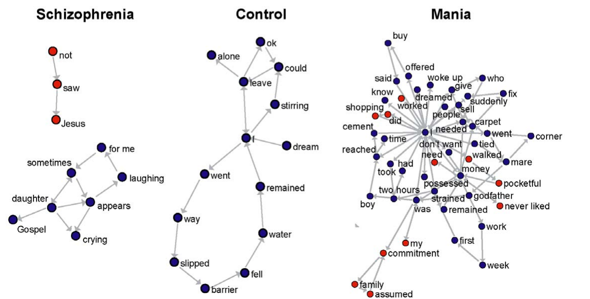

---
# =====================================================================
#  GrafosDelHabla.qmd
#  ========================
#
#
#  Descripcion:
#  ------------
#  Exposicion del paper "Speech Graphs Provide a Quantitative Measure
#  of Thought Disorder in Psychosis" (Mota et al., PLoS ONE 2012) para
#  Fundamentos para el Analisis Automatico de Lenguaje. Explica el
#  problema del diagnostico diferencial de la psicosis, como se
#  convierte una entrevista en un grafo, las catorce medidas, los
#  resultados crudos y normalizados, la clasificacion automatica y la
#  discusion. Se compila con "quarto render GrafosDelHabla.qmd".
#
#  Las dos graficas de datos, entre los comentarios inicio:nombre y
#  fin:nombre, las escribe FigurasGrafosDelHabla.py; no se editan a
#  mano. El grafo del ejemplo del paper (figura 1B) esta dibujado a
#  mano en SVG con las mismas once aristas. La figura 1C va como
#  imagen recortada del PDF, Figura1Grafos.png, con licencia CC BY.
#
#  Las notas del presentador son un guion corto: solo lo que se dice.
#
#  El encabezado va dentro del YAML y no en un comentario HTML despues
#  de el: Quarto convierte cualquier contenido previo al primer
#  encabezado en una diapositiva.
#
#
#  Metadata:
#  ----------
#   * Author: zxxz6 (Bryan Violante Arriaga)
#   * Version: 1.0.0
#
#
#  History:
#  ------------
#  Author      Date            Description
#  zxxz6       02/11/2026      Creation
#
#
# =====================================================================
title: "Grafos del habla en la psicosis"
subtitle: "Speech Graphs Provide a Quantitative Measure of Thought Disorder in Psychosis"
author:
  - "Bryan Ezequiel Violante Arriaga"
lang: es
title-slide-attributes:
  data-background-gradient: >-
    linear-gradient(135deg, #d6e6fa 0%, #ffffff 48%, #fde3d6 100%)
format:
  revealjs:
    theme: simple
    from: markdown-smart
    slide-number: true
    progress: true
    hash: true
    transition: fade
    html-math-method: katex
    embed-resources: true
    center: false
    width: 1280
    height: 720
    include-in-header:
      text: |
        <style>
        :root { --r-main-font-size: 30px; }
        .reveal .slides section { padding-bottom: 40px; }
        .reveal .slides section .aside,
        .reveal .slides section aside {
          position: absolute; bottom: 14px; left: 0; right: 0;
          font-size: 15px !important; line-height: 1.25; color: #777;
        }
        .reveal h2 { color: #17324d; }
        .reveal .slides section.level1 h1,
        .reveal .slides section.level1 p { color: #fff; }
        .reveal .lema { font-size: 30px; opacity: .9; margin-top: 18px; }
        #title-slide .title { color: #17324d; }
        #title-slide .subtitle { font-size: 24px; color: #52514e;
          font-style: italic; margin-top: 4px; }
        #title-slide .quarto-title-authors { flex-direction: column;
          align-items: center; gap: 0; }
        #title-slide .quarto-title-author { padding: 2px 0; }
        #title-slide .portada-inst { font-size: 26px; margin: 6px 0 0;
          color: #2a78d6; font-weight: 600; }
        #title-slide .portada-liga { font-size: 22px; color: #555; }
        .nota { font-size: 21px; color: #52514e; line-height: 1.4; }
        .azul { color: #2a78d6; }
        .nar { color: #eb6834; }
        .verde { color: #138a60; }
        .morado { color: #6c4fc4; }
        .rojo { color: #d64545; }
        .gris { color: #8a8984; }
        .caja { padding: 10px 20px; border-radius: 8px;
          border-left: 6px solid; margin: 12px 0; }
        .caja p { margin: 4px 0; }
        .caja .katex-display { margin: 6px 0 !important; }
        .c-azul { background: #eaf2fc; border-color: #2a78d6; }
        .c-nar { background: #fdeee6; border-color: #eb6834; }
        .c-verde { background: #e3f6ee; border-color: #1baf7a; }
        .c-morado { background: #efeafb; border-color: #6c4fc4; }
        .tiles { display: grid; grid-template-columns: repeat(3, 1fr);
          gap: 22px; margin-top: 26px; }
        .tile { border-radius: 10px; padding: 16px 20px;
          border-top: 6px solid; background: #fbfaf7; }
        .tile b { display: block; font-size: 60px; line-height: 1.05;
          color: #17324d; font-weight: 700; }
        .tile span { font-size: 21px; color: #52514e; }
        .tarjetas { display: grid; grid-template-columns: 1fr 1fr;
          gap: 20px; margin-top: 16px; }
        .tarjetas > div { border-radius: 10px; padding: 16px 20px;
          border-top: 6px solid; font-size: 23px; line-height: 1.4; }
        .tok { display: inline-block; font-size: 24px; padding: 3px 12px;
          margin: 3px; border-radius: 6px; border: 2px solid; }
        .tok.s { border-color: #2a78d6; background: #eaf2fc; }
        .tok.v { border-color: #d64545; background: #fbe4e4; }
        .medidas { display: grid; grid-template-columns: repeat(7, 1fr);
          gap: 10px; margin-top: 12px; }
        .medidas > div { border-radius: 8px; padding: 10px 6px;
          text-align: center; background: #f4f3ef; border-top: 5px solid
          #d8d6cf; }
        .medidas b { display: block; font-size: 26px; color: #17324d; }
        .medidas span { font-size: 15px; color: #52514e; line-height: 1.2;
          display: block; }
        .medidas .m { background: #fdeee6; border-color: #eb6834; }
        .medidas .s { background: #eaf2fc; border-color: #2a78d6; }
        .medidas .x { opacity: .45; }
        table.datos { font-size: 21px; border-collapse: collapse;
          width: auto !important; margin: 6px auto; }
        table.datos th, table.datos td { padding: 6px 16px;
          border-bottom: 1px solid #e3e1da; text-align: left; }
        table.datos tr.yo td { background: #eaf2fc; font-weight: 700; }
        .lista-fr li { margin-bottom: 10px; }
        .refs li { font-size: 22px; margin-bottom: 12px; }
        </style>
    include-after-body:
      text: |
        <script>
        (function () {
          var t = document.getElementById("title-slide");
          if (!t) return;
          var a = t.querySelector(".quarto-title-authors");
          var i = document.createElement("p");
          i.className = "portada-inst";
          i.textContent = "INAOE";
          if (a) a.insertAdjacentElement("afterend", i);
          var l = document.createElement("p");
          l.className = "portada-liga";
          l.textContent = "Fundamentos para el Análisis Automático de " +
            "Lenguaje, Otoño 2026";
          t.appendChild(l);
        })();
        </script>
---

# El problema {background-color="#2a78d6"}

[Diagnosticar la psicosis por cómo se habla, no por qué se dice]{.lema}

## El paper

**Speech Graphs Provide a Quantitative Measure of Thought Disorder in
Psychosis.** Mota, Vasconcelos, Lemos, Pieretti, Kinouchi, Cecchi,
Copelli y Ribeiro. Instituto del Cerebro, Universidad Federal de Rio
Grande do Norte, Brasil, e IBM Research. PLoS ONE, 2012.

::: {.caja .c-azul}
Convierte entrevistas de pacientes psicóticos en **grafos de palabras**
y usa medidas de la red para distinguir **manía** de **esquizofrenia**.
:::

```{=html}
<div class="tiles">
<div class="tile fragment fade-up" style="border-color:#2a78d6;">
<b>24</b><span>entrevistados: 8 con esquizofrenia, 8 con manía y 8
controles</span></div>
<div class="tile fragment fade-up" style="border-color:#eb6834;">
<b>93.8 %</b><span>de sensibilidad al separar esquizofrenia de manía
con medidas del grafo</span></div>
<div class="tile fragment fade-up" style="border-color:#1baf7a;">
<b>62.5 %</b><span>lo que logran las escalas psiquiátricas estándar en
la misma tarea</span></div>
</div>
```

::: {.notes}
- Mota y siete autores más. Instituto del Cerebro de la UFRN, en
  Natal, Brasil, y uno de IBM Research. PLoS ONE, 2012.
- Convierten entrevistas en grafos de palabras y con medidas de la red
  distinguen manía de esquizofrenia.
- 24 personas, 8 por grupo. Con el grafo separan esquizofrenia de
  manía con 93.8 % de sensibilidad. Las escalas psiquiátricas llegan a
  62.5 %.
:::

## El diagnóstico depende de la entrevista

- La psicosis aparece en la **esquizofrenia** y en la **manía**. El
  tratamiento es distinto, así que hay que distinguirlas.
- Desde hace un siglo la herramienta es la **entrevista**: un
  examinador entrenado escucha y juzga. No hay medición.
- Los síntomas que la separan están en el habla:

```{=html}
<div class="tarjetas" style="grid-template-columns:1fr 1fr 1fr;">
<div class="fragment fade-up" style="background:#eaf2fc;border-color:#2a78d6;">
<b class="azul">Pobreza del habla</b><br>esquizofrenia: poco
discurso, respuestas cortas, no elabora</div>
<div class="fragment fade-up" style="background:#fdeee6;border-color:#eb6834;">
<b class="nar">Logorrea</b><br>manía: habla en exceso, sin
freno</div>
<div class="fragment fade-up" style="background:#fdeee6;border-color:#eb6834;">
<b class="nar">Fuga de ideas</b><br>manía: salta de un tema a otro,
pierde el hilo</div>
</div>
```

::: {.fragment .fade-up}
::: {.caja .c-nar}
**Pregunta del paper:** ¿se puede medir objetivamente la alteración
del pensamiento, y decir en qué consiste?
:::
:::

::: {.notes}
- Psicosis: esquizofrenia o manía. Se tratan distinto.
- El diagnóstico es una entrevista. Alguien entrenado escucha y
  decide. No se mide nada.
- Lo que distingue a una de otra está en el habla: pobreza del habla
  en esquizofrenia; logorrea y fuga de ideas en manía.
- Pregunta: ¿eso se puede medir?
:::

## El habla como grafo

Un grafo es $G = (N, E)$: un conjunto de **nodos** y un conjunto de
**aristas** entre ellos.

::: {.incremental}
- **Nodo:** cada palabra distinta, en su forma canónica (lexema).
- **Arista:** de cada palabra a la que se dijo **después**. Es un grafo
  de co-ocurrencia, **dirigido**.
- Es un **multigrafo**: se permiten lazos de un nodo a sí mismo y
  varias aristas entre el mismo par.
:::

::: {.fragment .fade-up}
::: {.caja .c-azul}
El grafo **no guarda qué dijo** el paciente. Guarda **cómo se mueve**
entre palabras: si avanza, si regresa, si se ramifica.
:::
:::

::: {.notes}
- Grafo: nodos y aristas.
- Nodo: cada palabra distinta, lematizada.
- Arista: de cada palabra a la siguiente. Dirigido.
- Multigrafo: lazos y aristas repetidas se permiten. Eso importa
  después, porque la repetición es lo que mide la recurrencia.
- El grafo olvida el contenido y se queda con la forma del recorrido.
:::

# El método {background-color="#eb6834"}

[Del reporte de un sueño a catorce números]{.lema}

## Del reporte al grafo

```{=html}
<p style="text-align:center;margin:0 0 6px;">
<span class="tok s">I</span><span class="tok s">walked</span>
<span class="tok s">into a place</span><span class="tok s">and I</span>
<span class="tok s">found</span><span class="tok s">my grandma</span>
<span class="tok s">I</span><span class="tok s">hugged</span>
<span class="tok s">her</span><span class="tok s">strongly</span>
<span class="tok v">I</span><span class="tok v">woke up</span>
</p>
<p class="nota" style="text-align:center;margin:0;">
<span class="azul">azul: sobre el sueño</span> &nbsp;
<span class="rojo">rojo: sobre la vigilia</span></p>
```

```{=html}
<svg viewBox="0 0 1180 300" width="1180" height="300"
  style="display:block;margin:0 auto;">
<defs><marker id="fg" viewBox="0 0 10 10" refX="9" refY="5"
  markerWidth="6" markerHeight="6" orient="auto-start-reverse">
<path d="M0,0 L10,5 L0,10 z" fill="#52514e"/></marker></defs>
<g class="fragment" data-fragment-index="1">
<line x1="542" y1="138" x2="437" y2="66" stroke="#52514e" stroke-width="2.5" marker-end="url(#fg)"/>
<text x="497" y="95" font-size="16" fill="#52514e" text-anchor="middle">1</text>
</g>
<g class="fragment" data-fragment-index="2">
<line x1="403" y1="60" x2="269" y2="99" stroke="#52514e" stroke-width="2.5" marker-end="url(#fg)"/>
<text x="332" y="71" font-size="16" fill="#52514e" text-anchor="middle">2</text>
</g>
<g class="fragment" data-fragment-index="3">
<line x1="268" y1="108" x2="536" y2="147" stroke="#52514e" stroke-width="2.5" marker-end="url(#fg)"/>
<text x="400" y="146" font-size="16" fill="#52514e" text-anchor="middle">3</text>
</g>
<g class="fragment" data-fragment-index="4">
<line x1="578" y1="138" x2="683" y2="66" stroke="#52514e" stroke-width="2.5" marker-end="url(#fg)"/>
<text x="623" y="95" font-size="16" fill="#52514e" text-anchor="middle">4</text>
</g>
<g class="fragment" data-fragment-index="5">
<line x1="715" y1="64" x2="843" y2="140" stroke="#52514e" stroke-width="2.5" marker-end="url(#fg)"/>
<text x="772" y="119" font-size="16" fill="#52514e" text-anchor="middle">5</text>
</g>
<g class="fragment" data-fragment-index="6">
<line x1="842" y1="150" x2="584" y2="150" stroke="#52514e" stroke-width="2.5" marker-end="url(#fg)"/>
<text x="713" y="141" font-size="16" fill="#52514e" text-anchor="middle">6</text>
</g>
<g class="fragment" data-fragment-index="7">
<line x1="578" y1="162" x2="683" y2="234" stroke="#52514e" stroke-width="2.5" marker-end="url(#fg)"/>
<text x="623" y="215" font-size="16" fill="#52514e" text-anchor="middle">7</text>
</g>
<g class="fragment" data-fragment-index="8">
<line x1="715" y1="236" x2="843" y2="160" stroke="#52514e" stroke-width="2.5" marker-end="url(#fg)"/>
<text x="786" y="215" font-size="16" fill="#52514e" text-anchor="middle">8</text>
</g>
<g class="fragment" data-fragment-index="9">
<line x1="842" y1="154" x2="440" y2="241" stroke="#52514e" stroke-width="2.5" marker-end="url(#fg)"/>
<text x="638" y="189" font-size="16" fill="#52514e" text-anchor="middle">9</text>
</g>
<g class="fragment" data-fragment-index="10">
<line x1="435" y1="235" x2="540" y2="163" stroke="#52514e" stroke-width="2.5" marker-end="url(#fg)"/>
<text x="495" y="216" font-size="16" fill="#52514e" text-anchor="middle">10</text>
</g>
<g class="fragment" data-fragment-index="11">
<line x1="581" y1="145" x2="941" y2="60" stroke="#d64545" stroke-width="2.5" marker-end="url(#fg)"/>
<text x="772" y="134" font-size="16" fill="#d64545" text-anchor="middle">11</text>
</g>
<circle cx="560" cy="150" r="22" fill="#2a78d6"/>
<text x="560" y="120" font-size="21" fill="#2b2b2b" text-anchor="middle" font-weight="700">I</text>
<circle cx="420" cy="55" r="18" fill="#2a78d6"/>
<text x="420" y="29" font-size="21" fill="#2b2b2b" text-anchor="middle">walked</text>
<circle cx="250" cy="105" r="18" fill="#2a78d6"/>
<text x="224" y="111" font-size="21" fill="#2b2b2b" text-anchor="end">place</text>
<circle cx="700" cy="55" r="18" fill="#2a78d6"/>
<text x="700" y="29" font-size="21" fill="#2b2b2b" text-anchor="middle">found</text>
<circle cx="860" cy="150" r="18" fill="#2a78d6"/>
<text x="888" y="156" font-size="21" fill="#2b2b2b" text-anchor="start">grandma</text>
<circle cx="700" cy="245" r="18" fill="#2a78d6"/>
<text x="700" y="287" font-size="21" fill="#2b2b2b" text-anchor="middle">hugged</text>
<circle cx="420" cy="245" r="18" fill="#2a78d6"/>
<text x="420" y="287" font-size="21" fill="#2b2b2b" text-anchor="middle">strongly</text>
<circle cx="960" cy="55" r="18" fill="#d64545"/>
<text x="960" y="29" font-size="21" fill="#2b2b2b" text-anchor="middle">woke up</text>
</svg>
```

::: aside
Figura 1 del paper, traducida del portugués. "her" y "my grandma" son
el mismo lexema
:::

::: {.notes}
- El paciente cuenta un sueño. Se transcribe y se parte en sujeto,
  verbo y objeto.
- Azul: habla del sueño. Rojo: se salió del tema y habla de la
  vigilia.
- Cada elemento es un nodo. Cada paso al siguiente, una arista
  numerada.
- "I" aparece tres veces en el sueño y una en la vigilia: un solo nodo
  con muchas aristas. "her" es "grandma": mismo lexema, mismo nodo.
- Once aristas, ocho nodos. Ese es el grafo de este reporte.
:::

## El protocolo

:::: {.columns}
::: {.column width="50%"}
**Sujetos**

- 24 adultos: 8 con esquizofrenia, 8 con manía, 8 controles.
- Diagnóstico de psiquiatras de primera respuesta, **confirmado con
  SCID**. Cinco entrevistas se descartaron por no coincidir.
- **PANSS** y **BPRS** el día de la entrevista, para medir síntomas.
- Pacientes medicados y fuera de la fase aguda.
:::
::: {.column width="50%"}
**Entrevista**

- **Tema ancla:** "cuénteme el sueño más reciente". El entrevistador
  no interviene.
- 20 a 60 minutos. En promedio **84 palabras** sobre el sueño.
- Hablar de la vigilia es salirse del tema: así se mide la **fuga de
  ideas**.
- Transcripción ciega por dos personas, lematización, y parseo en
  sujeto, verbo y objeto.
:::
::::

::: {.fragment .fade-up}
::: {.caja .c-nar}
El sueño es un tema **cerrado y personal**: cualquier desviación se
nota y se puede contar.
:::
:::

::: {.notes}
- 24 adultos, 8 por grupo. Diagnóstico previo confirmado con SCID,
  la entrevista estructurada del DSM. Cinco se descartaron.
- PANSS y BPRS: las dos escalas estándar de síntomas psicóticos.
  Sirven para comparar después.
- Medicados, fuera de la fase aguda.
- Tema ancla: el sueño más reciente. El entrevistador calla.
- 84 palabras en promedio: grafos chicos.
- Salirse a la vigilia es la medida de fuga de ideas.
- Por qué un sueño: tema cerrado, toda desviación se puede contar.
:::

## Catorce medidas

```{=html}
<table class="datos" style="font-size:24px;margin-top:16px;">
<tr><th>Categoría</th><th>Medida</th><th>Qué cuenta</th></tr>
<tr><td><b>Generales</b></td><td>N, E</td>
<td>nodos (palabras distintas) y aristas (transiciones)</td></tr>
<tr><td><b>Conectividad</b></td><td>LCC, LSC, ATD</td>
<td>componente conexo mayor, componente <i>fuertemente</i> conexo
mayor, grado total promedio</td></tr>
<tr><td><b>Recurrencia</b></td><td>PE, L1, L2, L3</td>
<td>aristas paralelas y lazos de 1, 2 y 3 nodos</td></tr>
<tr><td><b>Desviación del tema</b></td><td>WN, WE</td>
<td>nodos y aristas que hablan de la vigilia</td></tr>
<tr><td><b>Globales</b></td><td>D, DI, ASP</td>
<td>densidad <span class="math inline">E'/N^2</span>, diámetro y
camino más corto promedio, sin lazos ni paralelas</td></tr>
</table>
```

::: {.fragment .fade-up}
::: {.caja .c-nar}
Once **locales** describen vecindarios y subgrafos; tres **globales**
describen la red entera. Solo WN y WE requieren interpretar el
significado; **las otras doce son pura estructura**.
:::
:::

::: {.notes}
- Catorce medidas en cinco grupos.
- Generales: cuántos nodos y cuántas aristas.
- Conectividad: qué tan grande es el pedazo conectado del grafo, y
  cuántas aristas toca cada nodo en promedio.
- Recurrencia: aristas repetidas y lazos. Siguiente diapositiva.
- Desviación: cuánto se habló de la vigilia.
- Globales: densidad, diámetro y camino promedio, calculadas sin
  lazos ni paralelas.
- Solo las dos de vigilia requieren entender el contenido. Las otras
  doce no.
:::

## Recurrencia: volver a la misma idea

```{=html}
<svg viewBox="0 0 1180 230" width="1180" height="230"
  style="display:block;margin:4px auto 0;">
<defs><marker id="fr" viewBox="0 0 10 10" refX="9" refY="5"
  markerWidth="6" markerHeight="6" orient="auto-start-reverse">
<path d="M0,0 L10,5 L0,10 z" fill="#52514e"/></marker></defs>
<g font-size="21" text-anchor="middle" fill="#17324d" font-weight="600">
<text x="150" y="30">L1: lazo de 1 nodo</text>
<text x="450" y="30">L2: lazo de 2 nodos</text>
<text x="750" y="30">L3: lazo de 3 nodos</text>
<text x="1040" y="30">PE: aristas paralelas</text>
</g>
<g stroke="#52514e" stroke-width="2.5" fill="none">
<path d="M158,114 C200,60 230,110 170,138" marker-end="url(#fr)"/>
<path d="M418,118 C440,90 470,90 492,118" marker-end="url(#fr)"/>
<path d="M492,142 C470,170 440,170 418,142" marker-end="url(#fr)"/>
<path d="M702,160 L732,86" marker-end="url(#fr)"/>
<path d="M768,86 L798,160" marker-end="url(#fr)"/>
<path d="M786,176 L714,176" marker-end="url(#fr)"/>
<path d="M1008,120 C1030,96 1050,96 1072,120" marker-end="url(#fr)"/>
<path d="M1008,140 C1030,164 1050,164 1072,140" marker-end="url(#fr)"/>
</g>
<g fill="#2a78d6">
<circle cx="150" cy="130" r="16"/>
<circle cx="400" cy="130" r="16"/><circle cx="510" cy="130" r="16"/>
<circle cx="750" cy="70" r="16"/><circle cx="695" cy="176" r="16"/>
<circle cx="805" cy="176" r="16"/>
<circle cx="990" cy="130" r="16"/><circle cx="1090" cy="130" r="16"/>
</g>
<g font-size="17" text-anchor="middle" fill="#52514e" font-style="italic">
<text x="150" y="180">"no, no"</text>
<text x="455" y="205">"fui, volví, fui"</text>
<text x="750" y="220">"casa, calle, casa"... tres</text>
<text x="1040" y="200">"la casa... la casa"</text>
</g>
</svg>
```

$$
L_k = \operatorname{tr}\!\left(A^k\right)
\qquad
\text{con } A \text{ la matriz de adyacencia}
$$

::: {.fragment .fade-up}
::: {.caja .c-nar}
Un **lazo** es una idea que regresa a sí misma en $k$ pasos. Una
**arista paralela** es la misma transición dicha dos veces.
:::
:::

::: {.notes}
- Lazo de 1: una palabra seguida de sí misma. De 2: ida y vuelta. De
  3: un triángulo.
- Se cuentan con la traza de A a la k. La entrada i, i de A a la k es
  cuántos caminos de largo k salen de i y regresan a i.
- Arista paralela: la misma transición repetida.
- Todo esto es recurrencia: volver a la misma idea.
:::

# Resultados {background-color="#138a60"}

[Manía y esquizofrenia deforman el grafo en sentidos opuestos]{.lema}

## Tres grafos, tres formas

{fig-align="center" width="1000"}

::: aside
Figura 1C del paper, CC BY. Un paciente representativo por grupo;
nodos rojos: vigilia
:::

::: {.notes}
- Un paciente típico de cada grupo.
- Esquizofrenia: pocos nodos, cadenas cortas, casi nada regresa.
- Control: tamaño medio, un ciclo grande.
- Manía: muchos nodos, "I" como centro con decenas de aristas, y
  muchos nodos rojos: se salió del sueño una y otra vez.
:::

## Medidas crudas: la manía gana en diez

```{=html}
<div class="medidas">
<div class="m"><b>N</b><span>M &gt; S<br>P = 0.003</span></div>
<div class="m"><b>E</b><span>M &gt; S<br>P = 0.003</span></div>
<div class="m"><b>LCC</b><span>M &gt; S<br>P = 0.005</span></div>
<div class="m"><b>LSC</b><span>M &gt; S<br>P = 0.008</span></div>
<div class="m"><b>ATD</b><span>M &gt; S<br>P = 0.007</span></div>
<div class="m"><b>PE</b><span>M &gt; S<br>P = 0.003</span></div>
<div class="x"><b>L1</b><span>sin<br>diferencia</span></div>
<div class="m"><b>L2</b><span>M &gt; S<br>P = 0.003</span></div>
<div class="m"><b>L3</b><span>M &gt; S<br>P = 0.005</span></div>
<div class="m"><b>WN</b><span>M &gt; S<br>P = 0.006</span></div>
<div class="m"><b>WE</b><span>M &gt; S<br>P = 0.001</span></div>
<div class="x"><b>D</b><span>sin<br>diferencia</span></div>
<div class="x"><b>DI</b><span>sin<br>diferencia</span></div>
<div class="x"><b>ASP</b><span>sin<br>diferencia</span></div>
</div>
```

::: {.incremental}
- **N y E** más altos: **logorrea**. **Conectividad y recurrencia** más
  bajas en esquizofrenia: **pobreza del habla**. **WN y WE** más altos:
  **fuga de ideas**.
- Las tres globales no distinguen a nadie.
:::

::: {.fragment .fade-up}
::: {.caja .c-nar}
Pero los maníacos dijeron **muchas más palabras** por reporte
($P = 0.0006$). ¿Es todo verbosidad?
:::
:::

::: aside
Kruskal-Wallis y luego Wilcoxon por pares con corrección de
Bonferroni, alfa corregida 0.0166. Figuras 2, 3 y 4
:::

::: {.notes}
- Datos crudos. Naranja: la manía puntúa más alto que la
  esquizofrenia, con significancia. Diez de catorce.
- Más nodos y aristas: logorrea. Menos conectividad y recurrencia en
  esquizofrenia: pobreza del habla. Más nodos y aristas de vigilia:
  fuga de ideas.
- Las globales no separan a nadie.
- Pero los maníacos hablan mucho más. Todo esto podría ser solo
  verbosidad.
:::

## Normalizadas por palabra: lo que sobrevive

```{=html}
<div class="medidas">
<div class="s"><b>N</b><span>S &gt; M<br>P = 0.010</span></div>
<div class="x"><b>E</b><span>sin<br>diferencia</span></div>
<div class="x"><b>LCC</b><span>sin<br>diferencia</span></div>
<div class="x"><b>LSC</b><span>sin<br>diferencia</span></div>
<div class="s"><b>ATD</b><span>S &gt; M<br>P = 0.005</span></div>
<div class="m"><b>PE</b><span>M &gt; S<br>P = 0.004</span></div>
<div class="x"><b>L1</b><span>sin<br>diferencia</span></div>
<div class="x"><b>L2</b><span>sin<br>diferencia</span></div>
<div class="x"><b>L3</b><span>sin<br>diferencia</span></div>
<div class="x"><b>WN</b><span>sin<br>diferencia</span></div>
<div class="m"><b>WE</b><span>M &gt; S<br>P = 0.015</span></div>
<div class="m"><b>D</b><span>M &gt; S<br>P = 0.007</span></div>
<div class="s"><b>DI</b><span>S &gt; M<br>P = 0.014</span></div>
<div class="s"><b>ASP</b><span>S &gt; M<br>P = 0.010</span></div>
</div>
```

::: {.fragment .fade-up}
::: {.caja .c-azul}
**Esquizofrenia:** más nodos y más grado **por palabra**. Toca cada
tema una sola vez, sin ramificar ni regresar.
:::
:::

::: {.fragment .fade-up}
::: {.caja .c-nar}
**Manía:** más aristas paralelas y más aristas de vigilia **por
palabra**. Regresa a lo mismo y se sale del tema, y eso **no** es
solo hablar más.
:::
:::

::: aside
Cada medida dividida entre el número de palabras del reporte. Figuras
6A y 7, Tabla S4
:::

::: {.notes}
- Cada medida dividida entre las palabras del reporte.
- De las locales sobreviven cuatro, y dos se voltean: esquizofrenia
  tiene más nodos y más grado por palabra.
- Manía conserva más paralelas y más aristas de vigilia por palabra.
- Y las globales, que crudas no decían nada, ahora separan las tres.
- Lectura: el esquizofrénico toca cada tema una vez. El maníaco
  regresa y se sale. Ninguna de las dos cosas es solo verbosidad.
:::

## Las globales normalizadas separan limpio

<!-- inicio:globales -->
```{=html}
<svg viewBox="0 0 1180 300" width="1180" height="300" style="display:block;margin:0 auto;" font-family="Lato, sans-serif">
<text x="261.7" y="36.0" font-size="18" fill="#2b2b2b" text-anchor="middle" font-weight="600">Densidad</text>
<line x1="150.0" y1="54" x2="150.0" y2="230" stroke="#e8e6e1"/>
<text x="150.0" y="250.0" font-size="13" fill="#52514e" text-anchor="middle">0</text>
<line x1="261.7" y1="54" x2="261.7" y2="230" stroke="#e8e6e1"/>
<text x="261.7" y="250.0" font-size="13" fill="#52514e" text-anchor="middle">5.5</text>
<line x1="373.3" y1="54" x2="373.3" y2="230" stroke="#e8e6e1"/>
<text x="373.3" y="250.0" font-size="13" fill="#52514e" text-anchor="middle">11</text>
<text x="136.0" y="93.3" font-size="15" fill="#52514e" text-anchor="end">Esquizofrenia</text>
<rect x="194.7" y="79.33333333333333" width="36.5" height="18" rx="4" fill="#2a78d6" fill-opacity=".35"><title>Densidad, Esquizofrenia: de 2.2 a 4, mediana 3.1</title></rect>
<rect x="210.9" y="75.33333333333333" width="4" height="26" rx="2" fill="#2a78d6"/>
<text x="136.0" y="150.0" font-size="15" fill="#52514e" text-anchor="end">Manía</text>
<rect x="269.8" y="136.0" width="62.9" height="18" rx="4" fill="#eb6834" fill-opacity=".35"><title>Densidad, Manía: de 5.9 a 9, mediana 6.3</title></rect>
<rect x="275.9" y="132.0" width="4" height="26" rx="2" fill="#eb6834"/>
<text x="136.0" y="206.7" font-size="15" fill="#52514e" text-anchor="end">Control</text>
<rect x="196.7" y="192.66666666666666" width="162.4" height="18" rx="4" fill="#6c4fc4" fill-opacity=".35"><title>Densidad, Control: de 2.3 a 10.3, mediana 6.5</title></rect>
<rect x="280.0" y="188.66666666666666" width="4" height="26" rx="2" fill="#6c4fc4"/>
<text x="645.0" y="36.0" font-size="18" fill="#2b2b2b" text-anchor="middle" font-weight="600">Diámetro</text>
<line x1="533.3" y1="54" x2="533.3" y2="230" stroke="#e8e6e1"/>
<text x="533.3" y="250.0" font-size="13" fill="#52514e" text-anchor="middle">0</text>
<line x1="645.0" y1="54" x2="645.0" y2="230" stroke="#e8e6e1"/>
<text x="645.0" y="250.0" font-size="13" fill="#52514e" text-anchor="middle">0.12</text>
<line x1="756.7" y1="54" x2="756.7" y2="230" stroke="#e8e6e1"/>
<text x="756.7" y="250.0" font-size="13" fill="#52514e" text-anchor="middle">0.24</text>
<text x="519.3" y="93.3" font-size="15" fill="#52514e" text-anchor="end">Esquizofrenia</text>
<rect x="626.4" y="79.33333333333333" width="55.8" height="18" rx="4" fill="#2a78d6" fill-opacity=".35"><title>Diámetro, Esquizofrenia: de 0.1 a 0.16, mediana 0.12</title></rect>
<rect x="643.0" y="75.33333333333333" width="4" height="26" rx="2" fill="#2a78d6"/>
<text x="519.3" y="150.0" font-size="15" fill="#52514e" text-anchor="end">Manía</text>
<rect x="551.9" y="136.0" width="83.8" height="18" rx="4" fill="#eb6834" fill-opacity=".35"><title>Diámetro, Manía: de 0.02 a 0.11, mediana 0.045</title></rect>
<rect x="573.2" y="132.0" width="4" height="26" rx="2" fill="#eb6834"/>
<text x="519.3" y="206.7" font-size="15" fill="#52514e" text-anchor="end">Control</text>
<rect x="551.9" y="192.66666666666666" width="186.1" height="18" rx="4" fill="#6c4fc4" fill-opacity=".35"><title>Diámetro, Control: de 0.02 a 0.22, mediana 0.065</title></rect>
<rect x="591.8" y="188.66666666666666" width="4" height="26" rx="2" fill="#6c4fc4"/>
<text x="1028.3" y="36.0" font-size="18" fill="#2b2b2b" text-anchor="middle" font-weight="600">Camino más corto promedio</text>
<line x1="916.7" y1="54" x2="916.7" y2="230" stroke="#e8e6e1"/>
<text x="916.7" y="250.0" font-size="13" fill="#52514e" text-anchor="middle">0</text>
<line x1="1028.3" y1="54" x2="1028.3" y2="230" stroke="#e8e6e1"/>
<text x="1028.3" y="250.0" font-size="13" fill="#52514e" text-anchor="middle">0.06</text>
<line x1="1140.0" y1="54" x2="1140.0" y2="230" stroke="#e8e6e1"/>
<text x="1140.0" y="250.0" font-size="13" fill="#52514e" text-anchor="middle">0.12</text>
<text x="902.7" y="93.3" font-size="15" fill="#52514e" text-anchor="end">Esquizofrenia</text>
<rect x="1000.4" y="79.33333333333333" width="83.8" height="18" rx="4" fill="#2a78d6" fill-opacity=".35"><title>Camino más corto promedio, Esquizofrenia: de 0.045 a 0.09, mediana 0.062</title></rect>
<rect x="1030.1" y="75.33333333333333" width="4" height="26" rx="2" fill="#2a78d6"/>
<text x="902.7" y="150.0" font-size="15" fill="#52514e" text-anchor="end">Manía</text>
<rect x="939.0" y="136.0" width="70.7" height="18" rx="4" fill="#eb6834" fill-opacity=".35"><title>Camino más corto promedio, Manía: de 0.012 a 0.05, mediana 0.025</title></rect>
<rect x="961.2" y="132.0" width="4" height="26" rx="2" fill="#eb6834"/>
<text x="902.7" y="206.7" font-size="15" fill="#52514e" text-anchor="end">Control</text>
<rect x="935.3" y="192.66666666666666" width="176.8" height="18" rx="4" fill="#6c4fc4" fill-opacity=".35"><title>Camino más corto promedio, Control: de 0.01 a 0.105, mediana 0.032</title></rect>
<rect x="974.2" y="188.66666666666666" width="4" height="26" rx="2" fill="#6c4fc4"/>
<text x="590.0" y="290.0" font-size="14" fill="#8a8984" text-anchor="middle">Barra: rango del grupo. Marca: mediana. Valores por palabra, leídos de la figura 7.</text>
</svg>
```
<!-- fin:globales -->

::: {.fragment .fade-up}
::: {.caja .c-morado}
Los dos grupos clínicos tienen **poca varianza** y quedan en extremos
opuestos. Los controles **cubren todo el rango** entre ambos.
:::
:::

::: aside
Rangos y medianas leídos de la figura 7 del paper; aproximados. D:
P = 0.007; DI: P = 0.0138; ASP: P = 0.0104
:::

::: {.notes}
- Densidad, diámetro y camino promedio, por palabra.
- Manía: denso, diámetro chico, caminos cortos. Esquizofrenia: lo
  contrario.
- Los pacientes casi no varían entre sí. Los controles van de un
  extremo al otro.
- Lectura del paper: la patología restringe la forma del habla. Sin
  patología hay más variedad entre personas.
- Los números los leí del boxplot, no están en tabla.
:::

## Las escalas no distinguen manía de esquizofrenia

```{=html}
<table class="datos" style="font-size:22px;margin-top:14px;">
<tr><th>Comparación</th><th>BPRS</th><th>PANSS</th><th>Grafo
normalizado</th></tr>
<tr><td>Esquizofrenia vs control</td><td>P = 0.0003</td>
<td>P = 0.0003</td><td>N, L1, L2</td></tr>
<tr><td>Manía vs control</td><td>P = 0.0012</td><td>P = 0.0006</td>
<td>L1, L2, L3</td></tr>
<tr class="yo"><td>Esquizofrenia vs manía</td><td>P = 0.14</td>
<td>P = 0.11</td><td>7 medidas, P &lt; 0.015</td></tr>
</table>
```

::: {.fragment .fade-up}
Ninguna medida de grafo normalizada **correlaciona** con BPRS ni con
PANSS (Tabla S5).
:::

::: {.fragment .fade-up}
::: {.caja .c-verde}
Las escalas dicen **cuánto** síntoma hay. El grafo dice **qué forma**
tiene el habla. Miden cosas distintas: son **complementarias**.
:::
:::

::: aside
Figura 6B, Tablas S5 y S6
:::

::: {.notes}
- BPRS y PANSS separan pacientes de controles muy bien.
- Pero esquizofrenia contra manía: P de 0.14 y 0.11. No separan.
- El grafo normalizado sí: siete medidas significativas.
- Y ninguna medida del grafo correlaciona con las escalas.
- Conclusión: miden cosas distintas. Complementarias, no redundantes.
:::

## Clasificación automática

<!-- inicio:clasificacion -->
```{=html}
<svg viewBox="0 0 1180 380" width="1180" height="380" style="display:block;margin:0 auto;" font-family="Lato, sans-serif">
<rect x="40" y="15" width="14" height="14" rx="3" fill="#2a78d6"/>
<text x="62.0" y="26.0" font-size="16" fill="#52514e" text-anchor="start">Medidas de grafo</text>
<rect x="246" y="15" width="14" height="14" rx="3" fill="#eb6834"/>
<text x="268.0" y="26.0" font-size="16" fill="#52514e" text-anchor="start">Escalas BPRS y PANSS</text>
<text x="177.5" y="56.0" font-size="18" fill="#2b2b2b" text-anchor="middle" font-weight="600">AUC</text>
<line x1="60.0" y1="257.5" x2="295.0" y2="257.5" stroke="#e8e6e1"/>
<line x1="60.0" y1="195.0" x2="295.0" y2="195.0" stroke="#e8e6e1"/>
<line x1="60.0" y1="132.5" x2="295.0" y2="132.5" stroke="#e8e6e1"/>
<line x1="60.0" y1="70.0" x2="295.0" y2="70.0" stroke="#e8e6e1"/>
<line x1="60.0" y1="320" x2="295.0" y2="320" stroke="#8a8984"/>
<path d="M68.2,320.0 V104.0 a4,4 0 0 1 4,-4 H94.2 a4,4 0 0 1 4,4 V320.0 Z" fill="#2a78d6"><title>AUC, S x M, medidas de grafo: 0.88</title></path>
<text x="83.2" y="94.0" font-size="13" fill="#52514e" text-anchor="middle">0.88</text>
<path d="M100.2,320.0 V181.5 a4,4 0 0 1 4,-4 H126.2 a4,4 0 0 1 4,4 V320.0 Z" fill="#eb6834"><title>AUC, S x M, escalas: 0.57</title></path>
<text x="115.2" y="171.5" font-size="13" fill="#52514e" text-anchor="middle">0.57</text>
<text x="99.2" y="342.0" font-size="15" fill="#52514e" text-anchor="middle">S x M</text>
<path d="M146.5,320.0 V99.0 a4,4 0 0 1 4,-4 H172.5 a4,4 0 0 1 4,4 V320.0 Z" fill="#2a78d6"><title>AUC, S x C, medidas de grafo: 0.90</title></path>
<text x="161.5" y="89.0" font-size="13" fill="#52514e" text-anchor="middle">0.90</text>
<path d="M178.5,320.0 V114.0 a4,4 0 0 1 4,-4 H204.5 a4,4 0 0 1 4,4 V320.0 Z" fill="#eb6834"><title>AUC, S x C, escalas: 0.84</title></path>
<text x="193.5" y="104.0" font-size="13" fill="#52514e" text-anchor="middle">0.84</text>
<text x="177.5" y="342.0" font-size="15" fill="#52514e" text-anchor="middle">S x C</text>
<path d="M224.8,320.0 V124.0 a4,4 0 0 1 4,-4 H250.8 a4,4 0 0 1 4,4 V320.0 Z" fill="#2a78d6"><title>AUC, M x C, medidas de grafo: 0.80</title></path>
<text x="239.8" y="114.0" font-size="13" fill="#52514e" text-anchor="middle">0.80</text>
<path d="M256.8,320.0 V79.0 a4,4 0 0 1 4,-4 H282.8 a4,4 0 0 1 4,4 V320.0 Z" fill="#eb6834"><title>AUC, M x C, escalas: 0.98</title></path>
<text x="271.8" y="69.0" font-size="13" fill="#52514e" text-anchor="middle">0.98</text>
<text x="255.8" y="342.0" font-size="15" fill="#52514e" text-anchor="middle">M x C</text>
<text x="452.5" y="56.0" font-size="18" fill="#2b2b2b" text-anchor="middle" font-weight="600">Kappa</text>
<line x1="335.0" y1="257.5" x2="570.0" y2="257.5" stroke="#e8e6e1"/>
<line x1="335.0" y1="195.0" x2="570.0" y2="195.0" stroke="#e8e6e1"/>
<line x1="335.0" y1="132.5" x2="570.0" y2="132.5" stroke="#e8e6e1"/>
<line x1="335.0" y1="70.0" x2="570.0" y2="70.0" stroke="#e8e6e1"/>
<line x1="335.0" y1="320" x2="570.0" y2="320" stroke="#8a8984"/>
<path d="M343.2,320.0 V104.0 a4,4 0 0 1 4,-4 H369.2 a4,4 0 0 1 4,4 V320.0 Z" fill="#2a78d6"><title>Kappa, S x M, medidas de grafo: 0.88</title></path>
<text x="358.2" y="94.0" font-size="13" fill="#52514e" text-anchor="middle">0.88</text>
<path d="M375.2,320.0 V261.5 a4,4 0 0 1 4,-4 H401.2 a4,4 0 0 1 4,4 V320.0 Z" fill="#eb6834"><title>Kappa, S x M, escalas: 0.25</title></path>
<text x="390.2" y="251.5" font-size="13" fill="#52514e" text-anchor="middle">0.25</text>
<text x="374.2" y="342.0" font-size="15" fill="#52514e" text-anchor="middle">S x M</text>
<path d="M421.5,320.0 V136.5 a4,4 0 0 1 4,-4 H447.5 a4,4 0 0 1 4,4 V320.0 Z" fill="#2a78d6"><title>Kappa, S x C, medidas de grafo: 0.75</title></path>
<text x="436.5" y="126.5" font-size="13" fill="#52514e" text-anchor="middle">0.75</text>
<path d="M453.5,320.0 V136.5 a4,4 0 0 1 4,-4 H479.5 a4,4 0 0 1 4,4 V320.0 Z" fill="#eb6834"><title>Kappa, S x C, escalas: 0.75</title></path>
<text x="468.5" y="126.5" font-size="13" fill="#52514e" text-anchor="middle">0.75</text>
<text x="452.5" y="342.0" font-size="15" fill="#52514e" text-anchor="middle">S x C</text>
<path d="M499.8,320.0 V231.5 a4,4 0 0 1 4,-4 H525.8 a4,4 0 0 1 4,4 V320.0 Z" fill="#2a78d6"><title>Kappa, M x C, medidas de grafo: 0.37</title></path>
<text x="514.8" y="221.5" font-size="13" fill="#52514e" text-anchor="middle">0.37</text>
<path d="M531.8,320.0 V136.5 a4,4 0 0 1 4,-4 H557.8 a4,4 0 0 1 4,4 V320.0 Z" fill="#eb6834"><title>Kappa, M x C, escalas: 0.75</title></path>
<text x="546.8" y="126.5" font-size="13" fill="#52514e" text-anchor="middle">0.75</text>
<text x="530.8" y="342.0" font-size="15" fill="#52514e" text-anchor="middle">M x C</text>
<text x="727.5" y="56.0" font-size="18" fill="#2b2b2b" text-anchor="middle" font-weight="600">Sensibilidad %</text>
<line x1="610.0" y1="257.5" x2="845.0" y2="257.5" stroke="#e8e6e1"/>
<line x1="610.0" y1="195.0" x2="845.0" y2="195.0" stroke="#e8e6e1"/>
<line x1="610.0" y1="132.5" x2="845.0" y2="132.5" stroke="#e8e6e1"/>
<line x1="610.0" y1="70.0" x2="845.0" y2="70.0" stroke="#e8e6e1"/>
<line x1="610.0" y1="320" x2="845.0" y2="320" stroke="#8a8984"/>
<path d="M618.2,320.0 V89.5 a4,4 0 0 1 4,-4 H644.2 a4,4 0 0 1 4,4 V320.0 Z" fill="#2a78d6"><title>Sensibilidad %, S x M, medidas de grafo: 93.8</title></path>
<text x="633.2" y="79.5" font-size="13" fill="#52514e" text-anchor="middle">93.8</text>
<path d="M650.2,320.0 V167.8 a4,4 0 0 1 4,-4 H676.2 a4,4 0 0 1 4,4 V320.0 Z" fill="#eb6834"><title>Sensibilidad %, S x M, escalas: 62.5</title></path>
<text x="665.2" y="157.8" font-size="13" fill="#52514e" text-anchor="middle">62.5</text>
<text x="649.2" y="342.0" font-size="15" fill="#52514e" text-anchor="middle">S x M</text>
<path d="M696.5,320.0 V105.2 a4,4 0 0 1 4,-4 H722.5 a4,4 0 0 1 4,4 V320.0 Z" fill="#2a78d6"><title>Sensibilidad %, S x C, medidas de grafo: 87.5</title></path>
<text x="711.5" y="95.2" font-size="13" fill="#52514e" text-anchor="middle">87.5</text>
<path d="M728.5,320.0 V105.2 a4,4 0 0 1 4,-4 H754.5 a4,4 0 0 1 4,4 V320.0 Z" fill="#eb6834"><title>Sensibilidad %, S x C, escalas: 87.5</title></path>
<text x="743.5" y="95.2" font-size="13" fill="#52514e" text-anchor="middle">87.5</text>
<text x="727.5" y="342.0" font-size="15" fill="#52514e" text-anchor="middle">S x C</text>
<path d="M774.8,320.0 V152.0 a4,4 0 0 1 4,-4 H800.8 a4,4 0 0 1 4,4 V320.0 Z" fill="#2a78d6"><title>Sensibilidad %, M x C, medidas de grafo: 68.8</title></path>
<text x="789.8" y="142.0" font-size="13" fill="#52514e" text-anchor="middle">68.8</text>
<path d="M806.8,320.0 V105.2 a4,4 0 0 1 4,-4 H832.8 a4,4 0 0 1 4,4 V320.0 Z" fill="#eb6834"><title>Sensibilidad %, M x C, escalas: 87.5</title></path>
<text x="821.8" y="95.2" font-size="13" fill="#52514e" text-anchor="middle">87.5</text>
<text x="805.8" y="342.0" font-size="15" fill="#52514e" text-anchor="middle">M x C</text>
<text x="1002.5" y="56.0" font-size="18" fill="#2b2b2b" text-anchor="middle" font-weight="600">Especificidad %</text>
<line x1="885.0" y1="257.5" x2="1120.0" y2="257.5" stroke="#e8e6e1"/>
<line x1="885.0" y1="195.0" x2="1120.0" y2="195.0" stroke="#e8e6e1"/>
<line x1="885.0" y1="132.5" x2="1120.0" y2="132.5" stroke="#e8e6e1"/>
<line x1="885.0" y1="70.0" x2="1120.0" y2="70.0" stroke="#e8e6e1"/>
<line x1="885.0" y1="320" x2="1120.0" y2="320" stroke="#8a8984"/>
<path d="M893.2,320.0 V89.8 a4,4 0 0 1 4,-4 H919.2 a4,4 0 0 1 4,4 V320.0 Z" fill="#2a78d6"><title>Especificidad %, S x M, medidas de grafo: 93.7</title></path>
<text x="908.2" y="79.8" font-size="13" fill="#52514e" text-anchor="middle">93.7</text>
<path d="M925.2,320.0 V167.8 a4,4 0 0 1 4,-4 H951.2 a4,4 0 0 1 4,4 V320.0 Z" fill="#eb6834"><title>Especificidad %, S x M, escalas: 62.5</title></path>
<text x="940.2" y="157.8" font-size="13" fill="#52514e" text-anchor="middle">62.5</text>
<text x="924.2" y="342.0" font-size="15" fill="#52514e" text-anchor="middle">S x M</text>
<path d="M971.5,320.0 V105.2 a4,4 0 0 1 4,-4 H997.5 a4,4 0 0 1 4,4 V320.0 Z" fill="#2a78d6"><title>Especificidad %, S x C, medidas de grafo: 87.5</title></path>
<text x="986.5" y="95.2" font-size="13" fill="#52514e" text-anchor="middle">87.5</text>
<path d="M1003.5,320.0 V105.2 a4,4 0 0 1 4,-4 H1029.5 a4,4 0 0 1 4,4 V320.0 Z" fill="#eb6834"><title>Especificidad %, S x C, escalas: 87.5</title></path>
<text x="1018.5" y="95.2" font-size="13" fill="#52514e" text-anchor="middle">87.5</text>
<text x="1002.5" y="342.0" font-size="15" fill="#52514e" text-anchor="middle">S x C</text>
<path d="M1049.8,320.0 V152.2 a4,4 0 0 1 4,-4 H1075.8 a4,4 0 0 1 4,4 V320.0 Z" fill="#2a78d6"><title>Especificidad %, M x C, medidas de grafo: 68.7</title></path>
<text x="1064.8" y="142.2" font-size="13" fill="#52514e" text-anchor="middle">68.7</text>
<path d="M1081.8,320.0 V105.2 a4,4 0 0 1 4,-4 H1107.8 a4,4 0 0 1 4,4 V320.0 Z" fill="#eb6834"><title>Especificidad %, M x C, escalas: 87.5</title></path>
<text x="1096.8" y="95.2" font-size="13" fill="#52514e" text-anchor="middle">87.5</text>
<text x="1080.8" y="342.0" font-size="15" fill="#52514e" text-anchor="middle">M x C</text>
<text x="590.0" y="370.0" font-size="14" fill="#8a8984" text-anchor="middle">S: esquizofrenia, M: manía, C: control</text>
</svg>
```
<!-- fin:clasificacion -->

::: {.fragment .fade-up}
::: {.caja .c-azul}
**Naive Bayes** con validación cruzada, entradas normalizadas y **sin
las medidas de vigilia**. Esquizofrenia contra manía: **93.8 %** de
sensibilidad y **93.7 %** de especificidad con N, E y ATD, contra
**62.5 %** con las escalas.
:::
:::

::: aside
Figura 8 y Tabla S6. RBF, MLP, SVM y árbol de decisión dan el mismo
patrón; los mejores son RBF y naive Bayes
:::

::: {.notes}
- Clasificador naive Bayes, en Weka, con validación cruzada.
- Entradas: medidas normalizadas por palabra. Sin las de vigilia, que
  requieren interpretar.
- Esquizofrenia contra manía: con tres medidas, N, E y ATD, 93.8 de
  sensibilidad y 93.7 de especificidad. Las escalas: 62.5 y 62.5.
- Esquizofrenia contra control: empate.
- Manía contra control: ganan las escalas.
- Probaron otros cuatro clasificadores. Mismo patrón.
:::

# Discusión {background-color="#6c4fc4"}

[Qué dice la forma del grafo sobre el pensamiento]{.lema}

## Lo que miden los grafos

```{=html}
<div class="tarjetas">
<div class="fragment fade-up" style="background:#fdeee6;border-color:#eb6834;">
<b class="nar">La logorrea no es solo más palabras.</b> Es un discurso
que se ramifica más y regresa más veces al mismo punto: más aristas
paralelas por palabra.</div>
<div class="fragment fade-up" style="background:#fdeee6;border-color:#eb6834;">
<b class="nar">La fuga de ideas es estructural.</b> Más aristas de
vigilia por palabra, no por hablar más tiempo.</div>
<div class="fragment fade-up" style="background:#eaf2fc;border-color:#2a78d6;">
<b class="azul">La pobreza del habla es no regresar.</b> Más nodos y
más grado por palabra: cada tema se toca una vez y se abandona.</div>
<div class="fragment fade-up" style="background:#efeafb;border-color:#6c4fc4;">
<b class="morado">Lazos y estabilidad.</b> Más lazos en una red,
menos estabilidad dinámica. Encaja con el curso cíclico de la manía y
el curso monótono de la esquizofrenia.</div>
</div>
```

::: aside
La relación entre lazos y estabilidad es de Ma'ayan et al. (2008), que
el paper cita
:::

::: {.notes}
- Logorrea: no es solo volumen. Es ramificar y regresar.
- Fuga de ideas: estructural, sobrevive a la normalización.
- Pobreza del habla: cada tema una vez. Más nodos por palabra porque
  nada se repite.
- Lazos y estabilidad: en redes, más lazos es menos estabilidad. El
  paper lo conecta con el curso cíclico de la manía contra el curso
  monótono de la esquizofrenia. Es una hipótesis, no un resultado.
:::

## Límites

::: {.incremental}
- **8 por grupo** y grafos de 84 palabras. El paper lo reconoce y pide
  muestras más grandes.
- Pacientes **medicados y fuera de la fase aguda**: no es el cuadro de
  urgencias donde más urge el diagnóstico.
- **WN y WE** se contaron a mano y requieren juicio semántico. Por eso
  el clasificador no las usa.
- Portugués, un solo tema, una sola entrevistadora.
:::

::: {.fragment .fade-up}
::: {.caja .c-nar}
**Mi observación:** las medidas de entrada al clasificador se
eligieron viendo cuáles separaban mejor los grupos, con los mismos 16
pacientes que luego se clasifican. Con tan pocos datos, eso infla el
93.8 %.
:::
:::

::: {.notes}
- Ocho por grupo. Grafos de 84 palabras. Lo dicen ellos.
- Medicados y estables. El caso difícil es la urgencia, y ahí no se
  probó.
- Las de vigilia se contaron a mano. Por eso quedan fuera del
  clasificador.
- Portugués, un tema, una entrevistadora.
- Mi crítica: escogieron las medidas de entrada con los mismos datos
  que luego clasifican. Con 16 pacientes eso infla el resultado.
:::

## Conclusiones

```{=html}
<div class="tarjetas">
<div class="fragment fade-up" style="background:#eaf2fc;border-color:#2a78d6;">
<b class="azul">La estructura del habla se mide</b> con grafos, sin
interpretar el contenido. Doce de las catorce medidas son pura
forma.</div>
<div class="fragment fade-up" style="background:#fdeee6;border-color:#eb6834;">
<b class="nar">Manía y esquizofrenia deforman el grafo al revés</b>:
denso y recurrente contra lineal y sin regreso.</div>
<div class="fragment fade-up" style="background:#e3f6ee;border-color:#1baf7a;">
<b class="verde">Complementa a las escalas</b>: separa justo lo que
BPRS y PANSS no separan, y no correlaciona con ellas.</div>
<div class="fragment fade-up" style="background:#efeafb;border-color:#6c4fc4;">
<b class="morado">Hacia un diagnóstico automatizado</b> basado no en
qué se dice, sino en cómo se dice. El paper lo llama un test de Turing
psiquiátrico.</div>
</div>
```

::: {.notes}
- La forma del habla se puede medir sin leer el contenido.
- Manía y esquizofrenia deforman el grafo en sentidos opuestos.
- Complementa a las escalas: separa lo que ellas no.
- Cierre del paper: diagnóstico por cómo se habla, no por qué se dice.
  Lo llaman test de Turing psiquiátrico.
:::

## Referencias {.refs}

- N. B. Mota, N. A. P. Vasconcelos, N. Lemos, A. C. Pieretti, O.
  Kinouchi, G. A. Cecchi, M. Copelli y S. Ribeiro. *Speech Graphs
  Provide a Quantitative Measure of Thought Disorder in Psychosis*.
  PLoS ONE 7(4): e34928, 2012.
- R. Ferrer i Cancho y R. V. Solé. *The Small World of Human
  Language*. Proc. R. Soc. Lond. B 268: 2261-2265, 2001.
- A. Ma'ayan et al. *Ordered cyclic motifs contribute to dynamic
  stability in biological and engineered networks*. PNAS 105:
  19235-19240, 2008.
- S. R. Kay, A. Fiszbein y L. A. Opler. *The positive and negative
  syndrome scale (PANSS) for schizophrenia*. Schizophr. Bull. 13:
  261-276, 1987.

<!--
########################### END OF GRAFOSDELHABLA.QMD ##########################
################################################################################
-->
