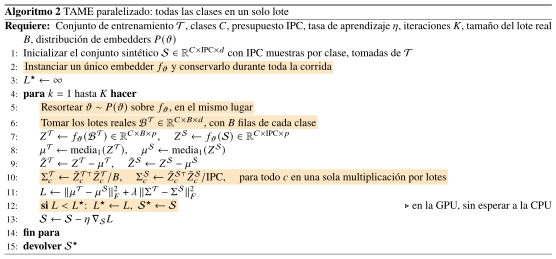
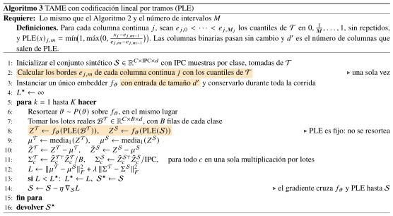
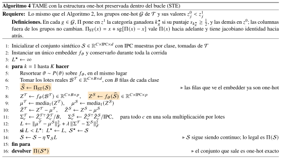
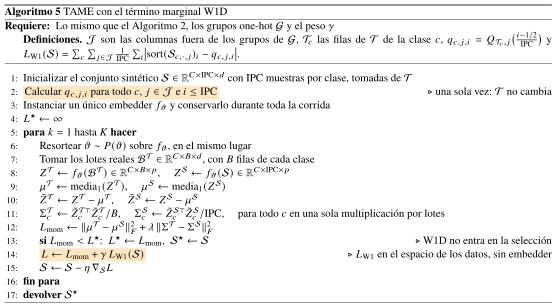

# Recordatorio

<!--
Propuestas.qmd
========================


Descripcion:
------------
Segunda exposicion sobre TAME. Empieza con la paralelizacion del nucleo
(todas las clases en un lote), que es la base de todo lo demas. Despues
explica el defecto que vemos en el metodo (mueve los valores sinteticos sin ninguna restriccion), la
hipotesis de que eso dana a los clasificadores basados en arboles y
las tres propuestas para atacarlo: PLE, STE y el termino W1D. Cierra
con el plan de experimentos.


Considerations:
------------
- Se compila con "quarto render Propuestas.qmd" o se previsualiza con
  "quarto preview Propuestas.qmd"
- El front matter YAML tiene que ser lo primero del archivo; este
  encabezado va dentro de la primera seccion porque suelto entre el
  YAML y el primer encabezado genera una diapositiva en blanco
- Cada "##" abre una diapositiva y cada "#" una seccion
- Las animaciones usan auto-animate de reveal.js: las diapositivas
  seguidas con el mismo titulo y elementos con el mismo data-id se
  interpolan solas
- Los ejemplos de juguete usan numeros hechos a mano para que las
  cuentas se puedan seguir; no son resultados
- Los algoritmos estan escritos en LaTeX en alg/ (mismo estilo que los
  del notebook de TAME) y se compilan a img/ con "bash alg/compilar.sh",
  que usa pdflatex, pdfcrop y pdftocairo
- Los diagramas siguen la figura 1 del paper, igual que la exposicion 1:
  un SVG absoluto de 1280 x 720 y las etiquetas en divs absolutos con KaTeX


Metadata:
----------
* Author: zxxz6 (Bryan Violante Arriaga)
* Version: 1.1.1
* License: Copyright (c) 2026 Bryan Violante Arriaga.


History:
------------
Author      Date            Description
zxxz6       24/10/2026      Creation
zxxz6       24/10/2026      Paralelizacion, diagramas al estilo del paper
                            y algoritmos en LaTeX por lotes
zxxz6       26/10/2026      Sin la diapositiva de contenido


-->

## TAME in a nutshell {.nostretch}

```{=html}
<svg class="fig tame-fig" viewBox="0 0 1280 720" width="1280" height="720"
  style="position:absolute; top:0; left:0; pointer-events:none;">
<defs>
<marker id="mR" viewBox="0 0 10 10" refX="9" refY="5" markerWidth="8" markerHeight="8" orient="auto-start-reverse">
<path d="M0,0 L10,5 L0,10 z" fill="#333"/></marker>
<marker id="mRn" viewBox="0 0 10 10" refX="9" refY="5" markerWidth="8" markerHeight="8" orient="auto-start-reverse">
<path d="M0,0 L10,5 L0,10 z" fill="#c77700"/></marker>
</defs>
<rect x="60" y="130" width="1160" height="440" rx="6" fill="#f4f4f4" stroke="#999"/>
<rect x="100" y="235" width="180" height="80" fill="#eeeaf7" stroke="#6a5fa8" stroke-width="1"/>
<rect x="100" y="235" width="180" height="18" fill="#c9c3e6" stroke="#6a5fa8" stroke-width="1"/>
<rect x="100" y="440" width="180" height="80" fill="#f7eaf4" stroke="#a85f95" stroke-width="1"/>
<rect x="100" y="440" width="180" height="18" fill="#e6c9e0" stroke="#a85f95" stroke-width="1"/>
<polyline points="280,275 355,275 355,345 426,345" fill="none" stroke="#333" stroke-width="2.5" marker-end="url(#mR)"/>
<polyline points="280,480 355,480 355,425 426,425" fill="none" stroke="#333" stroke-width="2.5" marker-end="url(#mR)"/>
<g class="carta"><rect x="452" y="268" width="290" height="190" rx="14" fill="#b9cdea" stroke="#5b7fb5"/></g>
<rect x="441" y="279" width="290" height="190" rx="14" fill="#c7d8ef" stroke="#5b7fb5"/>
<rect x="430" y="290" width="290" height="190" rx="14" fill="#dbe7f6" stroke="#5b7fb5" stroke-width="2"/>
<g stroke="#445" stroke-width="1.4"><line class="arista" style="animation-delay:0.00s" x1="488" y1="335" x2="556" y2="315"/><line class="arista" style="animation-delay:0.14s" x1="488" y1="335" x2="556" y2="355"/><line class="arista" style="animation-delay:0.27s" x1="488" y1="335" x2="556" y2="395"/><line class="arista" style="animation-delay:0.41s" x1="488" y1="335" x2="556" y2="435"/><line class="arista" style="animation-delay:0.55s" x1="488" y1="375" x2="556" y2="315"/><line class="arista" style="animation-delay:0.69s" x1="488" y1="375" x2="556" y2="355"/><line class="arista" style="animation-delay:0.82s" x1="488" y1="375" x2="556" y2="395"/><line class="arista" style="animation-delay:0.96s" x1="488" y1="375" x2="556" y2="435"/><line class="arista" style="animation-delay:1.10s" x1="488" y1="415" x2="556" y2="315"/><line class="arista" style="animation-delay:1.23s" x1="488" y1="415" x2="556" y2="355"/><line class="arista" style="animation-delay:1.37s" x1="488" y1="415" x2="556" y2="395"/><line class="arista" style="animation-delay:1.51s" x1="488" y1="415" x2="556" y2="435"/><line class="arista" style="animation-delay:0.04s" x1="556" y1="315" x2="623" y2="315"/><line class="arista" style="animation-delay:0.18s" x1="556" y1="315" x2="623" y2="355"/><line class="arista" style="animation-delay:0.32s" x1="556" y1="315" x2="623" y2="395"/><line class="arista" style="animation-delay:0.46s" x1="556" y1="315" x2="623" y2="435"/><line class="arista" style="animation-delay:0.59s" x1="556" y1="355" x2="623" y2="315"/><line class="arista" style="animation-delay:0.73s" x1="556" y1="355" x2="623" y2="355"/><line class="arista" style="animation-delay:0.87s" x1="556" y1="355" x2="623" y2="395"/><line class="arista" style="animation-delay:1.00s" x1="556" y1="355" x2="623" y2="435"/><line class="arista" style="animation-delay:1.14s" x1="556" y1="395" x2="623" y2="315"/><line class="arista" style="animation-delay:1.28s" x1="556" y1="395" x2="623" y2="355"/><line class="arista" style="animation-delay:1.41s" x1="556" y1="395" x2="623" y2="395"/><line class="arista" style="animation-delay:1.55s" x1="556" y1="395" x2="623" y2="435"/><line class="arista" style="animation-delay:0.09s" x1="556" y1="435" x2="623" y2="315"/><line class="arista" style="animation-delay:0.23s" x1="556" y1="435" x2="623" y2="355"/><line class="arista" style="animation-delay:0.36s" x1="556" y1="435" x2="623" y2="395"/><line class="arista" style="animation-delay:0.50s" x1="556" y1="435" x2="623" y2="435"/><line class="arista" style="animation-delay:0.64s" x1="623" y1="315" x2="691" y2="335"/><line class="arista" style="animation-delay:0.77s" x1="623" y1="315" x2="691" y2="375"/><line class="arista" style="animation-delay:0.91s" x1="623" y1="315" x2="691" y2="415"/><line class="arista" style="animation-delay:1.05s" x1="623" y1="355" x2="691" y2="335"/><line class="arista" style="animation-delay:1.18s" x1="623" y1="355" x2="691" y2="375"/><line class="arista" style="animation-delay:1.32s" x1="623" y1="355" x2="691" y2="415"/><line class="arista" style="animation-delay:1.46s" x1="623" y1="395" x2="691" y2="335"/><line class="arista" style="animation-delay:1.59s" x1="623" y1="395" x2="691" y2="375"/><line class="arista" style="animation-delay:0.13s" x1="623" y1="395" x2="691" y2="415"/><line class="arista" style="animation-delay:0.27s" x1="623" y1="435" x2="691" y2="335"/><line class="arista" style="animation-delay:0.41s" x1="623" y1="435" x2="691" y2="375"/><line class="arista" style="animation-delay:0.54s" x1="623" y1="435" x2="691" y2="415"/></g>
<g fill="#fff" stroke="#333" stroke-width="2"><circle cx="488" cy="335" r="9"/><circle cx="488" cy="375" r="9"/><circle cx="488" cy="415" r="9"/><circle cx="556" cy="315" r="9"/><circle cx="556" cy="355" r="9"/><circle cx="556" cy="395" r="9"/><circle cx="556" cy="435" r="9"/><circle cx="623" cy="315" r="9"/><circle cx="623" cy="355" r="9"/><circle cx="623" cy="395" r="9"/><circle cx="623" cy="435" r="9"/><circle cx="691" cy="335" r="9"/><circle cx="691" cy="375" r="9"/><circle cx="691" cy="415" r="9"/></g>
<polyline points="720,385 750,385 750,290 786,290" fill="none" stroke="#333" stroke-width="2.5" marker-end="url(#mR)"/>
<polyline points="720,385 750,385 750,465 786,465" fill="none" stroke="#333" stroke-width="2.5" marker-end="url(#mR)"/>
<rect x="790" y="245" width="120" height="90" fill="#d9d4ef" stroke="#555"/>
<polygon points="790,245 806,229 926,229 910,245" fill="#c9c3e6" stroke="#555"/>
<polygon points="910,245 926,229 926,319 910,335" fill="#b3abd8" stroke="#555"/>
<rect x="790" y="420" width="120" height="90" fill="#f0d9ea" stroke="#555"/>
<polygon points="790,420 806,404 926,404 910,420" fill="#e6c9e0" stroke="#555"/>
<polygon points="910,420 926,404 926,494 910,510" fill="#d6b0cc" stroke="#555"/>
<polyline points="926,282 950,282 950,375 981,375" fill="none" stroke="#333" stroke-width="2.5" marker-end="url(#mR)"/>
<polyline points="926,457 950,457 950,375 981,375" fill="none" stroke="#333" stroke-width="2.5" marker-end="url(#mR)"/>
<rect x="985" y="335" width="190" height="80" rx="16" fill="#fff" stroke="#222" stroke-width="3"/>
<polyline class="retro" points="1080,335 1080,178 195,178 195,231" fill="none" stroke="#333" stroke-width="2.5" marker-end="url(#mR)"/>
<g class="fragment" data-fragment-index="1"><rect x="88" y="223" width="204" height="104" rx="10" fill="none" stroke="#d1495b" stroke-width="3" stroke-dasharray="7 5"/></g>
</svg>
```

::: {.etq .ab style="top:258px;left:100px;width:180px"}
$B_c^{\mathcal{S}}$ $(\mathrm{IPC} \times d)$
:::

::: {.etq .ab style="top:463px;left:100px;width:180px"}
$B_c^{\mathcal{T}}$ $(B \times d)$
:::

::: {.etq .ab style="top:240px;left:420px;width:320px"}
Embedders congelados $f_\vartheta^k$
:::

::: {.etq .ab .cara style="top:245px;left:790px;width:120px;height:90px"}
$Z_c^{\mathcal{S}}$<br>$(\mathrm{IPC} \times p)$
:::

::: {.etq .ab .cara style="top:420px;left:790px;width:120px;height:90px"}
$Z_c^{\mathcal{T}}$<br>$(B \times p)$
:::

::: {.etq .ab .cara style="top:335px;left:985px;width:190px;height:80px"}
$\mathcal{L}_c(\mu, \Sigma)$
:::

::: {.etq .ab .fondo style="top:160px;left:520px;width:260px"}
$\mathcal{S} \leftarrow \mathcal{S} - \eta \nabla_{\mathcal{S}} \mathcal{L}$
:::

::: {.etq .ab .libre-etq .fragment fragment-index="1" style="top:335px;left:70px;width:270px"}
cada celda, un número libre
:::

::: {.etq .ab .pie2 style="top:590px;left:60px;width:1160px"}
El mismo $f_\vartheta^k$ proyecta ambos lotes; en la siguiente iteración es
otro.
:::

::: {.notes}
Recordatorio rapido, con la figura 1 del paper. Entran dos lotes de la
clase c: el sintetico, de IPC filas por d columnas, y uno real de B
filas. Los dos pasan por el mismo embedder congelado, aleatorio, que
cambia en cada iteracion. Salen las proyecciones Z, se comparan media y
covarianza, y el gradiente de esa perdida actualiza directamente S.

Lo que queremos remarcar hoy: cada celda de S es un numero real libre.
El paso de gradiente lo puede mover a donde sea; no hay nada que lo
obligue a quedarse en valores que existan en los datos.
:::

::: aside
Barnoviciu y Florea (2026), figura 1
:::

## El algoritmo del paper {.nostretch}

{width="1150px" fig-align="center"}

::: {.notes}
El algoritmo tal como viene en el paper. Ojo con la linea 5: un ciclo
sobre las clases. Para cada clase se toma su lote, se proyecta, se
calculan sus momentos y se suma su pedazo de perdida. Y en la linea 3,
un embedder nuevo en cada iteracion.

Esas dos cosas son las que cambia la paralelizacion.
:::

::: aside
Barnoviciu y Florea (2026), algoritmo 1
:::

# Paralelizar TAME

## Por qué paralelizar

::: {.incremental}
- Hoy el algoritmo de TAME **itera por clase**, pero cada clase es
  **independiente**: la pérdida es una suma de pérdidas por clase, así que
  se pueden calcular todas a la vez
- Además, el código **crea un embedder nuevo** en cada iteración: lo
  construye, lo sube a la GPU, lo usa una vez y lo tira
- Y **lee la pérdida desde la CPU** en cada iteración, lo que obliga a
  esperar a que la GPU termine
:::

::: {.notes}
Esto no es una propuesta sobre el metodo, es ingenieria. Pero sin esto
los barridos de las propuestas no hubieran cabido en el tiempo que
tenemos.

Hoy TAME recorre las clases una por una: para cada clase proyecta su
lote, calcula sus momentos y suma su pedazo de perdida. Pero ninguna
clase mira a las otras; la perdida total es solo la suma. Entonces se
pueden hacer todas a la vez.

Ademas, en cada iteracion el codigo construye un embedder nuevo desde
cero, aunque nunca lo entrena: lo usa una vez y lo tira. Y en cada
iteracion baja la perdida a la CPU para quedarse con el mejor S, lo que
hace esperar a la GPU.

Lo notamos porque letter, con 26 clases, tardaba entre 600 y 2200
segundos por destilacion. Vamos una por una.
:::

::: aside
Código de Barnoviciu y Florea (2026)
:::

## bottleneck 1: un bucle sobre las clases {auto-animate=true .nostretch}

```{=html}
<svg class="fig tame-fig" viewBox="0 0 1280 720" width="1280" height="720"
  style="position:absolute; top:0; left:0; pointer-events:none;">
<defs>
<marker id="mAa" viewBox="0 0 10 10" refX="9" refY="5" markerWidth="8" markerHeight="8" orient="auto-start-reverse">
<path d="M0,0 L10,5 L0,10 z" fill="#333"/></marker>
<marker id="mAan" viewBox="0 0 10 10" refX="9" refY="5" markerWidth="8" markerHeight="8" orient="auto-start-reverse">
<path d="M0,0 L10,5 L0,10 z" fill="#c77700"/></marker>
</defs>
<rect x="0" y="130" width="1240" height="475" rx="6" fill="#f4f4f4" stroke="#999"/>
<polyline points="260,206 356,206" fill="none" stroke="#333" stroke-width="2.5" marker-end="url(#mAa)"/>
<polyline points="490,206 540,206 540,172 586,172" fill="none" stroke="#333" stroke-width="2.5" marker-end="url(#mAa)"/>
<polyline points="490,206 540,206 540,237 586,237" fill="none" stroke="#333" stroke-width="2.5" marker-end="url(#mAa)"/>
<polyline points="662,172 710,172 710,206 756,206" fill="none" stroke="#333" stroke-width="2.5" marker-end="url(#mAa)"/>
<polyline points="662,237 710,237 710,206 756,206" fill="none" stroke="#333" stroke-width="2.5" marker-end="url(#mAa)"/>
<polyline points="860,206 930,206 930,370 986,370" fill="none" stroke="#333" stroke-width="2.5" marker-end="url(#mAa)"/>
<polyline points="260,342 356,342" fill="none" stroke="#333" stroke-width="2.5" marker-end="url(#mAa)"/>
<polyline points="490,342 540,342 540,308 586,308" fill="none" stroke="#333" stroke-width="2.5" marker-end="url(#mAa)"/>
<polyline points="490,342 540,342 540,373 586,373" fill="none" stroke="#333" stroke-width="2.5" marker-end="url(#mAa)"/>
<polyline points="662,308 710,308 710,342 756,342" fill="none" stroke="#333" stroke-width="2.5" marker-end="url(#mAa)"/>
<polyline points="662,373 710,373 710,342 756,342" fill="none" stroke="#333" stroke-width="2.5" marker-end="url(#mAa)"/>
<polyline points="860,342 930,342 930,370 986,370" fill="none" stroke="#333" stroke-width="2.5" marker-end="url(#mAa)"/>
<polyline points="260,533 356,533" fill="none" stroke="#333" stroke-width="2.5" marker-end="url(#mAa)"/>
<polyline points="490,533 540,533 540,499 586,499" fill="none" stroke="#333" stroke-width="2.5" marker-end="url(#mAa)"/>
<polyline points="490,533 540,533 540,564 586,564" fill="none" stroke="#333" stroke-width="2.5" marker-end="url(#mAa)"/>
<polyline points="662,499 710,499 710,533 756,533" fill="none" stroke="#333" stroke-width="2.5" marker-end="url(#mAa)"/>
<polyline points="662,564 710,564 710,533 756,533" fill="none" stroke="#333" stroke-width="2.5" marker-end="url(#mAa)"/>
<polyline points="860,533 930,533 930,370 986,370" fill="none" stroke="#333" stroke-width="2.5" marker-end="url(#mAa)"/>
</svg>
<div class="tb syn" data-id="ts2" style="left:110px;top:467px;width:150px;height:46px"></div>
<div class="tb syn" data-id="ts1" style="left:110px;top:276px;width:150px;height:46px"></div>
<div class="tb syn" data-id="ts0" style="left:110px;top:140px;width:150px;height:46px"></div>
<div class="tb real" data-id="tr2" style="left:110px;top:535px;width:150px;height:46px"></div>
<div class="tb real" data-id="tr1" style="left:110px;top:344px;width:150px;height:46px"></div>
<div class="tb real" data-id="tr0" style="left:110px;top:208px;width:150px;height:46px"></div>
<div class="card" data-id="em2" style="left:360px;top:488px;width:130px;height:90px;background:#dbe7f6"><svg class="tame-fig" viewBox="0 0 300 190" preserveAspectRatio="xMidYMid meet"><g stroke="#445" stroke-width="1.4"><line class="arista" style="animation-delay:0.00s" x1="60" y1="45" x2="130" y2="25"/><line class="arista" style="animation-delay:0.14s" x1="60" y1="45" x2="130" y2="65"/><line class="arista" style="animation-delay:0.27s" x1="60" y1="45" x2="130" y2="105"/><line class="arista" style="animation-delay:0.41s" x1="60" y1="45" x2="130" y2="145"/><line class="arista" style="animation-delay:0.55s" x1="60" y1="85" x2="130" y2="25"/><line class="arista" style="animation-delay:0.69s" x1="60" y1="85" x2="130" y2="65"/><line class="arista" style="animation-delay:0.82s" x1="60" y1="85" x2="130" y2="105"/><line class="arista" style="animation-delay:0.96s" x1="60" y1="85" x2="130" y2="145"/><line class="arista" style="animation-delay:1.10s" x1="60" y1="125" x2="130" y2="25"/><line class="arista" style="animation-delay:1.23s" x1="60" y1="125" x2="130" y2="65"/><line class="arista" style="animation-delay:1.37s" x1="60" y1="125" x2="130" y2="105"/><line class="arista" style="animation-delay:1.51s" x1="60" y1="125" x2="130" y2="145"/><line class="arista" style="animation-delay:0.04s" x1="130" y1="25" x2="200" y2="25"/><line class="arista" style="animation-delay:0.18s" x1="130" y1="25" x2="200" y2="65"/><line class="arista" style="animation-delay:0.32s" x1="130" y1="25" x2="200" y2="105"/><line class="arista" style="animation-delay:0.46s" x1="130" y1="25" x2="200" y2="145"/><line class="arista" style="animation-delay:0.59s" x1="130" y1="65" x2="200" y2="25"/><line class="arista" style="animation-delay:0.73s" x1="130" y1="65" x2="200" y2="65"/><line class="arista" style="animation-delay:0.87s" x1="130" y1="65" x2="200" y2="105"/><line class="arista" style="animation-delay:1.00s" x1="130" y1="65" x2="200" y2="145"/><line class="arista" style="animation-delay:1.14s" x1="130" y1="105" x2="200" y2="25"/><line class="arista" style="animation-delay:1.28s" x1="130" y1="105" x2="200" y2="65"/><line class="arista" style="animation-delay:1.41s" x1="130" y1="105" x2="200" y2="105"/><line class="arista" style="animation-delay:1.55s" x1="130" y1="105" x2="200" y2="145"/><line class="arista" style="animation-delay:0.09s" x1="130" y1="145" x2="200" y2="25"/><line class="arista" style="animation-delay:0.23s" x1="130" y1="145" x2="200" y2="65"/><line class="arista" style="animation-delay:0.36s" x1="130" y1="145" x2="200" y2="105"/><line class="arista" style="animation-delay:0.50s" x1="130" y1="145" x2="200" y2="145"/><line class="arista" style="animation-delay:0.64s" x1="200" y1="25" x2="270" y2="45"/><line class="arista" style="animation-delay:0.77s" x1="200" y1="25" x2="270" y2="85"/><line class="arista" style="animation-delay:0.91s" x1="200" y1="25" x2="270" y2="125"/><line class="arista" style="animation-delay:1.05s" x1="200" y1="65" x2="270" y2="45"/><line class="arista" style="animation-delay:1.18s" x1="200" y1="65" x2="270" y2="85"/><line class="arista" style="animation-delay:1.32s" x1="200" y1="65" x2="270" y2="125"/><line class="arista" style="animation-delay:1.46s" x1="200" y1="105" x2="270" y2="45"/><line class="arista" style="animation-delay:1.59s" x1="200" y1="105" x2="270" y2="85"/><line class="arista" style="animation-delay:0.13s" x1="200" y1="105" x2="270" y2="125"/><line class="arista" style="animation-delay:0.27s" x1="200" y1="145" x2="270" y2="45"/><line class="arista" style="animation-delay:0.41s" x1="200" y1="145" x2="270" y2="85"/><line class="arista" style="animation-delay:0.54s" x1="200" y1="145" x2="270" y2="125"/></g><g fill="#fff" stroke="#333" stroke-width="2"><circle cx="60" cy="45" r="9"/><circle cx="60" cy="85" r="9"/><circle cx="60" cy="125" r="9"/><circle cx="130" cy="25" r="9"/><circle cx="130" cy="65" r="9"/><circle cx="130" cy="105" r="9"/><circle cx="130" cy="145" r="9"/><circle cx="200" cy="25" r="9"/><circle cx="200" cy="65" r="9"/><circle cx="200" cy="105" r="9"/><circle cx="200" cy="145" r="9"/><circle cx="270" cy="45" r="9"/><circle cx="270" cy="85" r="9"/><circle cx="270" cy="125" r="9"/></g></svg></div>
<div class="card" data-id="em1" style="left:360px;top:297px;width:130px;height:90px;background:#dbe7f6"><svg class="tame-fig" viewBox="0 0 300 190" preserveAspectRatio="xMidYMid meet"><g stroke="#445" stroke-width="1.4"><line class="arista" style="animation-delay:0.00s" x1="60" y1="45" x2="130" y2="25"/><line class="arista" style="animation-delay:0.14s" x1="60" y1="45" x2="130" y2="65"/><line class="arista" style="animation-delay:0.27s" x1="60" y1="45" x2="130" y2="105"/><line class="arista" style="animation-delay:0.41s" x1="60" y1="45" x2="130" y2="145"/><line class="arista" style="animation-delay:0.55s" x1="60" y1="85" x2="130" y2="25"/><line class="arista" style="animation-delay:0.69s" x1="60" y1="85" x2="130" y2="65"/><line class="arista" style="animation-delay:0.82s" x1="60" y1="85" x2="130" y2="105"/><line class="arista" style="animation-delay:0.96s" x1="60" y1="85" x2="130" y2="145"/><line class="arista" style="animation-delay:1.10s" x1="60" y1="125" x2="130" y2="25"/><line class="arista" style="animation-delay:1.23s" x1="60" y1="125" x2="130" y2="65"/><line class="arista" style="animation-delay:1.37s" x1="60" y1="125" x2="130" y2="105"/><line class="arista" style="animation-delay:1.51s" x1="60" y1="125" x2="130" y2="145"/><line class="arista" style="animation-delay:0.04s" x1="130" y1="25" x2="200" y2="25"/><line class="arista" style="animation-delay:0.18s" x1="130" y1="25" x2="200" y2="65"/><line class="arista" style="animation-delay:0.32s" x1="130" y1="25" x2="200" y2="105"/><line class="arista" style="animation-delay:0.46s" x1="130" y1="25" x2="200" y2="145"/><line class="arista" style="animation-delay:0.59s" x1="130" y1="65" x2="200" y2="25"/><line class="arista" style="animation-delay:0.73s" x1="130" y1="65" x2="200" y2="65"/><line class="arista" style="animation-delay:0.87s" x1="130" y1="65" x2="200" y2="105"/><line class="arista" style="animation-delay:1.00s" x1="130" y1="65" x2="200" y2="145"/><line class="arista" style="animation-delay:1.14s" x1="130" y1="105" x2="200" y2="25"/><line class="arista" style="animation-delay:1.28s" x1="130" y1="105" x2="200" y2="65"/><line class="arista" style="animation-delay:1.41s" x1="130" y1="105" x2="200" y2="105"/><line class="arista" style="animation-delay:1.55s" x1="130" y1="105" x2="200" y2="145"/><line class="arista" style="animation-delay:0.09s" x1="130" y1="145" x2="200" y2="25"/><line class="arista" style="animation-delay:0.23s" x1="130" y1="145" x2="200" y2="65"/><line class="arista" style="animation-delay:0.36s" x1="130" y1="145" x2="200" y2="105"/><line class="arista" style="animation-delay:0.50s" x1="130" y1="145" x2="200" y2="145"/><line class="arista" style="animation-delay:0.64s" x1="200" y1="25" x2="270" y2="45"/><line class="arista" style="animation-delay:0.77s" x1="200" y1="25" x2="270" y2="85"/><line class="arista" style="animation-delay:0.91s" x1="200" y1="25" x2="270" y2="125"/><line class="arista" style="animation-delay:1.05s" x1="200" y1="65" x2="270" y2="45"/><line class="arista" style="animation-delay:1.18s" x1="200" y1="65" x2="270" y2="85"/><line class="arista" style="animation-delay:1.32s" x1="200" y1="65" x2="270" y2="125"/><line class="arista" style="animation-delay:1.46s" x1="200" y1="105" x2="270" y2="45"/><line class="arista" style="animation-delay:1.59s" x1="200" y1="105" x2="270" y2="85"/><line class="arista" style="animation-delay:0.13s" x1="200" y1="105" x2="270" y2="125"/><line class="arista" style="animation-delay:0.27s" x1="200" y1="145" x2="270" y2="45"/><line class="arista" style="animation-delay:0.41s" x1="200" y1="145" x2="270" y2="85"/><line class="arista" style="animation-delay:0.54s" x1="200" y1="145" x2="270" y2="125"/></g><g fill="#fff" stroke="#333" stroke-width="2"><circle cx="60" cy="45" r="9"/><circle cx="60" cy="85" r="9"/><circle cx="60" cy="125" r="9"/><circle cx="130" cy="25" r="9"/><circle cx="130" cy="65" r="9"/><circle cx="130" cy="105" r="9"/><circle cx="130" cy="145" r="9"/><circle cx="200" cy="25" r="9"/><circle cx="200" cy="65" r="9"/><circle cx="200" cy="105" r="9"/><circle cx="200" cy="145" r="9"/><circle cx="270" cy="45" r="9"/><circle cx="270" cy="85" r="9"/><circle cx="270" cy="125" r="9"/></g></svg></div>
<div class="card" data-id="em0" style="left:360px;top:161px;width:130px;height:90px;background:#dbe7f6"><svg class="tame-fig" viewBox="0 0 300 190" preserveAspectRatio="xMidYMid meet"><g stroke="#445" stroke-width="1.4"><line class="arista" style="animation-delay:0.00s" x1="60" y1="45" x2="130" y2="25"/><line class="arista" style="animation-delay:0.14s" x1="60" y1="45" x2="130" y2="65"/><line class="arista" style="animation-delay:0.27s" x1="60" y1="45" x2="130" y2="105"/><line class="arista" style="animation-delay:0.41s" x1="60" y1="45" x2="130" y2="145"/><line class="arista" style="animation-delay:0.55s" x1="60" y1="85" x2="130" y2="25"/><line class="arista" style="animation-delay:0.69s" x1="60" y1="85" x2="130" y2="65"/><line class="arista" style="animation-delay:0.82s" x1="60" y1="85" x2="130" y2="105"/><line class="arista" style="animation-delay:0.96s" x1="60" y1="85" x2="130" y2="145"/><line class="arista" style="animation-delay:1.10s" x1="60" y1="125" x2="130" y2="25"/><line class="arista" style="animation-delay:1.23s" x1="60" y1="125" x2="130" y2="65"/><line class="arista" style="animation-delay:1.37s" x1="60" y1="125" x2="130" y2="105"/><line class="arista" style="animation-delay:1.51s" x1="60" y1="125" x2="130" y2="145"/><line class="arista" style="animation-delay:0.04s" x1="130" y1="25" x2="200" y2="25"/><line class="arista" style="animation-delay:0.18s" x1="130" y1="25" x2="200" y2="65"/><line class="arista" style="animation-delay:0.32s" x1="130" y1="25" x2="200" y2="105"/><line class="arista" style="animation-delay:0.46s" x1="130" y1="25" x2="200" y2="145"/><line class="arista" style="animation-delay:0.59s" x1="130" y1="65" x2="200" y2="25"/><line class="arista" style="animation-delay:0.73s" x1="130" y1="65" x2="200" y2="65"/><line class="arista" style="animation-delay:0.87s" x1="130" y1="65" x2="200" y2="105"/><line class="arista" style="animation-delay:1.00s" x1="130" y1="65" x2="200" y2="145"/><line class="arista" style="animation-delay:1.14s" x1="130" y1="105" x2="200" y2="25"/><line class="arista" style="animation-delay:1.28s" x1="130" y1="105" x2="200" y2="65"/><line class="arista" style="animation-delay:1.41s" x1="130" y1="105" x2="200" y2="105"/><line class="arista" style="animation-delay:1.55s" x1="130" y1="105" x2="200" y2="145"/><line class="arista" style="animation-delay:0.09s" x1="130" y1="145" x2="200" y2="25"/><line class="arista" style="animation-delay:0.23s" x1="130" y1="145" x2="200" y2="65"/><line class="arista" style="animation-delay:0.36s" x1="130" y1="145" x2="200" y2="105"/><line class="arista" style="animation-delay:0.50s" x1="130" y1="145" x2="200" y2="145"/><line class="arista" style="animation-delay:0.64s" x1="200" y1="25" x2="270" y2="45"/><line class="arista" style="animation-delay:0.77s" x1="200" y1="25" x2="270" y2="85"/><line class="arista" style="animation-delay:0.91s" x1="200" y1="25" x2="270" y2="125"/><line class="arista" style="animation-delay:1.05s" x1="200" y1="65" x2="270" y2="45"/><line class="arista" style="animation-delay:1.18s" x1="200" y1="65" x2="270" y2="85"/><line class="arista" style="animation-delay:1.32s" x1="200" y1="65" x2="270" y2="125"/><line class="arista" style="animation-delay:1.46s" x1="200" y1="105" x2="270" y2="45"/><line class="arista" style="animation-delay:1.59s" x1="200" y1="105" x2="270" y2="85"/><line class="arista" style="animation-delay:0.13s" x1="200" y1="105" x2="270" y2="125"/><line class="arista" style="animation-delay:0.27s" x1="200" y1="145" x2="270" y2="45"/><line class="arista" style="animation-delay:0.41s" x1="200" y1="145" x2="270" y2="85"/><line class="arista" style="animation-delay:0.54s" x1="200" y1="145" x2="270" y2="125"/></g><g fill="#fff" stroke="#333" stroke-width="2"><circle cx="60" cy="45" r="9"/><circle cx="60" cy="85" r="9"/><circle cx="60" cy="125" r="9"/><circle cx="130" cy="25" r="9"/><circle cx="130" cy="65" r="9"/><circle cx="130" cy="105" r="9"/><circle cx="130" cy="145" r="9"/><circle cx="200" cy="25" r="9"/><circle cx="200" cy="65" r="9"/><circle cx="200" cy="105" r="9"/><circle cx="200" cy="145" r="9"/><circle cx="270" cy="45" r="9"/><circle cx="270" cy="85" r="9"/><circle cx="270" cy="125" r="9"/></g></svg></div>
<div class="cubo" data-id="zs2" style="left:590px;top:471px;width:72px;height:48px"><svg viewBox="0 0 136 106" preserveAspectRatio="none"><rect x="0" y="16" width="120" height="90" fill="#d9d4ef" stroke="#555" vector-effect="non-scaling-stroke"/><polygon points="0,16 16,0 136,0 120,16" fill="#c9c3e6" stroke="#555" vector-effect="non-scaling-stroke"/><polygon points="120,16 136,0 136,90 120,106" fill="#b3abd8" stroke="#555" vector-effect="non-scaling-stroke"/></svg></div>
<div class="cubo" data-id="zs1" style="left:590px;top:280px;width:72px;height:48px"><svg viewBox="0 0 136 106" preserveAspectRatio="none"><rect x="0" y="16" width="120" height="90" fill="#d9d4ef" stroke="#555" vector-effect="non-scaling-stroke"/><polygon points="0,16 16,0 136,0 120,16" fill="#c9c3e6" stroke="#555" vector-effect="non-scaling-stroke"/><polygon points="120,16 136,0 136,90 120,106" fill="#b3abd8" stroke="#555" vector-effect="non-scaling-stroke"/></svg></div>
<div class="cubo" data-id="zs0" style="left:590px;top:144px;width:72px;height:48px"><svg viewBox="0 0 136 106" preserveAspectRatio="none"><rect x="0" y="16" width="120" height="90" fill="#d9d4ef" stroke="#555" vector-effect="non-scaling-stroke"/><polygon points="0,16 16,0 136,0 120,16" fill="#c9c3e6" stroke="#555" vector-effect="non-scaling-stroke"/><polygon points="120,16 136,0 136,90 120,106" fill="#b3abd8" stroke="#555" vector-effect="non-scaling-stroke"/></svg></div>
<div class="cubo" data-id="zt2" style="left:590px;top:536px;width:72px;height:48px"><svg viewBox="0 0 136 106" preserveAspectRatio="none"><rect x="0" y="16" width="120" height="90" fill="#f0d9ea" stroke="#555" vector-effect="non-scaling-stroke"/><polygon points="0,16 16,0 136,0 120,16" fill="#e6c9e0" stroke="#555" vector-effect="non-scaling-stroke"/><polygon points="120,16 136,0 136,90 120,106" fill="#d6b0cc" stroke="#555" vector-effect="non-scaling-stroke"/></svg></div>
<div class="cubo" data-id="zt1" style="left:590px;top:345px;width:72px;height:48px"><svg viewBox="0 0 136 106" preserveAspectRatio="none"><rect x="0" y="16" width="120" height="90" fill="#f0d9ea" stroke="#555" vector-effect="non-scaling-stroke"/><polygon points="0,16 16,0 136,0 120,16" fill="#e6c9e0" stroke="#555" vector-effect="non-scaling-stroke"/><polygon points="120,16 136,0 136,90 120,106" fill="#d6b0cc" stroke="#555" vector-effect="non-scaling-stroke"/></svg></div>
<div class="cubo" data-id="zt0" style="left:590px;top:209px;width:72px;height:48px"><svg viewBox="0 0 136 106" preserveAspectRatio="none"><rect x="0" y="16" width="120" height="90" fill="#f0d9ea" stroke="#555" vector-effect="non-scaling-stroke"/><polygon points="0,16 16,0 136,0 120,16" fill="#e6c9e0" stroke="#555" vector-effect="non-scaling-stroke"/><polygon points="120,16 136,0 136,90 120,106" fill="#d6b0cc" stroke="#555" vector-effect="non-scaling-stroke"/></svg></div>
<div class="perd" data-id="lc2" style="left:760px;top:510px;width:100px;height:46px"></div>
<div class="perd" data-id="lc1" style="left:760px;top:319px;width:100px;height:46px"></div>
<div class="perd" data-id="lc0" style="left:760px;top:183px;width:100px;height:46px"></div>
<div class="perd" data-id="lt" style="left:990px;top:330px;width:190px;height:80px"></div>
```

::: {.etq .ab data-id="nc0" style="top:192px;left:6px;width:104px;white-space:nowrap;font-size:19px"}
$c = 0$
:::

::: {.etq .ab .chica data-id="bs0" style="top:157px;left:110px;width:150px"}
$B_{0}^{\mathcal{S}}$
:::

::: {.etq .ab .chica data-id="bt0" style="top:225px;left:110px;width:150px"}
$B_{0}^{\mathcal{T}}$
:::

::: {.etq .ab data-id="nl0" style="top:194px;left:760px;width:100px"}
$\mathcal{L}_{0}$
:::

::: {.etq .ab data-id="nc1" style="top:328px;left:6px;width:104px;white-space:nowrap;font-size:19px"}
$c = 1$
:::

::: {.etq .ab .chica data-id="bs1" style="top:293px;left:110px;width:150px"}
$B_{1}^{\mathcal{S}}$
:::

::: {.etq .ab .chica data-id="bt1" style="top:361px;left:110px;width:150px"}
$B_{1}^{\mathcal{T}}$
:::

::: {.etq .ab data-id="nl1" style="top:330px;left:760px;width:100px"}
$\mathcal{L}_{1}$
:::

::: {.etq .ab data-id="nc2" style="top:519px;left:6px;width:104px;white-space:nowrap;font-size:19px"}
$c = C{-}1$
:::

::: {.etq .ab .chica data-id="bs2" style="top:484px;left:110px;width:150px"}
$B_{C-1}^{\mathcal{S}}$
:::

::: {.etq .ab .chica data-id="bt2" style="top:552px;left:110px;width:150px"}
$B_{C-1}^{\mathcal{T}}$
:::

::: {.etq .ab data-id="nl2" style="top:521px;left:760px;width:100px"}
$\mathcal{L}_{C-1}$
:::

::: {.etq .ab .chica style="top:161px;left:590px;width:64px"}
$Z_{0}^{\mathcal{S}}$
:::

::: {.etq .ab .chica style="top:226px;left:590px;width:64px"}
$Z_{0}^{\mathcal{T}}$
:::

::: {.etq .ab .chica style="top:297px;left:590px;width:64px"}
$Z_{1}^{\mathcal{S}}$
:::

::: {.etq .ab .chica style="top:362px;left:590px;width:64px"}
$Z_{1}^{\mathcal{T}}$
:::

::: {.etq .ab .chica style="top:488px;left:590px;width:64px"}
$Z_{C-1}^{\mathcal{S}}$
:::

::: {.etq .ab .chica style="top:553px;left:590px;width:64px"}
$Z_{C-1}^{\mathcal{T}}$
:::

::: {.etq .ab .dim style="top:187px;left:110px;width:150px"}
$(\mathrm{IPC} {\times} d)$
:::

::: {.etq .ab .dim style="top:255px;left:110px;width:150px"}
$(B {\times} d)$
:::

::: {.etq .ab .dim style="top:323px;left:110px;width:150px"}
$(\mathrm{IPC} {\times} d)$
:::

::: {.etq .ab .dim style="top:391px;left:110px;width:150px"}
$(B {\times} d)$
:::

::: {.etq .ab .dim style="top:514px;left:110px;width:150px"}
$(\mathrm{IPC} {\times} d)$
:::

::: {.etq .ab .dim style="top:582px;left:110px;width:150px"}
$(B {\times} d)$
:::

::: {.etq .ab .dim style="top:193px;left:586px;width:80px"}
$(\mathrm{IPC} {\times} p)$
:::

::: {.etq .ab .dim style="top:258px;left:586px;width:80px"}
$(B {\times} p)$
:::

::: {.etq .ab .dim style="top:329px;left:586px;width:80px"}
$(\mathrm{IPC} {\times} p)$
:::

::: {.etq .ab .dim style="top:394px;left:586px;width:80px"}
$(B {\times} p)$
:::

::: {.etq .ab .dim style="top:520px;left:586px;width:80px"}
$(\mathrm{IPC} {\times} p)$
:::

::: {.etq .ab .dim style="top:585px;left:586px;width:80px"}
$(B {\times} p)$
:::

::: {.etq .ab .puntos style="top:405px;left:110px;width:150px"}
$\vdots$
:::

::: {.etq .ab .puntos style="top:405px;left:760px;width:100px"}
$\vdots$
:::

::: {.etq .ab data-id="nlt" style="top:352px;left:990px;width:190px"}
$\mathcal{L} = \sum_c \mathcal{L}_c$
:::

::: {.etq .ab .pie2 data-id="pieA" style="top:620px;left:0px;width:1240px"}
Antes: un forward, una covarianza y una suma **por clase**, $C$ veces en cada iteración
:::

::: {.notes}
Asi corre el codigo publicado. Para cada clase: toma su lote sintetico y
su lote real, los pasa por el embedder, calcula media y covarianza y
suma su pedazo de perdida. Despues la siguiente clase.

Con letter son 26 vueltas por iteracion, y cada vuelta lanza sus propias
operaciones pequenas en la GPU.
:::

## bottleneck 1 (un bucle sobre las clases) {auto-animate=true .nostretch}

```{=html}
<svg class="fig tame-fig" viewBox="0 0 1280 720" width="1280" height="720"
  style="position:absolute; top:0; left:0; pointer-events:none;">
<defs>
<marker id="mAb" viewBox="0 0 10 10" refX="9" refY="5" markerWidth="8" markerHeight="8" orient="auto-start-reverse">
<path d="M0,0 L10,5 L0,10 z" fill="#333"/></marker>
<marker id="mAbn" viewBox="0 0 10 10" refX="9" refY="5" markerWidth="8" markerHeight="8" orient="auto-start-reverse">
<path d="M0,0 L10,5 L0,10 z" fill="#c77700"/></marker>
</defs>
<rect x="0" y="130" width="1240" height="475" rx="6" fill="#f4f4f4" stroke="#999"/>
<polyline points="280,295 355,295 355,365 426,365" fill="none" stroke="#333" stroke-width="2.5" marker-end="url(#mAb)"/>
<polyline points="280,500 355,500 355,445 426,445" fill="none" stroke="#333" stroke-width="2.5" marker-end="url(#mAb)"/>
<polyline points="720,405 750,405 750,310 786,310" fill="none" stroke="#333" stroke-width="2.5" marker-end="url(#mAb)"/>
<polyline points="720,405 750,405 750,485 786,485" fill="none" stroke="#333" stroke-width="2.5" marker-end="url(#mAb)"/>
<polyline points="926,302 950,302 950,395 981,395" fill="none" stroke="#333" stroke-width="2.5" marker-end="url(#mAb)"/>
<polyline points="926,477 950,477 950,395 981,395" fill="none" stroke="#333" stroke-width="2.5" marker-end="url(#mAb)"/>
<polyline class="retro" points="1080,355 1080,198 195,198 195,235" fill="none" stroke="#333" stroke-width="2.5" marker-end="url(#mAb)"/>
</svg>
<div class="tb syn" data-id="ts2" style="left:116px;top:239px;width:180px;height:80px"></div>
<div class="tb syn" data-id="ts1" style="left:108px;top:247px;width:180px;height:80px"></div>
<div class="tb syn" data-id="ts0" style="left:100px;top:255px;width:180px;height:80px"></div>
<div class="tb real" data-id="tr2" style="left:116px;top:444px;width:180px;height:80px"></div>
<div class="tb real" data-id="tr1" style="left:108px;top:452px;width:180px;height:80px"></div>
<div class="tb real" data-id="tr0" style="left:100px;top:460px;width:180px;height:80px"></div>
<div class="card" data-id="em2" style="left:452px;top:288px;width:290px;height:190px;background:#b9cdea"><svg class="tame-fig" viewBox="0 0 300 190" preserveAspectRatio="xMidYMid meet"><g stroke="#445" stroke-width="1.4"><line class="arista" style="animation-delay:0.00s" x1="60" y1="45" x2="130" y2="25"/><line class="arista" style="animation-delay:0.14s" x1="60" y1="45" x2="130" y2="65"/><line class="arista" style="animation-delay:0.27s" x1="60" y1="45" x2="130" y2="105"/><line class="arista" style="animation-delay:0.41s" x1="60" y1="45" x2="130" y2="145"/><line class="arista" style="animation-delay:0.55s" x1="60" y1="85" x2="130" y2="25"/><line class="arista" style="animation-delay:0.69s" x1="60" y1="85" x2="130" y2="65"/><line class="arista" style="animation-delay:0.82s" x1="60" y1="85" x2="130" y2="105"/><line class="arista" style="animation-delay:0.96s" x1="60" y1="85" x2="130" y2="145"/><line class="arista" style="animation-delay:1.10s" x1="60" y1="125" x2="130" y2="25"/><line class="arista" style="animation-delay:1.23s" x1="60" y1="125" x2="130" y2="65"/><line class="arista" style="animation-delay:1.37s" x1="60" y1="125" x2="130" y2="105"/><line class="arista" style="animation-delay:1.51s" x1="60" y1="125" x2="130" y2="145"/><line class="arista" style="animation-delay:0.04s" x1="130" y1="25" x2="200" y2="25"/><line class="arista" style="animation-delay:0.18s" x1="130" y1="25" x2="200" y2="65"/><line class="arista" style="animation-delay:0.32s" x1="130" y1="25" x2="200" y2="105"/><line class="arista" style="animation-delay:0.46s" x1="130" y1="25" x2="200" y2="145"/><line class="arista" style="animation-delay:0.59s" x1="130" y1="65" x2="200" y2="25"/><line class="arista" style="animation-delay:0.73s" x1="130" y1="65" x2="200" y2="65"/><line class="arista" style="animation-delay:0.87s" x1="130" y1="65" x2="200" y2="105"/><line class="arista" style="animation-delay:1.00s" x1="130" y1="65" x2="200" y2="145"/><line class="arista" style="animation-delay:1.14s" x1="130" y1="105" x2="200" y2="25"/><line class="arista" style="animation-delay:1.28s" x1="130" y1="105" x2="200" y2="65"/><line class="arista" style="animation-delay:1.41s" x1="130" y1="105" x2="200" y2="105"/><line class="arista" style="animation-delay:1.55s" x1="130" y1="105" x2="200" y2="145"/><line class="arista" style="animation-delay:0.09s" x1="130" y1="145" x2="200" y2="25"/><line class="arista" style="animation-delay:0.23s" x1="130" y1="145" x2="200" y2="65"/><line class="arista" style="animation-delay:0.36s" x1="130" y1="145" x2="200" y2="105"/><line class="arista" style="animation-delay:0.50s" x1="130" y1="145" x2="200" y2="145"/><line class="arista" style="animation-delay:0.64s" x1="200" y1="25" x2="270" y2="45"/><line class="arista" style="animation-delay:0.77s" x1="200" y1="25" x2="270" y2="85"/><line class="arista" style="animation-delay:0.91s" x1="200" y1="25" x2="270" y2="125"/><line class="arista" style="animation-delay:1.05s" x1="200" y1="65" x2="270" y2="45"/><line class="arista" style="animation-delay:1.18s" x1="200" y1="65" x2="270" y2="85"/><line class="arista" style="animation-delay:1.32s" x1="200" y1="65" x2="270" y2="125"/><line class="arista" style="animation-delay:1.46s" x1="200" y1="105" x2="270" y2="45"/><line class="arista" style="animation-delay:1.59s" x1="200" y1="105" x2="270" y2="85"/><line class="arista" style="animation-delay:0.13s" x1="200" y1="105" x2="270" y2="125"/><line class="arista" style="animation-delay:0.27s" x1="200" y1="145" x2="270" y2="45"/><line class="arista" style="animation-delay:0.41s" x1="200" y1="145" x2="270" y2="85"/><line class="arista" style="animation-delay:0.54s" x1="200" y1="145" x2="270" y2="125"/></g><g fill="#fff" stroke="#333" stroke-width="2"><circle cx="60" cy="45" r="9"/><circle cx="60" cy="85" r="9"/><circle cx="60" cy="125" r="9"/><circle cx="130" cy="25" r="9"/><circle cx="130" cy="65" r="9"/><circle cx="130" cy="105" r="9"/><circle cx="130" cy="145" r="9"/><circle cx="200" cy="25" r="9"/><circle cx="200" cy="65" r="9"/><circle cx="200" cy="105" r="9"/><circle cx="200" cy="145" r="9"/><circle cx="270" cy="45" r="9"/><circle cx="270" cy="85" r="9"/><circle cx="270" cy="125" r="9"/></g></svg></div>
<div class="card" data-id="em1" style="left:441px;top:299px;width:290px;height:190px;background:#c7d8ef"><svg class="tame-fig" viewBox="0 0 300 190" preserveAspectRatio="xMidYMid meet"><g stroke="#445" stroke-width="1.4"><line class="arista" style="animation-delay:0.00s" x1="60" y1="45" x2="130" y2="25"/><line class="arista" style="animation-delay:0.14s" x1="60" y1="45" x2="130" y2="65"/><line class="arista" style="animation-delay:0.27s" x1="60" y1="45" x2="130" y2="105"/><line class="arista" style="animation-delay:0.41s" x1="60" y1="45" x2="130" y2="145"/><line class="arista" style="animation-delay:0.55s" x1="60" y1="85" x2="130" y2="25"/><line class="arista" style="animation-delay:0.69s" x1="60" y1="85" x2="130" y2="65"/><line class="arista" style="animation-delay:0.82s" x1="60" y1="85" x2="130" y2="105"/><line class="arista" style="animation-delay:0.96s" x1="60" y1="85" x2="130" y2="145"/><line class="arista" style="animation-delay:1.10s" x1="60" y1="125" x2="130" y2="25"/><line class="arista" style="animation-delay:1.23s" x1="60" y1="125" x2="130" y2="65"/><line class="arista" style="animation-delay:1.37s" x1="60" y1="125" x2="130" y2="105"/><line class="arista" style="animation-delay:1.51s" x1="60" y1="125" x2="130" y2="145"/><line class="arista" style="animation-delay:0.04s" x1="130" y1="25" x2="200" y2="25"/><line class="arista" style="animation-delay:0.18s" x1="130" y1="25" x2="200" y2="65"/><line class="arista" style="animation-delay:0.32s" x1="130" y1="25" x2="200" y2="105"/><line class="arista" style="animation-delay:0.46s" x1="130" y1="25" x2="200" y2="145"/><line class="arista" style="animation-delay:0.59s" x1="130" y1="65" x2="200" y2="25"/><line class="arista" style="animation-delay:0.73s" x1="130" y1="65" x2="200" y2="65"/><line class="arista" style="animation-delay:0.87s" x1="130" y1="65" x2="200" y2="105"/><line class="arista" style="animation-delay:1.00s" x1="130" y1="65" x2="200" y2="145"/><line class="arista" style="animation-delay:1.14s" x1="130" y1="105" x2="200" y2="25"/><line class="arista" style="animation-delay:1.28s" x1="130" y1="105" x2="200" y2="65"/><line class="arista" style="animation-delay:1.41s" x1="130" y1="105" x2="200" y2="105"/><line class="arista" style="animation-delay:1.55s" x1="130" y1="105" x2="200" y2="145"/><line class="arista" style="animation-delay:0.09s" x1="130" y1="145" x2="200" y2="25"/><line class="arista" style="animation-delay:0.23s" x1="130" y1="145" x2="200" y2="65"/><line class="arista" style="animation-delay:0.36s" x1="130" y1="145" x2="200" y2="105"/><line class="arista" style="animation-delay:0.50s" x1="130" y1="145" x2="200" y2="145"/><line class="arista" style="animation-delay:0.64s" x1="200" y1="25" x2="270" y2="45"/><line class="arista" style="animation-delay:0.77s" x1="200" y1="25" x2="270" y2="85"/><line class="arista" style="animation-delay:0.91s" x1="200" y1="25" x2="270" y2="125"/><line class="arista" style="animation-delay:1.05s" x1="200" y1="65" x2="270" y2="45"/><line class="arista" style="animation-delay:1.18s" x1="200" y1="65" x2="270" y2="85"/><line class="arista" style="animation-delay:1.32s" x1="200" y1="65" x2="270" y2="125"/><line class="arista" style="animation-delay:1.46s" x1="200" y1="105" x2="270" y2="45"/><line class="arista" style="animation-delay:1.59s" x1="200" y1="105" x2="270" y2="85"/><line class="arista" style="animation-delay:0.13s" x1="200" y1="105" x2="270" y2="125"/><line class="arista" style="animation-delay:0.27s" x1="200" y1="145" x2="270" y2="45"/><line class="arista" style="animation-delay:0.41s" x1="200" y1="145" x2="270" y2="85"/><line class="arista" style="animation-delay:0.54s" x1="200" y1="145" x2="270" y2="125"/></g><g fill="#fff" stroke="#333" stroke-width="2"><circle cx="60" cy="45" r="9"/><circle cx="60" cy="85" r="9"/><circle cx="60" cy="125" r="9"/><circle cx="130" cy="25" r="9"/><circle cx="130" cy="65" r="9"/><circle cx="130" cy="105" r="9"/><circle cx="130" cy="145" r="9"/><circle cx="200" cy="25" r="9"/><circle cx="200" cy="65" r="9"/><circle cx="200" cy="105" r="9"/><circle cx="200" cy="145" r="9"/><circle cx="270" cy="45" r="9"/><circle cx="270" cy="85" r="9"/><circle cx="270" cy="125" r="9"/></g></svg></div>
<div class="card" data-id="em0" style="left:430px;top:310px;width:290px;height:190px;background:#dbe7f6"><svg class="tame-fig" viewBox="0 0 300 190" preserveAspectRatio="xMidYMid meet"><g stroke="#445" stroke-width="1.4"><line class="arista" style="animation-delay:0.00s" x1="60" y1="45" x2="130" y2="25"/><line class="arista" style="animation-delay:0.14s" x1="60" y1="45" x2="130" y2="65"/><line class="arista" style="animation-delay:0.27s" x1="60" y1="45" x2="130" y2="105"/><line class="arista" style="animation-delay:0.41s" x1="60" y1="45" x2="130" y2="145"/><line class="arista" style="animation-delay:0.55s" x1="60" y1="85" x2="130" y2="25"/><line class="arista" style="animation-delay:0.69s" x1="60" y1="85" x2="130" y2="65"/><line class="arista" style="animation-delay:0.82s" x1="60" y1="85" x2="130" y2="105"/><line class="arista" style="animation-delay:0.96s" x1="60" y1="85" x2="130" y2="145"/><line class="arista" style="animation-delay:1.10s" x1="60" y1="125" x2="130" y2="25"/><line class="arista" style="animation-delay:1.23s" x1="60" y1="125" x2="130" y2="65"/><line class="arista" style="animation-delay:1.37s" x1="60" y1="125" x2="130" y2="105"/><line class="arista" style="animation-delay:1.51s" x1="60" y1="125" x2="130" y2="145"/><line class="arista" style="animation-delay:0.04s" x1="130" y1="25" x2="200" y2="25"/><line class="arista" style="animation-delay:0.18s" x1="130" y1="25" x2="200" y2="65"/><line class="arista" style="animation-delay:0.32s" x1="130" y1="25" x2="200" y2="105"/><line class="arista" style="animation-delay:0.46s" x1="130" y1="25" x2="200" y2="145"/><line class="arista" style="animation-delay:0.59s" x1="130" y1="65" x2="200" y2="25"/><line class="arista" style="animation-delay:0.73s" x1="130" y1="65" x2="200" y2="65"/><line class="arista" style="animation-delay:0.87s" x1="130" y1="65" x2="200" y2="105"/><line class="arista" style="animation-delay:1.00s" x1="130" y1="65" x2="200" y2="145"/><line class="arista" style="animation-delay:1.14s" x1="130" y1="105" x2="200" y2="25"/><line class="arista" style="animation-delay:1.28s" x1="130" y1="105" x2="200" y2="65"/><line class="arista" style="animation-delay:1.41s" x1="130" y1="105" x2="200" y2="105"/><line class="arista" style="animation-delay:1.55s" x1="130" y1="105" x2="200" y2="145"/><line class="arista" style="animation-delay:0.09s" x1="130" y1="145" x2="200" y2="25"/><line class="arista" style="animation-delay:0.23s" x1="130" y1="145" x2="200" y2="65"/><line class="arista" style="animation-delay:0.36s" x1="130" y1="145" x2="200" y2="105"/><line class="arista" style="animation-delay:0.50s" x1="130" y1="145" x2="200" y2="145"/><line class="arista" style="animation-delay:0.64s" x1="200" y1="25" x2="270" y2="45"/><line class="arista" style="animation-delay:0.77s" x1="200" y1="25" x2="270" y2="85"/><line class="arista" style="animation-delay:0.91s" x1="200" y1="25" x2="270" y2="125"/><line class="arista" style="animation-delay:1.05s" x1="200" y1="65" x2="270" y2="45"/><line class="arista" style="animation-delay:1.18s" x1="200" y1="65" x2="270" y2="85"/><line class="arista" style="animation-delay:1.32s" x1="200" y1="65" x2="270" y2="125"/><line class="arista" style="animation-delay:1.46s" x1="200" y1="105" x2="270" y2="45"/><line class="arista" style="animation-delay:1.59s" x1="200" y1="105" x2="270" y2="85"/><line class="arista" style="animation-delay:0.13s" x1="200" y1="105" x2="270" y2="125"/><line class="arista" style="animation-delay:0.27s" x1="200" y1="145" x2="270" y2="45"/><line class="arista" style="animation-delay:0.41s" x1="200" y1="145" x2="270" y2="85"/><line class="arista" style="animation-delay:0.54s" x1="200" y1="145" x2="270" y2="125"/></g><g fill="#fff" stroke="#333" stroke-width="2"><circle cx="60" cy="45" r="9"/><circle cx="60" cy="85" r="9"/><circle cx="60" cy="125" r="9"/><circle cx="130" cy="25" r="9"/><circle cx="130" cy="65" r="9"/><circle cx="130" cy="105" r="9"/><circle cx="130" cy="145" r="9"/><circle cx="200" cy="25" r="9"/><circle cx="200" cy="65" r="9"/><circle cx="200" cy="105" r="9"/><circle cx="200" cy="145" r="9"/><circle cx="270" cy="45" r="9"/><circle cx="270" cy="85" r="9"/><circle cx="270" cy="125" r="9"/></g></svg></div>
<div class="cubo" data-id="zs2" style="left:806px;top:233px;width:136px;height:106px"><svg viewBox="0 0 136 106" preserveAspectRatio="none"><rect x="0" y="16" width="120" height="90" fill="#d9d4ef" stroke="#555" vector-effect="non-scaling-stroke"/><polygon points="0,16 16,0 136,0 120,16" fill="#c9c3e6" stroke="#555" vector-effect="non-scaling-stroke"/><polygon points="120,16 136,0 136,90 120,106" fill="#b3abd8" stroke="#555" vector-effect="non-scaling-stroke"/></svg></div>
<div class="cubo" data-id="zs1" style="left:798px;top:241px;width:136px;height:106px"><svg viewBox="0 0 136 106" preserveAspectRatio="none"><rect x="0" y="16" width="120" height="90" fill="#d9d4ef" stroke="#555" vector-effect="non-scaling-stroke"/><polygon points="0,16 16,0 136,0 120,16" fill="#c9c3e6" stroke="#555" vector-effect="non-scaling-stroke"/><polygon points="120,16 136,0 136,90 120,106" fill="#b3abd8" stroke="#555" vector-effect="non-scaling-stroke"/></svg></div>
<div class="cubo" data-id="zs0" style="left:790px;top:249px;width:136px;height:106px"><svg viewBox="0 0 136 106" preserveAspectRatio="none"><rect x="0" y="16" width="120" height="90" fill="#d9d4ef" stroke="#555" vector-effect="non-scaling-stroke"/><polygon points="0,16 16,0 136,0 120,16" fill="#c9c3e6" stroke="#555" vector-effect="non-scaling-stroke"/><polygon points="120,16 136,0 136,90 120,106" fill="#b3abd8" stroke="#555" vector-effect="non-scaling-stroke"/></svg></div>
<div class="cubo" data-id="zt2" style="left:806px;top:408px;width:136px;height:106px"><svg viewBox="0 0 136 106" preserveAspectRatio="none"><rect x="0" y="16" width="120" height="90" fill="#f0d9ea" stroke="#555" vector-effect="non-scaling-stroke"/><polygon points="0,16 16,0 136,0 120,16" fill="#e6c9e0" stroke="#555" vector-effect="non-scaling-stroke"/><polygon points="120,16 136,0 136,90 120,106" fill="#d6b0cc" stroke="#555" vector-effect="non-scaling-stroke"/></svg></div>
<div class="cubo" data-id="zt1" style="left:798px;top:416px;width:136px;height:106px"><svg viewBox="0 0 136 106" preserveAspectRatio="none"><rect x="0" y="16" width="120" height="90" fill="#f0d9ea" stroke="#555" vector-effect="non-scaling-stroke"/><polygon points="0,16 16,0 136,0 120,16" fill="#e6c9e0" stroke="#555" vector-effect="non-scaling-stroke"/><polygon points="120,16 136,0 136,90 120,106" fill="#d6b0cc" stroke="#555" vector-effect="non-scaling-stroke"/></svg></div>
<div class="cubo" data-id="zt0" style="left:790px;top:424px;width:136px;height:106px"><svg viewBox="0 0 136 106" preserveAspectRatio="none"><rect x="0" y="16" width="120" height="90" fill="#f0d9ea" stroke="#555" vector-effect="non-scaling-stroke"/><polygon points="0,16 16,0 136,0 120,16" fill="#e6c9e0" stroke="#555" vector-effect="non-scaling-stroke"/><polygon points="120,16 136,0 136,90 120,106" fill="#d6b0cc" stroke="#555" vector-effect="non-scaling-stroke"/></svg></div>
<div class="perd" data-id="lc2" style="left:985px;top:355px;width:190px;height:80px"></div>
<div class="perd" data-id="lc1" style="left:985px;top:355px;width:190px;height:80px"></div>
<div class="perd" data-id="lc0" style="left:985px;top:355px;width:190px;height:80px"></div>
<div class="perd" data-id="lt" style="left:985px;top:355px;width:190px;height:80px"></div>
```

::: {.etq .ab style="top:274px;left:100px;width:180px"}
$\mathcal{S}$<br>$(C \times \mathrm{IPC} \times d)$
:::

::: {.etq .ab style="top:479px;left:100px;width:180px"}
$\mathcal{B}^{\mathcal{T}}$<br>$(C \times B \times d)$
:::

::: {.etq .ab style="top:260px;left:420px;width:320px"}
Embedders congelados $f_\vartheta$
:::

::: {.etq .ab .cara style="top:265px;left:790px;width:120px;height:90px"}
$Z^{\mathcal{S}}$<br>$(C {\times} \mathrm{IPC} {\times} p)$
:::

::: {.etq .ab .cara style="top:440px;left:790px;width:120px;height:90px"}
$Z^{\mathcal{T}}$<br>$(C {\times} B {\times} p)$
:::

::: {.etq .ab .cara style="top:355px;left:985px;width:190px;height:80px"}
$\mathcal{L}(\mu, \Sigma)$
:::

::: {.etq .ab .fondo style="top:180px;left:520px;width:260px"}
$\mathcal{S} \leftarrow \mathcal{S} - \eta \nabla_{\mathcal{S}} \mathcal{L}$
:::

::: {.etq .ab .pie2 data-id="pieB" style="top:620px;left:0px;width:1240px"}
Después: la clase es la primera dimensión. **Un** forward, **una** multiplicación por lotes y **una** suma
:::

::: {.notes}
Pero las filas de S ya vienen ordenadas por clase, asi que S se puede
ver como un tensor de C por IPC por d sin copiar nada. Con eso la clase
se vuelve una dimension mas.

Un solo forward con todas las filas, las C medias de una vez y las C
covarianzas en una sola multiplicacion por lotes. La perdida es la
misma suma; lo que cambia es en cuantas piezas se le entrega a la GPU.

El dibujo es el mismo de la figura 1, apilado: cada tabla y cada cubo
tiene ahora la clase como primera dimension.
:::


## bottleneck 2 (un embedder nuevo en cada iteración) {.smaller}

:::: {.columns}
::: {.column width="46%"}
- TAME **nunca entrena** el embedder: lo sortea, lo usa una vez y lo
  tira
- Construirlo: crear el módulo, inicializarlo en la CPU y copiarlo a la
  GPU tensor por tensor
- Ahora se construye **una vez** y en cada iteración se **redibujan sus
  pesos en el mismo lugar**
:::
::: {.column width="54%"}
Milisegundos por iteración, IPC 50

```{=html}
<div class="barras">
<div class="fila"><span class="nom">LnRes</span><span class="b cons" style="width:430px"></span>9.6</div>
<div class="fila fragment" data-fragment-index="1"><span class="nom"></span><span class="b redi" style="width:15px"></span>0.34</div>
<div class="sep"></div>
<div class="fila"><span class="nom">DCNv2</span><span class="b cons" style="width:86px"></span>1.9</div>
<div class="fila fragment" data-fragment-index="1"><span class="nom"></span><span class="b redi" style="width:9px"></span>0.20</div>
<div class="sep"></div>
<div class="fila"><span class="nom">NODE</span><span class="b cons" style="width:80px"></span>1.8</div>
<div class="fila fragment" data-fragment-index="1"><span class="nom"></span><span class="b redi" style="width:6px"></span>0.13</div>
</div>
```

[construir]{style="color:#5b7fb5"} · [redibujar]{.fragment fragment-index="1" style="color:#c77700"}
:::
::::

::: {.fragment fragment-index="2"}
Con LnRes son **9 a 11 s menos** en cada destilación de 1000 iteraciones.
:::

::: {.notes}
El segundo sospechoso. TAME nunca entrena el embedder: lo sortea, lo usa
una iteracion y lo tira. Mil iteraciones son mil redes construidas y
ninguna entrenada.

Construir cuesta: crear el modulo en Python, inicializar cada parametro
en la CPU y copiarlo a la GPU tensor por tensor. El metodo quiere pesos
nuevos, no un objeto nuevo. Asi que lo construimos una vez y en cada
iteracion redibujamos los pesos en su lugar, con el mismo inicializador
que usa PyTorch al construir.

El costo sigue al numero de tensores, no de parametros: LnRes tiene mas
tensores y es el que mas gana. Redibujar es casi gratis en los tres.
:::

::: aside
Mismo inicializador que al construir (`reset_parameters`), así que los
pesos salen de la misma distribución
:::

## bottleneck 3 (leer la pérdida en cada iteración)

- Para quedarse con el mejor $\mathcal{S}$, el código leía la pérdida
  desde la CPU con `.item()`, en cada iteración
- Cada lectura hace que la CPU **espere** a que la GPU termine todo lo
  que tiene encolado
- Ahora la comparación se hace **en la GPU**: de 3000 lecturas por
  destilación a 11

```python
mejor     = torch.isfinite(loss) & (loss < best_loss)   # sin salir de la GPU
best_loss = torch.where(mejor, loss, best_loss)
best_syn  = torch.where(mejor, syn, best_syn)
```

::: {.fragment}
Con la máquina libre ahorra **0.14 a 0.27 s** por destilación: casi
nada. La ganancia grande vino del embedder.
:::

::: {.notes}
El tercer sospechoso. Para quedarse con el S de menor perdida, el codigo
bajaba la perdida a la CPU en cada iteracion. La GPU no ejecuta cuando
Python se lo pide, encola; pedir un numero obliga a esperar a que termine
todo lo encolado, y luego la GPU espera a que la CPU la vuelva a llenar.

La decision se puede quedar en la GPU con torch.where: compara y
selecciona sin que la CPU sepa el resultado.

Pero medido con la maquina libre, ahorra menos de un tercio de segundo
por destilacion. Lo dejamos porque no cuesta nada, pero no es lo que
acelero.
:::

## Algoritmo paralelizado {.nostretch}

{width="1150px" fig-align="center"}

::: {.notes}
El algoritmo paralelizado, en el mismo formato. Lo resaltado es lo que
cambia respecto al del paper.

Linea 2: un solo embedder para toda la corrida. Linea 5: en cada
iteracion se resortean sus pesos en el mismo lugar.

Lineas 6 a 10: ya no hay ciclo sobre las clases. Los lotes reales son un
tensor de C por B por d, todo pasa por el embedder de una vez, y las C
covarianzas salen de una multiplicacion por lotes.

Linea 12: la seleccion del mejor S. Ya estaba en el codigo publicado,
aunque el algoritmo del paper no la muestra; lo nuevo es que se hace en
la GPU.
:::

::: aside
Lo resaltado cambia respecto al Algoritmo 1. La selección del mejor
$\mathcal{S}$ ya estaba en el código publicado, no en el algoritmo del paper
:::

# El defecto: valores sin restricción

## Qué significa "sin restricción"

La pérdida solo mira **momentos de la proyección**; ningún término dice
qué valores son **válidos** en cada columna.

::: {.fragment}
| | edad | hijos | estado civil (one-hot) |
|---|---|---|---|
| Fila real | 37 | 2 | (0, 1, 0) |
| Fila de $\mathcal{S}$ tras 1000 pasos | 36.4 | 2.37 | (0.38, 0.71, −0.12) |
:::

::: {.fragment}
- `hijos` vale 2.37: entre dos valores que existen
- El estado civil no es **ninguna** categoría
:::

::: {.notes}
La perdida de TAME compara medias y covarianzas despues del embedder.
Ningun termino habla de que valores son validos en cada columna.

Ejemplo de juguete, con numeros inventados para ilustrar: una fila
real con edad 37, 2 hijos y estado civil casado en one-hot. Despues de
mil pasos de gradiente, la fila sintetica que salio de ella tiene 2.37
hijos y un estado civil que no es ninguna categoria: un poco soltera,
bastante casada y viuda negativa.

Para una red eso puede no importar tanto, interpola. Para un arbol
puede importar mucho.
:::

::: aside
Ejemplo de juguete con números ilustrativos
:::

## Una variable categórica en $\mathcal{S}$ {auto-animate=true}

```{=html}
<div class="lienzo">
<div class="lin" style="left:130px;top:300px;width:400px"></div>
<div class="lin dash" style="left:130px;top:100px;width:400px"></div>
<div class="lbl chico" style="left:112px;top:88px">1</div>
<div class="lbl chico" style="left:112px;top:288px">0</div>
<div class="barv" data-id="ba" style="left:170px;top:297px;height:3px"></div>
<div class="barv" data-id="bb" style="left:290px;top:100px;height:200px"></div>
<div class="barv" data-id="bc" style="left:410px;top:297px;height:3px"></div>
<div class="lbl" data-id="va" style="left:205px;top:262px">0</div>
<div class="lbl" data-id="vb" style="left:325px;top:62px">1</div>
<div class="lbl" data-id="vc" style="left:445px;top:262px">0</div>
<div class="lbl chico" style="left:205px;top:362px">soltero</div>
<div class="lbl chico" style="left:325px;top:362px">casado</div>
<div class="lbl chico" style="left:445px;top:362px">viudo</div>
<div class="lbl l tit" data-id="t1" style="left:600px;top:110px">Una fila real</div>
<div class="lbl l" data-id="t2" style="left:600px;top:160px">estado civil = casado</div>
<div class="lbl l" data-id="t3" style="left:600px;top:210px">(0, 1, 0)</div>
</div>
```

::: {.pie data-id="pieC"}
Al inicio, $\mathcal{S}$ son filas reales: exactamente una dummy en 1
:::

::: {.notes}
Zoom a una variable categorica. Se codifica en one-hot: tres columnas,
una por categoria, y en una fila real exactamente una vale 1.

TAME inicializa S con filas reales, asi que al principio todo esta
bien.
:::

## Una variable categórica en $\mathcal{S}$ {auto-animate=true}

```{=html}
<div class="lienzo">
<div class="lin" style="left:130px;top:300px;width:400px"></div>
<div class="lin dash" style="left:130px;top:100px;width:400px"></div>
<div class="lbl chico" style="left:112px;top:88px">1</div>
<div class="lbl chico" style="left:112px;top:288px">0</div>
<div class="barv" data-id="ba" style="left:170px;top:224px;height:76px"></div>
<div class="barv" data-id="bb" style="left:290px;top:158px;height:142px"></div>
<div class="barv neg" data-id="bc" style="left:410px;top:300px;height:24px"></div>
<div class="lbl" data-id="va" style="left:205px;top:188px">0.38</div>
<div class="lbl" data-id="vb" style="left:325px;top:122px">0.71</div>
<div class="lbl" data-id="vc" style="left:445px;top:328px">−0.12</div>
<div class="lbl chico" style="left:205px;top:362px">soltero</div>
<div class="lbl chico" style="left:325px;top:362px">casado</div>
<div class="lbl chico" style="left:445px;top:362px">viudo</div>
<div class="lbl l tit" data-id="t1" style="left:600px;top:110px">La misma fila, 1000 pasos después</div>
<div class="lbl l" data-id="t2" style="left:600px;top:160px">no es ninguna categoría</div>
<div class="lbl l" data-id="t3" style="left:600px;top:210px">(0.38, 0.71, −0.12)</div>
<div class="lbl l chico" style="left:600px;top:270px">Ningún renglón real se ve así</div>
</div>
```

::: {.pie data-id="pieC"}
El gradiente mueve cada dummy por su lado: la fila se **embarra**
:::

::: {.notes}
Despues de los pasos de gradiente, cada dummy se movio por su cuenta.
La fila quedo con 0.38, 0.71 y menos 0.12.

A esto le llamamos embarrar el one-hot. El modelo final va a entrenar
con filas que no corresponden a ninguna categoria, y que no existen en
los datos reales.
:::

::: aside
Ejemplo de juguete con números ilustrativos
:::

## La forma de una columna {auto-animate=true}

```{=html}
<div class="lienzo">
<div class="zona" style="left:100px;top:30px;width:115px;height:350px"></div>
<div class="lbl l chico" style="left:106px;top:36px">casi sin<br>datos reales</div>
<div class="hist" style="left:100px;top:220px;height:0px"></div>
<div class="hist" style="left:140px;top:218px;height:2px"></div>
<div class="hist" style="left:180px;top:210px;height:10px"></div>
<div class="hist" style="left:220px;top:80px;height:140px"></div>
<div class="hist" style="left:260px;top:130px;height:90px"></div>
<div class="hist" style="left:300px;top:160px;height:60px"></div>
<div class="hist" style="left:340px;top:175px;height:45px"></div>
<div class="hist" style="left:380px;top:186px;height:34px"></div>
<div class="hist" style="left:420px;top:194px;height:26px"></div>
<div class="hist" style="left:460px;top:200px;height:20px"></div>
<div class="hist" style="left:500px;top:205px;height:15px"></div>
<div class="hist" style="left:540px;top:209px;height:11px"></div>
<div class="hist" style="left:580px;top:212px;height:8px"></div>
<div class="hist" style="left:620px;top:214px;height:6px"></div>
<div class="hist" style="left:660px;top:215px;height:5px"></div>
<div class="hist" style="left:700px;top:216px;height:4px"></div>
<div class="hist" style="left:740px;top:217px;height:3px"></div>
<div class="hist" style="left:780px;top:218px;height:2px"></div>
<div class="hist" style="left:820px;top:218px;height:2px"></div>
<div class="hist" style="left:860px;top:219px;height:1px"></div>
<div class="lin" style="left:100px;top:222px;width:800px"></div>
<div class="lbl l chico" style="left:520px;top:120px">datos reales (histograma)</div>
<div class="lbl l chico" style="left:912px;top:290px"><span class="math inline">\mathcal{S}</span></div>
<div class="pt syn" data-id="d0" style="left:232px;top:292px"></div>
<div class="pt syn" data-id="d1" style="left:238px;top:312px"></div>
<div class="pt syn" data-id="d2" style="left:243px;top:300px"></div>
<div class="pt syn" data-id="d3" style="left:247px;top:320px"></div>
<div class="pt syn" data-id="d4" style="left:251px;top:282px"></div>
<div class="pt syn" data-id="d5" style="left:255px;top:292px"></div>
<div class="pt syn" data-id="d6" style="left:259px;top:312px"></div>
<div class="pt syn" data-id="d7" style="left:265px;top:300px"></div>
<div class="pt syn" data-id="d8" style="left:272px;top:320px"></div>
<div class="pt syn" data-id="d9" style="left:280px;top:282px"></div>
<div class="pt syn" data-id="d10" style="left:288px;top:292px"></div>
<div class="pt syn" data-id="d11" style="left:300px;top:312px"></div>
<div class="pt syn" data-id="d12" style="left:318px;top:300px"></div>
<div class="pt syn" data-id="d13" style="left:335px;top:320px"></div>
<div class="pt syn" data-id="d14" style="left:360px;top:282px"></div>
<div class="pt syn" data-id="d15" style="left:390px;top:292px"></div>
<div class="pt syn" data-id="d16" style="left:430px;top:312px"></div>
<div class="pt syn" data-id="d17" style="left:480px;top:300px"></div>
<div class="pt syn" data-id="d18" style="left:560px;top:320px"></div>
<div class="pt syn" data-id="d19" style="left:700px;top:282px"></div>
</div>
```

::: {.pie data-id="pieF"}
Al inicio: filas reales al azar, siguen la forma real (pico y cola larga)
:::

::: {.notes}
El otro efecto es sobre la forma de cada columna. En gris, el
histograma real de una columna tipica: un pico angosto y una cola
larga a la derecha. A la izquierda del pico casi no hay datos.

Abajo, en rojo, los valores sinteticos de esa columna. Al inicio son
filas reales al azar, asi que siguen la misma forma.
:::

## La forma de una columna {auto-animate=true}

```{=html}
<div class="lienzo">
<div class="zona" style="left:100px;top:30px;width:115px;height:350px"></div>
<div class="lbl l chico" style="left:106px;top:36px">casi sin<br>datos reales</div>
<div class="hist" style="left:100px;top:220px;height:0px"></div>
<div class="hist" style="left:140px;top:218px;height:2px"></div>
<div class="hist" style="left:180px;top:210px;height:10px"></div>
<div class="hist" style="left:220px;top:80px;height:140px"></div>
<div class="hist" style="left:260px;top:130px;height:90px"></div>
<div class="hist" style="left:300px;top:160px;height:60px"></div>
<div class="hist" style="left:340px;top:175px;height:45px"></div>
<div class="hist" style="left:380px;top:186px;height:34px"></div>
<div class="hist" style="left:420px;top:194px;height:26px"></div>
<div class="hist" style="left:460px;top:200px;height:20px"></div>
<div class="hist" style="left:500px;top:205px;height:15px"></div>
<div class="hist" style="left:540px;top:209px;height:11px"></div>
<div class="hist" style="left:580px;top:212px;height:8px"></div>
<div class="hist" style="left:620px;top:214px;height:6px"></div>
<div class="hist" style="left:660px;top:215px;height:5px"></div>
<div class="hist" style="left:700px;top:216px;height:4px"></div>
<div class="hist" style="left:740px;top:217px;height:3px"></div>
<div class="hist" style="left:780px;top:218px;height:2px"></div>
<div class="hist" style="left:820px;top:218px;height:2px"></div>
<div class="hist" style="left:860px;top:219px;height:1px"></div>
<div class="lin" style="left:100px;top:222px;width:800px"></div>
<div class="lbl l chico" style="left:520px;top:120px">datos reales (histograma)</div>
<div class="lbl l chico" style="left:912px;top:290px"><span class="math inline">\mathcal{S}</span></div>
<div class="pt syn" data-id="d0" style="left:150px;top:292px"></div>
<div class="pt syn" data-id="d1" style="left:170px;top:312px"></div>
<div class="pt syn" data-id="d2" style="left:188px;top:300px"></div>
<div class="pt syn" data-id="d3" style="left:200px;top:320px"></div>
<div class="pt syn" data-id="d4" style="left:212px;top:282px"></div>
<div class="pt syn" data-id="d5" style="left:236px;top:292px"></div>
<div class="pt syn" data-id="d6" style="left:255px;top:312px"></div>
<div class="pt syn" data-id="d7" style="left:272px;top:300px"></div>
<div class="pt syn" data-id="d8" style="left:290px;top:320px"></div>
<div class="pt syn" data-id="d9" style="left:305px;top:282px"></div>
<div class="pt syn" data-id="d10" style="left:320px;top:292px"></div>
<div class="pt syn" data-id="d11" style="left:338px;top:312px"></div>
<div class="pt syn" data-id="d12" style="left:356px;top:300px"></div>
<div class="pt syn" data-id="d13" style="left:375px;top:320px"></div>
<div class="pt syn" data-id="d14" style="left:396px;top:282px"></div>
<div class="pt syn" data-id="d15" style="left:420px;top:292px"></div>
<div class="pt syn" data-id="d16" style="left:446px;top:312px"></div>
<div class="pt syn" data-id="d17" style="left:478px;top:300px"></div>
<div class="pt syn" data-id="d18" style="left:520px;top:320px"></div>
<div class="pt syn" data-id="d19" style="left:590px;top:282px"></div>
</div>
```

::: {.pie data-id="pieF"}
Después de 1000 pasos: más simétrica, y con valores donde casi no hay
datos reales
:::

::: {.notes}
Despues de los mil pasos, la forma de la columna sintetica cambio: se
volvio mas simetrica, como una campana, y cinco de los veinte valores
quedaron a la izquierda del pico, donde casi no hay datos reales.

Esto conecta con lo que vimos la vez pasada: el paper habla de
gaussianizacion. Aqui lo vemos directo en los valores de S. No es solo
un efecto del embedder: es que nada ata cada columna a su forma real.

Lo vimos en una columna de higgs: once de cincuenta valores destilados
quedaron en una zona con menos del uno por ciento de los datos reales.
:::

::: aside
Ilustración. En una columna de `higgs` (IPC 50), 11 de 50 valores
destilados por TAME quedaron en una zona con menos del 1% de los datos
reales.
:::


# Hipótesis

## Hipótesis

::: {.hipo}
Al mover los valores **sin restricción**, TAME saca a $\mathcal{S}$ del
soporte de los datos reales: dummies que no son ninguna categoría,
valores intermedios que no existen y columnas con otra forma. Eso daña
sobre todo a los clasificadores **basados en árboles**.
:::

::: {.fragment}
Si es cierta, al restringir el movimiento deberíamos ver:

- Random Forest y XGBoost **suben**
- El MLP **casi no cambia**: interpola
- Columnas sintéticas **más parecidas** a las reales
:::

::: {.notes}
Nuestra hipotesis: el defecto es mover los valores sin restriccion.
Eso saca a S del soporte de los datos reales de tres formas: one-hot
embarrado, valores intermedios y columnas con otra forma. Y eso dana
sobre todo a los arboles, que cortan por umbrales columna por columna.

Que predice: si restringimos el movimiento, los arboles suben, el MLP
casi no se mueve, y las columnas sinteticas quedan mas cerca de las
reales. Si las columnas se acercan pero los arboles no suben, la
hipotesis es falsa: es una prediccion que se puede refutar.
:::

::: aside
Grinsztajn et al. (2022); Barnoviciu y Florea (2026), sección 5.3
:::

## Tres propuestas {.smaller}

| Propuesta | Qué hace | Dónde actúa | Qué ataca |
|---|---|---|---|
| **PLE** | Codifica cada columna continua por intervalos antes del embedder | Dentro del embedder | La forma de las columnas se pierde al proyectar |
| **STE** | El embedder ve filas con one-hot válido | Entre $\mathcal{S}$ y el embedder | Dummies embarradas |
| **W1D** | Un término que compara cada columna con la real | En la pérdida, espacio de los datos | Columnas con otra forma |

::: {.fragment}
Las tres conservan lo que funciona de TAME: embedders aleatorios,
media y covarianza, sin entrenar modelos.
:::

::: {.notes}
Tres propuestas, cada una ataca un pedazo del defecto desde un lugar
distinto.

PLE cambia como el embedder ve los datos: codifica cada columna
continua en intervalos, para que los momentos sean sensibles a la
forma de la columna.

STE hace que el embedder vea filas con one-hot valido, sin dejar de
pasar gradiente.

W1D agrega un termino a la perdida que compara cada columna sintetica
con la real, directo en el espacio de los datos.

Ninguna toca lo que funciona de TAME.
:::

# Propuesta 1: PLE

## La idea

:::: {.columns}
::: {.column width="58%"}
- TDColER compara tres formas de codificar columnas numéricas; la
  mejor es **PLE** (*piecewise linear encoding*)
- En TAME: una capa **fija, sin parámetros**, antes de cada embedder
  aleatorio
- Cada valor se vuelve un vector de qué tanto llenó cada intervalo
- Objetivo: que los momentos **vean la forma** de cada columna
:::
::: {.column width="42%"}
| Codificación | *Regret* mediano (k-means) |
|---|---|
| Binaria | 0.56 |
| Escalada | 0.86 |
| **PLE** | **0.20** |
:::
::::

::: {.notes}
La idea viene de TDColER. Ellos comparan tres formas de convertir una
columna numerica antes de su autoencoder: binaria, escalada y PLE, de
Gorishniy. PLE gana con claridad.

Nosotros la usamos distinto: como una capa fija, sin parametros, antes
de cada embedder aleatorio de TAME. Los datos sinteticos siguen en su
espacio original; PLE solo cambia lo que ve el embedder.

La intuicion: si el embedder ve cada columna partida en intervalos por
cuantiles, la media de esas features ya dice cuanta masa hay en cada
intervalo. Los momentos se vuelven sensibles a la forma de la columna.
:::

::: aside
Kang et al. (2025), tabla 14 (k-means, 5 datasets); Gorishniy et al.
(2022)
:::

## Cómo codifica un valor {.smaller}

Bordes $e_0 < e_1 < \dots < e_M$: los **cuantiles** de la columna real
en $0, \tfrac{1}{M}, \dots, 1$, sin repetidos.

$$
\mathrm{PLE}(x)_m =
\begin{cases}
0 & x < e_{m-1} \\[4pt]
\dfrac{x - e_{m-1}}{e_m - e_{m-1}} & e_{m-1} \le x < e_m \\[8pt]
1 & x \ge e_m
\end{cases}
$$

::: {.incremental}
- Una columna continua se vuelve $M$ números entre 0 y 1 ($M = 16$)
- Las columnas binarias pasan tal cual
- Los bordes se calculan **una vez**, con los datos reales
:::

::: {.notes}
La definicion. Primero se calculan los bordes: los cuantiles de la
columna real en 0, 1 entre M, y asi hasta 1, quitando los repetidos.
Cada par de bordes seguidos es un intervalo.

Despues, para cada intervalo, el valor dice que tanto lo lleno x: 0 si
todavia no llega, 1 si ya lo paso, y la fraccion si cae adentro.

Usamos 16 intervalos. Las columnas binarias, como las dummies, no se
codifican. Los bordes se calculan una sola vez, antes del bucle, con
los datos reales; no cambian aunque S se mueva.
:::

::: aside
Gorishniy et al. (2022)
:::

## Ejemplo {.nostretch}

```{=html}
<div class="lienzo">
<div class="lbl tit" style="left:80px;top:8px">antes</div>
<div class="lbl tit fragment" data-fragment-index="1" style="left:777px;top:8px">después</div>
<div class="celda enc" style="left:40px;top:38px;width:80px"><span class="math inline">x</span></div>
<div class="celda enc fragment" data-fragment-index="1" style="left:600px;top:38px;width:84px">int. 1</div>
<div class="celda enc fragment" data-fragment-index="1" style="left:690px;top:38px;width:84px">int. 2</div>
<div class="celda enc fragment" data-fragment-index="1" style="left:780px;top:38px;width:84px">int. 3</div>
<div class="celda enc fragment" data-fragment-index="1" style="left:870px;top:38px;width:84px">int. 4</div>
<div class="celda" style="left:40px;top:78px;width:80px">0</div>
<div class="celda fragment" data-fragment-index="1" style="left:600px;top:78px;width:84px"><span class="lleno" style="width:0px"></span><span class="num">0</span></div>
<div class="celda fragment" data-fragment-index="1" style="left:690px;top:78px;width:84px"><span class="lleno" style="width:0px"></span><span class="num">0</span></div>
<div class="celda fragment" data-fragment-index="1" style="left:780px;top:78px;width:84px"><span class="lleno" style="width:0px"></span><span class="num">0</span></div>
<div class="celda muerto fragment" data-fragment-index="1" style="left:870px;top:78px;width:84px"><span class="lleno" style="width:0px"></span><span class="num">0</span></div>
<div class="celda" style="left:40px;top:116px;width:80px">0</div>
<div class="celda fragment" data-fragment-index="1" style="left:600px;top:116px;width:84px"><span class="lleno" style="width:0px"></span><span class="num">0</span></div>
<div class="celda fragment" data-fragment-index="1" style="left:690px;top:116px;width:84px"><span class="lleno" style="width:0px"></span><span class="num">0</span></div>
<div class="celda fragment" data-fragment-index="1" style="left:780px;top:116px;width:84px"><span class="lleno" style="width:0px"></span><span class="num">0</span></div>
<div class="celda muerto fragment" data-fragment-index="1" style="left:870px;top:116px;width:84px"><span class="lleno" style="width:0px"></span><span class="num">0</span></div>
<div class="celda" style="left:40px;top:154px;width:80px">0</div>
<div class="celda fragment" data-fragment-index="1" style="left:600px;top:154px;width:84px"><span class="lleno" style="width:0px"></span><span class="num">0</span></div>
<div class="celda fragment" data-fragment-index="1" style="left:690px;top:154px;width:84px"><span class="lleno" style="width:0px"></span><span class="num">0</span></div>
<div class="celda fragment" data-fragment-index="1" style="left:780px;top:154px;width:84px"><span class="lleno" style="width:0px"></span><span class="num">0</span></div>
<div class="celda muerto fragment" data-fragment-index="1" style="left:870px;top:154px;width:84px"><span class="lleno" style="width:0px"></span><span class="num">0</span></div>
<div class="celda" style="left:40px;top:192px;width:80px">10</div>
<div class="celda fragment" data-fragment-index="1" style="left:600px;top:192px;width:84px"><span class="lleno" style="width:84px"></span><span class="num">1</span></div>
<div class="celda fragment" data-fragment-index="1" style="left:690px;top:192px;width:84px"><span class="lleno" style="width:24px"></span><span class="num">0.29</span></div>
<div class="celda fragment" data-fragment-index="1" style="left:780px;top:192px;width:84px"><span class="lleno" style="width:0px"></span><span class="num">0</span></div>
<div class="celda muerto fragment" data-fragment-index="1" style="left:870px;top:192px;width:84px"><span class="lleno" style="width:0px"></span><span class="num">0</span></div>
<div class="celda" style="left:40px;top:230px;width:80px">5</div>
<div class="celda fragment" data-fragment-index="1" style="left:600px;top:230px;width:84px"><span class="lleno" style="width:56px"></span><span class="num">0.67</span></div>
<div class="celda fragment" data-fragment-index="1" style="left:690px;top:230px;width:84px"><span class="lleno" style="width:0px"></span><span class="num">0</span></div>
<div class="celda fragment" data-fragment-index="1" style="left:780px;top:230px;width:84px"><span class="lleno" style="width:0px"></span><span class="num">0</span></div>
<div class="celda muerto fragment" data-fragment-index="1" style="left:870px;top:230px;width:84px"><span class="lleno" style="width:0px"></span><span class="num">0</span></div>
<div class="celda" style="left:40px;top:268px;width:80px">15</div>
<div class="celda fragment" data-fragment-index="1" style="left:600px;top:268px;width:84px"><span class="lleno" style="width:84px"></span><span class="num">1</span></div>
<div class="celda fragment" data-fragment-index="1" style="left:690px;top:268px;width:84px"><span class="lleno" style="width:72px"></span><span class="num">0.86</span></div>
<div class="celda fragment" data-fragment-index="1" style="left:780px;top:268px;width:84px"><span class="lleno" style="width:0px"></span><span class="num">0</span></div>
<div class="celda muerto fragment" data-fragment-index="1" style="left:870px;top:268px;width:84px"><span class="lleno" style="width:0px"></span><span class="num">0</span></div>
<div class="celda" style="left:40px;top:306px;width:80px">20</div>
<div class="celda fragment" data-fragment-index="1" style="left:600px;top:306px;width:84px"><span class="lleno" style="width:84px"></span><span class="num">1</span></div>
<div class="celda fragment" data-fragment-index="1" style="left:690px;top:306px;width:84px"><span class="lleno" style="width:84px"></span><span class="num">1</span></div>
<div class="celda fragment" data-fragment-index="1" style="left:780px;top:306px;width:84px"><span class="lleno" style="width:36px"></span><span class="num">0.43</span></div>
<div class="celda muerto fragment" data-fragment-index="1" style="left:870px;top:306px;width:84px"><span class="lleno" style="width:0px"></span><span class="num">0</span></div>
<div class="celda" style="left:40px;top:344px;width:80px">25</div>
<div class="celda fragment" data-fragment-index="1" style="left:600px;top:344px;width:84px"><span class="lleno" style="width:84px"></span><span class="num">1</span></div>
<div class="celda fragment" data-fragment-index="1" style="left:690px;top:344px;width:84px"><span class="lleno" style="width:84px"></span><span class="num">1</span></div>
<div class="celda fragment" data-fragment-index="1" style="left:780px;top:344px;width:84px"><span class="lleno" style="width:84px"></span><span class="num">1</span></div>
<div class="celda muerto fragment" data-fragment-index="1" style="left:870px;top:344px;width:84px"><span class="lleno" style="width:0px"></span><span class="num">0</span></div>
<div class="lbl chico" style="left:360px;top:30px">bordes: cuantiles 0, 25, 50, 75 y 100% de <span class="math inline">x</span></div>
<div class="lin" style="left:180px;top:140px;width:360px"></div>
<div class="vlin" style="left:180px;top:116px;height:48px"></div>
<div class="lbl chico" style="left:180px;top:168px">0</div>
<div class="vlin" style="left:288px;top:116px;height:48px"></div>
<div class="lbl chico" style="left:288px;top:168px">7.5</div>
<div class="vlin" style="left:414px;top:116px;height:48px"></div>
<div class="lbl chico" style="left:414px;top:168px">16.25</div>
<div class="vlin" style="left:540px;top:116px;height:48px"></div>
<div class="lbl chico" style="left:540px;top:168px">25</div>
<div class="lbl chico" style="left:234px;top:88px">int. 1</div>
<div class="lbl chico" style="left:351px;top:88px">int. 2</div>
<div class="lbl chico" style="left:477px;top:88px">int. 3</div>
<div class="lbl chico" style="left:360px;top:204px">cuantiles: 0, 0, 7.5, 16.25, 25; el 0 se repite</div>
<div class="lbl chico" style="left:360px;top:228px">3 intervalos útiles y el int. 4 muerto (siempre 0)</div>
<svg class="fragment" data-fragment-index="1" style="position:absolute;left:0;top:0" width="1000" height="400"><defs><marker id="mPLE" viewBox="0 0 10 10" refX="9" refY="5" markerWidth="7" markerHeight="7" orient="auto"><path d="M0,0 L10,5 L0,10 z" fill="#555"/></marker></defs><line x1="180" y1="310" x2="570" y2="310" stroke="#555" stroke-width="2.5" marker-end="url(#mPLE)"/></svg>
<div class="lbl tit fragment" data-fragment-index="1" style="left:375px;top:278px">PLE</div>
<div class="resalta fragment" data-fragment-index="2" style="left:35px;top:302px;width:90px;height:42px"></div>
<div class="resalta fragment" data-fragment-index="2" style="left:595px;top:302px;width:364px;height:42px"></div>
<div class="pt mk fragment" data-fragment-index="2" style="left:468px;top:140px"></div>
</div>
```

::: {.pie .fragment fragment-index="2"}
$x = 20$: dos intervalos llenos y $\tfrac{20 - 16.25}{8.75} = 0.43$ del tercero
:::

::: {.notes}
Un ejemplo chico, con cuatro intervalos. A la izquierda la columna como
esta en los datos, ocho valores.

Primero los bordes: los cuantiles 0, 25, 50, 75 y 100 por ciento de la
columna. Ordenada queda 0, 0, 0, 5, 10, 15, 20, 25; el cuantil q cae en
la posicion 7 por q y, si no es entera, se interpola entre los vecinos.
Salen 0, 0, 7.5, 16.25 y 25. El 25 por ciento cae entre dos ceros y da 0
otra vez; al quitar el repetido quedan tres intervalos utiles y uno
muerto, que siempre vale cero. Pasa en columnas donde un valor se repite
mucho.

Despues cada valor se vuelve un vector de cuatro numeros: cuanto llena
cada intervalo. 0 si todavia no llega, 1 si ya lo paso, la fraccion si
cae adentro. Por ejemplo x igual a 20: los dos primeros intervalos
llenos y 0.43 del tercero, porque va 3.75 de 8.75. La columna de un
numero queda como una columna de vectores.
:::

## Es diferenciable {.nostretch}

```{=html}
<svg class="fig" viewBox="0 0 1000 400" width="1000" height="400"
  style="display:block; margin:0 auto;">
<rect x="0" y="0" width="1000" height="400" rx="8" fill="#f6f6f6"/>
<line x1="80" y1="320" x2="620" y2="320" stroke="#555" stroke-width="2"/>
<line x1="80" y1="320" x2="80" y2="70" stroke="#555" stroke-width="2"/>
<g font-size="17" fill="#555" text-anchor="middle">
<text x="80" y="345">0</text><text x="242" y="345">7.5</text>
<text x="431" y="345">16.25</text><text x="620" y="345">25</text>
<text x="350" y="380">x</text></g>
<g font-size="17" fill="#555" text-anchor="end">
<text x="70" y="325">0</text><text x="70" y="105">1</text></g>
<line x1="80" y1="100" x2="620" y2="100" stroke="#ccc" stroke-dasharray="4 4"/>
<polyline points="80,320 242,100 620,100" fill="none" stroke="#9bb3d8" stroke-width="4"/>
<polyline points="80,320 242,320 431,100 620,100" fill="none" stroke="#5b7fb5" stroke-width="4"/>
<polyline points="80,320 431,320 620,100" fill="none" stroke="#2c4a7a" stroke-width="4"/>
<g font-size="18" font-weight="bold">
<text x="178" y="262" fill="#7d98c4">int. 1</text>
<text x="368" y="262" fill="#5b7fb5">int. 2</text>
<text x="555" y="300" fill="#2c4a7a">int. 3</text></g>
<g class="fragment" data-fragment-index="1">
<line x1="512" y1="80" x2="512" y2="320" stroke="#c77700" stroke-width="3" stroke-dasharray="8 5"/>
<text x="512" y="66" text-anchor="middle" font-size="18" fill="#8a4f00" font-weight="bold">x = 20</text>
<circle cx="512" cy="100" r="8" fill="#9bb3d8"/>
<circle cx="512" cy="100" r="5" fill="#5b7fb5"/>
<circle cx="512" cy="226" r="8" fill="#2c4a7a"/>
</g>
<g class="fragment" data-fragment-index="2" font-size="20">
<text x="660" y="140">Dentro de su intervalo,</text>
<text x="660" y="166">PLE es una recta:</text>
<text x="660" y="200" font-weight="bold">pendiente 1 / ancho</text>
<text x="660" y="250">En x = 20 solo cambia el</text>
<text x="660" y="276">intervalo 3: 1/8.75 ≈ 0.11</text>
<text x="660" y="326">Los demás están topados:</text>
<text x="660" y="352">derivada 0</text>
</g>
</svg>
```

::: {.notes}
Por que se puede meter en TAME: es diferenciable. Cada intervalo es
una rampa: 0, sube en linea recta, y luego 1.

En x igual a 20, los intervalos 1 y 2 estan topados en 1; moverlo un
poquito no los cambia, derivada 0. El tercero esta en su rampa: su
pendiente es 1 entre el ancho, 1 entre 8.75.

Asi el gradiente pasa por PLE de regreso hasta S. La version binaria
de TDColER, que pone 1 en el intervalo donde cae y 0 en los demas, es
un escalon y su derivada es 0 casi en todos lados: no le serviria a
TAME.
:::

## PLE + TAME {.nostretch}

```{=html}
<svg class="fig tame-fig" viewBox="0 0 1280 720" width="1280" height="720"
  style="position:absolute; top:0; left:0; pointer-events:none;">
<defs>
<marker id="mP" viewBox="0 0 10 10" refX="9" refY="5" markerWidth="8" markerHeight="8" orient="auto-start-reverse">
<path d="M0,0 L10,5 L0,10 z" fill="#333"/></marker>
<marker id="mPn" viewBox="0 0 10 10" refX="9" refY="5" markerWidth="8" markerHeight="8" orient="auto-start-reverse">
<path d="M0,0 L10,5 L0,10 z" fill="#c77700"/></marker>
</defs>
<rect x="60" y="130" width="1160" height="440" rx="6" fill="#f4f4f4" stroke="#999"/>
<rect x="116" y="219" width="180" height="80" fill="#eeeaf7" stroke="#6a5fa8" stroke-width="1"/>
<rect x="116" y="219" width="180" height="18" fill="#c9c3e6" stroke="#6a5fa8" stroke-width="1"/>
<rect x="108" y="227" width="180" height="80" fill="#eeeaf7" stroke="#6a5fa8" stroke-width="1"/>
<rect x="108" y="227" width="180" height="18" fill="#c9c3e6" stroke="#6a5fa8" stroke-width="1"/>
<rect x="100" y="235" width="180" height="80" fill="#eeeaf7" stroke="#6a5fa8" stroke-width="1"/>
<rect x="100" y="235" width="180" height="18" fill="#c9c3e6" stroke="#6a5fa8" stroke-width="1"/>
<rect x="116" y="424" width="180" height="80" fill="#f7eaf4" stroke="#a85f95" stroke-width="1"/>
<rect x="116" y="424" width="180" height="18" fill="#e6c9e0" stroke="#a85f95" stroke-width="1"/>
<rect x="108" y="432" width="180" height="80" fill="#f7eaf4" stroke="#a85f95" stroke-width="1"/>
<rect x="108" y="432" width="180" height="18" fill="#e6c9e0" stroke="#a85f95" stroke-width="1"/>
<rect x="100" y="440" width="180" height="80" fill="#f7eaf4" stroke="#a85f95" stroke-width="1"/>
<rect x="100" y="440" width="180" height="18" fill="#e6c9e0" stroke="#a85f95" stroke-width="1"/>
<g class="carta"><rect x="452" y="268" width="290" height="190" rx="14" fill="#b9cdea" stroke="#5b7fb5"/></g>
<rect x="441" y="279" width="290" height="190" rx="14" fill="#c7d8ef" stroke="#5b7fb5"/>
<rect x="430" y="290" width="290" height="190" rx="14" fill="#dbe7f6" stroke="#5b7fb5" stroke-width="2"/>
<g stroke="#445" stroke-width="1.4"><line class="arista" style="animation-delay:0.00s" x1="488" y1="335" x2="556" y2="315"/><line class="arista" style="animation-delay:0.14s" x1="488" y1="335" x2="556" y2="355"/><line class="arista" style="animation-delay:0.27s" x1="488" y1="335" x2="556" y2="395"/><line class="arista" style="animation-delay:0.41s" x1="488" y1="335" x2="556" y2="435"/><line class="arista" style="animation-delay:0.55s" x1="488" y1="375" x2="556" y2="315"/><line class="arista" style="animation-delay:0.69s" x1="488" y1="375" x2="556" y2="355"/><line class="arista" style="animation-delay:0.82s" x1="488" y1="375" x2="556" y2="395"/><line class="arista" style="animation-delay:0.96s" x1="488" y1="375" x2="556" y2="435"/><line class="arista" style="animation-delay:1.10s" x1="488" y1="415" x2="556" y2="315"/><line class="arista" style="animation-delay:1.23s" x1="488" y1="415" x2="556" y2="355"/><line class="arista" style="animation-delay:1.37s" x1="488" y1="415" x2="556" y2="395"/><line class="arista" style="animation-delay:1.51s" x1="488" y1="415" x2="556" y2="435"/><line class="arista" style="animation-delay:0.04s" x1="556" y1="315" x2="623" y2="315"/><line class="arista" style="animation-delay:0.18s" x1="556" y1="315" x2="623" y2="355"/><line class="arista" style="animation-delay:0.32s" x1="556" y1="315" x2="623" y2="395"/><line class="arista" style="animation-delay:0.46s" x1="556" y1="315" x2="623" y2="435"/><line class="arista" style="animation-delay:0.59s" x1="556" y1="355" x2="623" y2="315"/><line class="arista" style="animation-delay:0.73s" x1="556" y1="355" x2="623" y2="355"/><line class="arista" style="animation-delay:0.87s" x1="556" y1="355" x2="623" y2="395"/><line class="arista" style="animation-delay:1.00s" x1="556" y1="355" x2="623" y2="435"/><line class="arista" style="animation-delay:1.14s" x1="556" y1="395" x2="623" y2="315"/><line class="arista" style="animation-delay:1.28s" x1="556" y1="395" x2="623" y2="355"/><line class="arista" style="animation-delay:1.41s" x1="556" y1="395" x2="623" y2="395"/><line class="arista" style="animation-delay:1.55s" x1="556" y1="395" x2="623" y2="435"/><line class="arista" style="animation-delay:0.09s" x1="556" y1="435" x2="623" y2="315"/><line class="arista" style="animation-delay:0.23s" x1="556" y1="435" x2="623" y2="355"/><line class="arista" style="animation-delay:0.36s" x1="556" y1="435" x2="623" y2="395"/><line class="arista" style="animation-delay:0.50s" x1="556" y1="435" x2="623" y2="435"/><line class="arista" style="animation-delay:0.64s" x1="623" y1="315" x2="691" y2="335"/><line class="arista" style="animation-delay:0.77s" x1="623" y1="315" x2="691" y2="375"/><line class="arista" style="animation-delay:0.91s" x1="623" y1="315" x2="691" y2="415"/><line class="arista" style="animation-delay:1.05s" x1="623" y1="355" x2="691" y2="335"/><line class="arista" style="animation-delay:1.18s" x1="623" y1="355" x2="691" y2="375"/><line class="arista" style="animation-delay:1.32s" x1="623" y1="355" x2="691" y2="415"/><line class="arista" style="animation-delay:1.46s" x1="623" y1="395" x2="691" y2="335"/><line class="arista" style="animation-delay:1.59s" x1="623" y1="395" x2="691" y2="375"/><line class="arista" style="animation-delay:0.13s" x1="623" y1="395" x2="691" y2="415"/><line class="arista" style="animation-delay:0.27s" x1="623" y1="435" x2="691" y2="335"/><line class="arista" style="animation-delay:0.41s" x1="623" y1="435" x2="691" y2="375"/><line class="arista" style="animation-delay:0.54s" x1="623" y1="435" x2="691" y2="415"/></g>
<g fill="#fff" stroke="#333" stroke-width="2"><circle cx="488" cy="335" r="9"/><circle cx="488" cy="375" r="9"/><circle cx="488" cy="415" r="9"/><circle cx="556" cy="315" r="9"/><circle cx="556" cy="355" r="9"/><circle cx="556" cy="395" r="9"/><circle cx="556" cy="435" r="9"/><circle cx="623" cy="315" r="9"/><circle cx="623" cy="355" r="9"/><circle cx="623" cy="395" r="9"/><circle cx="623" cy="435" r="9"/><circle cx="691" cy="335" r="9"/><circle cx="691" cy="375" r="9"/><circle cx="691" cy="415" r="9"/></g>
<polyline points="720,385 750,385 750,290 786,290" fill="none" stroke="#333" stroke-width="2.5" marker-end="url(#mP)"/>
<polyline points="720,385 750,385 750,465 786,465" fill="none" stroke="#333" stroke-width="2.5" marker-end="url(#mP)"/>
<rect x="790" y="245" width="120" height="90" fill="#d9d4ef" stroke="#555"/>
<polygon points="790,245 806,229 926,229 910,245" fill="#c9c3e6" stroke="#555"/>
<polygon points="910,245 926,229 926,319 910,335" fill="#b3abd8" stroke="#555"/>
<rect x="790" y="420" width="120" height="90" fill="#f0d9ea" stroke="#555"/>
<polygon points="790,420 806,404 926,404 910,420" fill="#e6c9e0" stroke="#555"/>
<polygon points="910,420 926,404 926,494 910,510" fill="#d6b0cc" stroke="#555"/>
<polyline points="926,282 950,282 950,375 981,375" fill="none" stroke="#333" stroke-width="2.5" marker-end="url(#mP)"/>
<polyline points="926,457 950,457 950,375 981,375" fill="none" stroke="#333" stroke-width="2.5" marker-end="url(#mP)"/>
<rect x="985" y="335" width="190" height="80" rx="16" fill="#fff" stroke="#222" stroke-width="3"/>
<polyline class="retro" points="1080,335 1080,178 195,178 195,215" fill="none" stroke="#333" stroke-width="2.5" marker-end="url(#mP)"/>
<rect class="nuevo" x="316" y="250" width="80" height="250" rx="12"/>
<polyline class="rama" points="280,275 312,275" marker-end="url(#mPn)"/>
<polyline class="rama" points="280,480 312,480" marker-end="url(#mPn)"/>
<polyline class="rama" points="396,345 426,345" marker-end="url(#mPn)"/>
<polyline class="rama" points="396,425 426,425" marker-end="url(#mPn)"/>
</svg>
```

::: {.etq .ab style="top:254px;left:100px;width:180px"}
$\mathcal{S}$<br>$(C \times \mathrm{IPC} \times d)$
:::

::: {.etq .ab style="top:459px;left:100px;width:180px"}
$\mathcal{B}^{\mathcal{T}}$<br>$(C \times B \times d)$
:::

::: {.etq .ab style="top:240px;left:420px;width:320px"}
Embedders congelados $f_\vartheta$
:::

::: {.etq .ab .cara style="top:245px;left:790px;width:120px;height:90px"}
$Z^{\mathcal{S}}$<br>$(C {\times} \mathrm{IPC} {\times} p)$
:::

::: {.etq .ab .cara style="top:420px;left:790px;width:120px;height:90px"}
$Z^{\mathcal{T}}$<br>$(C {\times} B {\times} p)$
:::

::: {.etq .ab .cara style="top:335px;left:985px;width:190px;height:80px"}
$\mathcal{L}(\mu, \Sigma)$
:::

::: {.etq .ab .fondo style="top:160px;left:520px;width:260px"}
$\mathcal{S} \leftarrow \mathcal{S} - \eta \nabla_{\mathcal{S}} \mathcal{L}$
:::

::: {.etq .ab .nueva .grande style="top:345px;left:316px;width:80px"}
**PLE**
:::

::: {.etq .ab .nueva style="top:508px;left:276px;width:160px"}
fijo: bordes de $\mathcal{T}$
:::

::: {.etq .ab .pie2 style="top:590px;left:60px;width:1160px"}
En naranja, lo que se agrega: los dos lotes pasan por PLE antes del
embedder.
:::

::: {.notes}
Asi queda TAME paralelizado con PLE. Todo igual, salvo la caja naranja:
el lote real y S pasan por PLE antes del embedder aleatorio.

PLE es fijo: sus bordes salen de los datos reales una vez, antes del
bucle. Lo que se resortea en cada iteracion sigue siendo solo el
embedder.

S sigue en el espacio original; el gradiente atraviesa el embedder y PLE
de regreso hasta S.
:::

::: aside
Modificación propia sobre Barnoviciu y Florea (2026), figura 1
:::

## PLE + TAME (Algoritmo 3) {.nostretch}

{width="1017px" fig-align="center"}

::: {.notes}
El Algoritmo 2 con PLE. Lo nuevo resaltado.

Linea 2: antes del bucle, los bordes de cada columna continua, con los
cuantiles de los datos reales.

Linea 3: el embedder recibe d prima columnas, las que salen de PLE.

Linea 8: los dos lotes pasan por PLE antes del embedder, todas las
clases a la vez.

Nada mas cambia: misma perdida, misma seleccion, mismo paso sobre S.
:::

::: aside
Lo resaltado cambia respecto al Algoritmo 2 (TAME paralelizado)
:::

# Propuesta 2: STE

## El one-hot después de escalar

Antes de TAME, el `StandardScaler` convierte cada dummy en dos valores,
$z^0_j$ y $z^1_j$:

Una dummy que vale 1 en el 10% de las filas (media 0.1, desviación 0.3):

$$
0 \;\to\; \frac{0 - 0.1}{0.3} = -0.33,
\qquad
1 \;\to\; \frac{1 - 0.1}{0.3} = 3
$$

::: {.fragment}
Para decidir, se regresa cada dummy a su **puntaje**:

$$
s_j(x) = \frac{x_j - z_j^0}{z_j^1 - z_j^0}
\qquad (0 = \text{apagada},\ 1 = \text{encendida})
$$
:::

::: {.notes}
Un detalle tecnico antes de proyectar. TAME no ve ceros y unos: antes
de destilar, el StandardScaler pasa cada columna a media 0 y
desviacion 1, dummies incluidas. Una dummy que aparece en el 10 por
ciento de las filas queda en menos 0.33 y 3.

Para decidir que categoria gana, se regresa cada dummy a la escala
original con su puntaje s: 0 es apagada, 1 es encendida. Un valor
destilado puede dar cualquier cosa, por ejemplo 0.46.
:::

## La proyección Π {.smaller .rigor}

Sea $\mathcal{G}$ el conjunto de grupos one-hot de $\mathcal{T}$, deducidos de
los datos: rachas de columnas de dos valores en las que, fila por fila, a lo
más una está en su valor alto. Para cada columna $j$ de un grupo
$g \in \mathcal{G}$, sean ${z_j^0 < z_j^1}$ los dos valores que $j$ toma en
$\mathcal{T}$ tras el escalado, y sea

$$
s_j(x) = \frac{x_j - z_j^0}{z_j^1 - z_j^0}, \qquad
k_g^\star(x) = \arg\max_{j \in g}\ s_j(x)
$$

su puntaje y la categoría ganadora del grupo. La proyección $\Pi$ deja
intactas las columnas que no pertenecen a ningún grupo y, dentro de cada
$g \in \mathcal{G}$, fija

$$
\Pi(x)_j =
\begin{cases}
z_j^1, & j = k_g^\star(x) \ \text{y}\ s_{k_g^\star}(x) \ge \tfrac{1}{2}, \\[4pt]
z_j^0, & \text{en otro caso.}
\end{cases}
$$

::: {.fragment}
La condición $s_{k^\star} \ge \tfrac12$ deja el grupo entero apagado cuando
ninguna categoría domina, que es como se ve una fila real con el dato
ausente; gracias a ella $\Pi$ es la identidad sobre filas de $\mathcal{T}$.
Como $\Pi$ es constante a trozos, **su gradiente es nulo** donde existe.
:::

::: {.notes}
La proyeccion Pi. En cada grupo, k estrella es la categoria con el
puntaje mas alto: quien gana. Y se enciende solo si su puntaje llega a
un medio, la mitad del camino entre apagado y encendido.

Si ninguna llega, el grupo se queda todo apagado, que es como se ve
una fila real con la categoria faltante. Gracias a eso, en una fila
real Pi es la identidad.

El problema: Pi es constante a tramos. Mover un poquito x no cambia al
ganador, asi que su derivada es cero casi en todos lados. Si la
metemos tal cual en el bucle, el gradiente se muere ahi.
:::

## *Straight-through*

$$
\Pi_{\mathrm{ST}}(x) = x + \operatorname{sg}\bigl[\Pi(x) - x\bigr]
$$

:::: {.columns}
::: {.column width="50%"}
::: {.fragment}
**Hacia adelante (valor)**

$x + \Pi(x) - x = \Pi(x)$

El embedder ve la fila **legal**
:::
:::
::: {.column width="50%"}
::: {.fragment}
**Hacia atrás (gradiente)**

$\operatorname{sg}$ congela la corrección:

$\dfrac{\partial \Pi_{\mathrm{ST}}}{\partial x} = I$

El gradiente pasa **intacto** a $x$
:::
:::
::::

::: {.fragment}
$\operatorname{sg}$ (*stop gradient*) es el `.detach()` de PyTorch.
:::

::: {.notes}
La solucion: el estimador straight-through, de Bengio. Se escribe x
mas una correccion, Pi de x menos x, y esa correccion se congela con
sg, stop gradient, el detach de PyTorch.

Hacia adelante, la aritmetica es normal: las x se cancelan y el valor
es Pi de x. El embedder ve la fila con one-hot legal.

Hacia atras, la correccion cuenta como constante, su derivada es 0, y
solo queda la x de afuera: el jacobiano es la identidad. El gradiente
pasa tal cual.

La mentira del STE: usa el gradiente de la identidad en lugar del de
Pi, que es cero. Es una aproximacion sesgada, pero apunta en una
direccion util.
:::

::: aside
Bengio, Léonard y Courville (2013)
:::

## Ejemplo {auto-animate=true}

```{=html}
<div class="lienzo">
<div class="lin" style="left:90px;top:330px;width:400px"></div>
<div class="lin dash" style="left:90px;top:80px;width:400px"></div>
<div class="lin umbral" style="left:90px;top:205px;width:400px"></div>
<div class="lbl chico" style="left:72px;top:68px">1</div>
<div class="lbl nar" style="left:72px;top:192px">½</div>
<div class="lbl chico" style="left:72px;top:318px">0</div>
<div class="barv" data-id="sa" style="left:130px;top:280px;height:50px"></div>
<div class="barv on" data-id="sb" style="left:255px;top:155px;height:175px"></div>
<div class="barv" data-id="sc" style="left:380px;top:230px;height:100px"></div>
<div class="lbl dentro" data-id="ta" style="left:165px;top:288px">0.20</div>
<div class="lbl dentro" data-id="tb" style="left:290px;top:163px">0.70</div>
<div class="lbl dentro" data-id="tc" style="left:415px;top:238px">0.40</div>
<div class="lbl" style="left:165px;top:345px">A</div>
<div class="lbl" style="left:290px;top:345px">B</div>
<div class="lbl" style="left:415px;top:345px">C</div>
<div class="lbl l tit" data-id="it" style="left:560px;top:50px">iteración 1</div>
<div class="lbl l chico" style="left:560px;top:92px">el grupo one-hot, columnas A, B y C:</div>
<div class="celda enc" style="left:720px;top:120px;width:64px">A</div>
<div class="celda enc" style="left:788px;top:120px;width:64px">B</div>
<div class="celda enc" style="left:856px;top:120px;width:64px">C</div>
<div class="lbl l chico" style="left:560px;top:161px"><span class="math inline">\mathcal{S}</span> guarda x</div>
<div class="celda" data-id="xa" style="left:720px;top:154px;width:64px">0.20</div>
<div class="celda" data-id="xb" style="left:788px;top:154px;width:64px">0.70</div>
<div class="celda" data-id="xc" style="left:856px;top:154px;width:64px">0.40</div>
<div class="lbl l chico" style="left:560px;top:199px">el embedder ve Π(x)</div>
<div class="celda" data-id="pa" style="left:720px;top:192px;width:64px">0</div>
<div class="celda on" data-id="pb" style="left:788px;top:192px;width:64px">1</div>
<div class="celda" data-id="pc" style="left:856px;top:192px;width:64px">0</div>
<div class="lbl l tit" data-id="px" style="left:932px;top:196px">→ B</div>
<div class="lbl l chico" style="left:560px;top:258px">la pérdida quiere más A y menos B:</div>
<div class="lbl l" data-id="gr" style="left:560px;top:286px">x ← x + (0.12, −0.08, 0)</div>
</div>
```

::: {.pie data-id="pieS"}
La fila está en B, pero el gradiente empuja hacia A
:::

::: {.notes}
Un grupo de tres categorias, A, B y C, en escala de puntaje. S guarda
0.2, 0.7 y 0.4. B es la mas alta y pasa de un medio, asi que Pi
enciende B: el embedder ve la fila como B.

Supongamos que la perdida, evaluada en esa fila legal, prefiere A: el
gradiente dice sube A y baja B. Con el paso de SGD, x cambia en mas
0.12 y menos 0.08.
:::


## Ejemplo {auto-animate=true}

```{=html}
<div class="lienzo">
<div class="lin" style="left:90px;top:330px;width:400px"></div>
<div class="lin dash" style="left:90px;top:80px;width:400px"></div>
<div class="lin umbral" style="left:90px;top:205px;width:400px"></div>
<div class="lbl chico" style="left:72px;top:68px">1</div>
<div class="lbl nar" style="left:72px;top:192px">½</div>
<div class="lbl chico" style="left:72px;top:318px">0</div>
<div class="barv" data-id="sa" style="left:130px;top:250px;height:80px"></div>
<div class="barv on" data-id="sb" style="left:255px;top:175px;height:155px"></div>
<div class="barv" data-id="sc" style="left:380px;top:230px;height:100px"></div>
<div class="lbl dentro" data-id="ta" style="left:165px;top:258px">0.32</div>
<div class="lbl dentro" data-id="tb" style="left:290px;top:183px">0.62</div>
<div class="lbl dentro" data-id="tc" style="left:415px;top:238px">0.40</div>
<div class="lbl" style="left:165px;top:345px">A</div>
<div class="lbl" style="left:290px;top:345px">B</div>
<div class="lbl" style="left:415px;top:345px">C</div>
<div class="lbl l tit" data-id="it" style="left:560px;top:50px">iteración 2</div>
<div class="lbl l chico" style="left:560px;top:92px">el grupo one-hot, columnas A, B y C:</div>
<div class="celda enc" style="left:720px;top:120px;width:64px">A</div>
<div class="celda enc" style="left:788px;top:120px;width:64px">B</div>
<div class="celda enc" style="left:856px;top:120px;width:64px">C</div>
<div class="lbl l chico" style="left:560px;top:161px"><span class="math inline">\mathcal{S}</span> guarda x</div>
<div class="celda" data-id="xa" style="left:720px;top:154px;width:64px">0.32</div>
<div class="celda" data-id="xb" style="left:788px;top:154px;width:64px">0.62</div>
<div class="celda" data-id="xc" style="left:856px;top:154px;width:64px">0.40</div>
<div class="lbl l chico" style="left:560px;top:199px">el embedder ve Π(x)</div>
<div class="celda" data-id="pa" style="left:720px;top:192px;width:64px">0</div>
<div class="celda on" data-id="pb" style="left:788px;top:192px;width:64px">1</div>
<div class="celda" data-id="pc" style="left:856px;top:192px;width:64px">0</div>
<div class="lbl l tit" data-id="px" style="left:932px;top:196px">→ B</div>
<div class="lbl l chico" style="left:560px;top:258px">la pérdida quiere más A y menos B:</div>
<div class="lbl l" data-id="gr" style="left:560px;top:286px">x ← x + (0.12, −0.08, 0)</div>
</div>
```

::: {.pie data-id="pieS"}
$x$ se movió, pero $\Pi(x)$ no: el embedder sigue viendo B
:::

::: {.notes}
Iteracion 2: x se movio, A subio a 0.32 y B bajo a 0.62. Pero Pi de x
no cambio: B sigue ganando. El embedder sigue viendo la fila como B.

Si en lugar de STE proyectaramos y escribieramos Pi de x de regreso en
S, este empujon chico se borraria y la fila nunca cambiaria. Con STE
el empujon se acumula en x.
:::

## Ejemplo {auto-animate=true}

```{=html}
<div class="lienzo">
<div class="lin" style="left:90px;top:330px;width:400px"></div>
<div class="lin dash" style="left:90px;top:80px;width:400px"></div>
<div class="lin umbral" style="left:90px;top:205px;width:400px"></div>
<div class="lbl chico" style="left:72px;top:68px">1</div>
<div class="lbl nar" style="left:72px;top:192px">½</div>
<div class="lbl chico" style="left:72px;top:318px">0</div>
<div class="barv" data-id="sa" style="left:130px;top:220px;height:110px"></div>
<div class="barv on" data-id="sb" style="left:255px;top:195px;height:135px"></div>
<div class="barv" data-id="sc" style="left:380px;top:230px;height:100px"></div>
<div class="lbl dentro" data-id="ta" style="left:165px;top:228px">0.44</div>
<div class="lbl dentro" data-id="tb" style="left:290px;top:203px">0.54</div>
<div class="lbl dentro" data-id="tc" style="left:415px;top:238px">0.40</div>
<div class="lbl" style="left:165px;top:345px">A</div>
<div class="lbl" style="left:290px;top:345px">B</div>
<div class="lbl" style="left:415px;top:345px">C</div>
<div class="lbl l tit" data-id="it" style="left:560px;top:50px">iteración 3</div>
<div class="lbl l chico" style="left:560px;top:92px">el grupo one-hot, columnas A, B y C:</div>
<div class="celda enc" style="left:720px;top:120px;width:64px">A</div>
<div class="celda enc" style="left:788px;top:120px;width:64px">B</div>
<div class="celda enc" style="left:856px;top:120px;width:64px">C</div>
<div class="lbl l chico" style="left:560px;top:161px"><span class="math inline">\mathcal{S}</span> guarda x</div>
<div class="celda" data-id="xa" style="left:720px;top:154px;width:64px">0.44</div>
<div class="celda" data-id="xb" style="left:788px;top:154px;width:64px">0.54</div>
<div class="celda" data-id="xc" style="left:856px;top:154px;width:64px">0.40</div>
<div class="lbl l chico" style="left:560px;top:199px">el embedder ve Π(x)</div>
<div class="celda" data-id="pa" style="left:720px;top:192px;width:64px">0</div>
<div class="celda on" data-id="pb" style="left:788px;top:192px;width:64px">1</div>
<div class="celda" data-id="pc" style="left:856px;top:192px;width:64px">0</div>
<div class="lbl l tit" data-id="px" style="left:932px;top:196px">→ B</div>
<div class="lbl l chico" style="left:560px;top:258px">la pérdida quiere más A y menos B:</div>
<div class="lbl l" data-id="gr" style="left:560px;top:286px">x ← x + (0.12, −0.08, 0)</div>
</div>
```

::: {.pie data-id="pieS"}
A casi alcanza a B
:::

::: {.notes}
Iteracion 3: A en 0.44, B en 0.54. B sigue ganando, pero por poco.
:::

## Ejemplo {auto-animate=true}

```{=html}
<div class="lienzo">
<div class="lin" style="left:90px;top:330px;width:400px"></div>
<div class="lin dash" style="left:90px;top:80px;width:400px"></div>
<div class="lin umbral" style="left:90px;top:205px;width:400px"></div>
<div class="lbl chico" style="left:72px;top:68px">1</div>
<div class="lbl nar" style="left:72px;top:192px">½</div>
<div class="lbl chico" style="left:72px;top:318px">0</div>
<div class="barv on" data-id="sa" style="left:130px;top:190px;height:140px"></div>
<div class="barv" data-id="sb" style="left:255px;top:215px;height:115px"></div>
<div class="barv" data-id="sc" style="left:380px;top:230px;height:100px"></div>
<div class="lbl dentro" data-id="ta" style="left:165px;top:198px">0.56</div>
<div class="lbl dentro" data-id="tb" style="left:290px;top:223px">0.46</div>
<div class="lbl dentro" data-id="tc" style="left:415px;top:238px">0.40</div>
<div class="lbl" style="left:165px;top:345px">A</div>
<div class="lbl" style="left:290px;top:345px">B</div>
<div class="lbl" style="left:415px;top:345px">C</div>
<div class="lbl l tit" data-id="it" style="left:560px;top:50px">iteración 4</div>
<div class="lbl l chico" style="left:560px;top:92px">el grupo one-hot, columnas A, B y C:</div>
<div class="celda enc" style="left:720px;top:120px;width:64px">A</div>
<div class="celda enc" style="left:788px;top:120px;width:64px">B</div>
<div class="celda enc" style="left:856px;top:120px;width:64px">C</div>
<div class="lbl l chico" style="left:560px;top:161px"><span class="math inline">\mathcal{S}</span> guarda x</div>
<div class="celda" data-id="xa" style="left:720px;top:154px;width:64px">0.56</div>
<div class="celda" data-id="xb" style="left:788px;top:154px;width:64px">0.46</div>
<div class="celda" data-id="xc" style="left:856px;top:154px;width:64px">0.40</div>
<div class="lbl l chico" style="left:560px;top:199px">el embedder ve Π(x)</div>
<div class="celda on" data-id="pa" style="left:720px;top:192px;width:64px">1</div>
<div class="celda" data-id="pb" style="left:788px;top:192px;width:64px">0</div>
<div class="celda" data-id="pc" style="left:856px;top:192px;width:64px">0</div>
<div class="lbl l tit" data-id="px" style="left:932px;top:196px">→ A</div>
<div class="lbl l chico" style="left:560px;top:258px">la fila cambió de categoría</div>
<div class="lbl l" data-id="gr" style="left:560px;top:286px">sin dejar de ser legal</div>
</div>
```

::: {.pie data-id="pieS"}
$x$ cruzó la frontera: ahora $\Pi(x)$ enciende A
:::

::: {.notes}
Iteracion 4: A rebasa a B y pasa de un medio. Pi de x cambia: la fila
ahora es A.

La perdida queria A desde la iteracion 1. Durante tres pasos el
embedder siguio viendo B, pero x fue acumulando hasta que A gano. En
todo momento el embedder vio una fila legal.
:::

## TAME + STE {.nostretch}

```{=html}
<svg class="fig tame-fig" viewBox="0 0 1280 720" width="1280" height="720"
  style="position:absolute; top:0; left:0; pointer-events:none;">
<defs>
<marker id="mS" viewBox="0 0 10 10" refX="9" refY="5" markerWidth="8" markerHeight="8" orient="auto-start-reverse">
<path d="M0,0 L10,5 L0,10 z" fill="#333"/></marker>
<marker id="mSn" viewBox="0 0 10 10" refX="9" refY="5" markerWidth="8" markerHeight="8" orient="auto-start-reverse">
<path d="M0,0 L10,5 L0,10 z" fill="#c77700"/></marker>
</defs>
<rect x="60" y="130" width="1160" height="440" rx="6" fill="#f4f4f4" stroke="#999"/>
<rect x="116" y="219" width="180" height="80" fill="#eeeaf7" stroke="#6a5fa8" stroke-width="1"/>
<rect x="116" y="219" width="180" height="18" fill="#c9c3e6" stroke="#6a5fa8" stroke-width="1"/>
<rect x="108" y="227" width="180" height="80" fill="#eeeaf7" stroke="#6a5fa8" stroke-width="1"/>
<rect x="108" y="227" width="180" height="18" fill="#c9c3e6" stroke="#6a5fa8" stroke-width="1"/>
<rect x="100" y="235" width="180" height="80" fill="#eeeaf7" stroke="#6a5fa8" stroke-width="1"/>
<rect x="100" y="235" width="180" height="18" fill="#c9c3e6" stroke="#6a5fa8" stroke-width="1"/>
<rect x="116" y="424" width="180" height="80" fill="#f7eaf4" stroke="#a85f95" stroke-width="1"/>
<rect x="116" y="424" width="180" height="18" fill="#e6c9e0" stroke="#a85f95" stroke-width="1"/>
<rect x="108" y="432" width="180" height="80" fill="#f7eaf4" stroke="#a85f95" stroke-width="1"/>
<rect x="108" y="432" width="180" height="18" fill="#e6c9e0" stroke="#a85f95" stroke-width="1"/>
<rect x="100" y="440" width="180" height="80" fill="#f7eaf4" stroke="#a85f95" stroke-width="1"/>
<rect x="100" y="440" width="180" height="18" fill="#e6c9e0" stroke="#a85f95" stroke-width="1"/>
<polyline points="280,480 355,480 355,425 426,425" fill="none" stroke="#333" stroke-width="2.5" marker-end="url(#mS)"/>
<g class="carta"><rect x="452" y="268" width="290" height="190" rx="14" fill="#b9cdea" stroke="#5b7fb5"/></g>
<rect x="441" y="279" width="290" height="190" rx="14" fill="#c7d8ef" stroke="#5b7fb5"/>
<rect x="430" y="290" width="290" height="190" rx="14" fill="#dbe7f6" stroke="#5b7fb5" stroke-width="2"/>
<g stroke="#445" stroke-width="1.4"><line class="arista" style="animation-delay:0.00s" x1="488" y1="335" x2="556" y2="315"/><line class="arista" style="animation-delay:0.14s" x1="488" y1="335" x2="556" y2="355"/><line class="arista" style="animation-delay:0.27s" x1="488" y1="335" x2="556" y2="395"/><line class="arista" style="animation-delay:0.41s" x1="488" y1="335" x2="556" y2="435"/><line class="arista" style="animation-delay:0.55s" x1="488" y1="375" x2="556" y2="315"/><line class="arista" style="animation-delay:0.69s" x1="488" y1="375" x2="556" y2="355"/><line class="arista" style="animation-delay:0.82s" x1="488" y1="375" x2="556" y2="395"/><line class="arista" style="animation-delay:0.96s" x1="488" y1="375" x2="556" y2="435"/><line class="arista" style="animation-delay:1.10s" x1="488" y1="415" x2="556" y2="315"/><line class="arista" style="animation-delay:1.23s" x1="488" y1="415" x2="556" y2="355"/><line class="arista" style="animation-delay:1.37s" x1="488" y1="415" x2="556" y2="395"/><line class="arista" style="animation-delay:1.51s" x1="488" y1="415" x2="556" y2="435"/><line class="arista" style="animation-delay:0.04s" x1="556" y1="315" x2="623" y2="315"/><line class="arista" style="animation-delay:0.18s" x1="556" y1="315" x2="623" y2="355"/><line class="arista" style="animation-delay:0.32s" x1="556" y1="315" x2="623" y2="395"/><line class="arista" style="animation-delay:0.46s" x1="556" y1="315" x2="623" y2="435"/><line class="arista" style="animation-delay:0.59s" x1="556" y1="355" x2="623" y2="315"/><line class="arista" style="animation-delay:0.73s" x1="556" y1="355" x2="623" y2="355"/><line class="arista" style="animation-delay:0.87s" x1="556" y1="355" x2="623" y2="395"/><line class="arista" style="animation-delay:1.00s" x1="556" y1="355" x2="623" y2="435"/><line class="arista" style="animation-delay:1.14s" x1="556" y1="395" x2="623" y2="315"/><line class="arista" style="animation-delay:1.28s" x1="556" y1="395" x2="623" y2="355"/><line class="arista" style="animation-delay:1.41s" x1="556" y1="395" x2="623" y2="395"/><line class="arista" style="animation-delay:1.55s" x1="556" y1="395" x2="623" y2="435"/><line class="arista" style="animation-delay:0.09s" x1="556" y1="435" x2="623" y2="315"/><line class="arista" style="animation-delay:0.23s" x1="556" y1="435" x2="623" y2="355"/><line class="arista" style="animation-delay:0.36s" x1="556" y1="435" x2="623" y2="395"/><line class="arista" style="animation-delay:0.50s" x1="556" y1="435" x2="623" y2="435"/><line class="arista" style="animation-delay:0.64s" x1="623" y1="315" x2="691" y2="335"/><line class="arista" style="animation-delay:0.77s" x1="623" y1="315" x2="691" y2="375"/><line class="arista" style="animation-delay:0.91s" x1="623" y1="315" x2="691" y2="415"/><line class="arista" style="animation-delay:1.05s" x1="623" y1="355" x2="691" y2="335"/><line class="arista" style="animation-delay:1.18s" x1="623" y1="355" x2="691" y2="375"/><line class="arista" style="animation-delay:1.32s" x1="623" y1="355" x2="691" y2="415"/><line class="arista" style="animation-delay:1.46s" x1="623" y1="395" x2="691" y2="335"/><line class="arista" style="animation-delay:1.59s" x1="623" y1="395" x2="691" y2="375"/><line class="arista" style="animation-delay:0.13s" x1="623" y1="395" x2="691" y2="415"/><line class="arista" style="animation-delay:0.27s" x1="623" y1="435" x2="691" y2="335"/><line class="arista" style="animation-delay:0.41s" x1="623" y1="435" x2="691" y2="375"/><line class="arista" style="animation-delay:0.54s" x1="623" y1="435" x2="691" y2="415"/></g>
<g fill="#fff" stroke="#333" stroke-width="2"><circle cx="488" cy="335" r="9"/><circle cx="488" cy="375" r="9"/><circle cx="488" cy="415" r="9"/><circle cx="556" cy="315" r="9"/><circle cx="556" cy="355" r="9"/><circle cx="556" cy="395" r="9"/><circle cx="556" cy="435" r="9"/><circle cx="623" cy="315" r="9"/><circle cx="623" cy="355" r="9"/><circle cx="623" cy="395" r="9"/><circle cx="623" cy="435" r="9"/><circle cx="691" cy="335" r="9"/><circle cx="691" cy="375" r="9"/><circle cx="691" cy="415" r="9"/></g>
<polyline points="720,385 750,385 750,290 786,290" fill="none" stroke="#333" stroke-width="2.5" marker-end="url(#mS)"/>
<polyline points="720,385 750,385 750,465 786,465" fill="none" stroke="#333" stroke-width="2.5" marker-end="url(#mS)"/>
<rect x="790" y="245" width="120" height="90" fill="#d9d4ef" stroke="#555"/>
<polygon points="790,245 806,229 926,229 910,245" fill="#c9c3e6" stroke="#555"/>
<polygon points="910,245 926,229 926,319 910,335" fill="#b3abd8" stroke="#555"/>
<rect x="790" y="420" width="120" height="90" fill="#f0d9ea" stroke="#555"/>
<polygon points="790,420 806,404 926,404 910,420" fill="#e6c9e0" stroke="#555"/>
<polygon points="910,420 926,404 926,494 910,510" fill="#d6b0cc" stroke="#555"/>
<polyline points="926,282 950,282 950,375 981,375" fill="none" stroke="#333" stroke-width="2.5" marker-end="url(#mS)"/>
<polyline points="926,457 950,457 950,375 981,375" fill="none" stroke="#333" stroke-width="2.5" marker-end="url(#mS)"/>
<rect x="985" y="335" width="190" height="80" rx="16" fill="#fff" stroke="#222" stroke-width="3"/>
<polyline class="retro" points="1080,335 1080,178 195,178 195,215" fill="none" stroke="#333" stroke-width="2.5" marker-end="url(#mS)"/>
<rect class="nuevo" x="304" y="240" width="104" height="70" rx="12"/>
<polyline class="rama" points="280,275 300,275" marker-end="url(#mSn)"/>
<polyline class="rama" points="408,275 416,275 416,345 426,345" marker-end="url(#mSn)"/>
</svg>
```

::: {.etq .ab style="top:254px;left:100px;width:180px"}
$\mathcal{S}$<br>$(C \times \mathrm{IPC} \times d)$
:::

::: {.etq .ab style="top:459px;left:100px;width:180px"}
$\mathcal{B}^{\mathcal{T}}$<br>$(C \times B \times d)$
:::

::: {.etq .ab style="top:240px;left:420px;width:320px"}
Embedders congelados $f_\vartheta$
:::

::: {.etq .ab .cara style="top:245px;left:790px;width:120px;height:90px"}
$Z^{\mathcal{S}}$<br>$(C {\times} \mathrm{IPC} {\times} p)$
:::

::: {.etq .ab .cara style="top:420px;left:790px;width:120px;height:90px"}
$Z^{\mathcal{T}}$<br>$(C {\times} B {\times} p)$
:::

::: {.etq .ab .cara style="top:335px;left:985px;width:190px;height:80px"}
$\mathcal{L}(\mu, \Sigma)$
:::

::: {.etq .ab .fondo style="top:160px;left:520px;width:260px"}
$\mathcal{S} \leftarrow \mathcal{S} - \eta \nabla_{\mathcal{S}} \mathcal{L}$
:::

::: {.etq .ab .nueva .grande style="top:254px;left:304px;width:104px"}
$\Pi_{\mathrm{ST}}$
:::

::: {.etq .ab .nueva style="top:318px;left:272px;width:136px"}
adelante: $\Pi(x)$<br>atrás: identidad
:::

::: {.etq .ab .pie2 style="top:590px;left:60px;width:1160px"}
En naranja, lo que se agrega. Al final se devuelve $\Pi(\mathcal{S}^\star)$,
con el one-hot exacto.
:::

::: {.notes}
Asi queda TAME con STE. La caja naranja va solo en el camino de S: el
lote real ya es one-hot valido, no hace falta proyectarlo.

Hacia adelante, el embedder recibe Pi de S, filas legales. Hacia atras,
el gradiente cruza la caja como si fuera la identidad y llega a S.

S sigue guardando valores continuos. Al terminar, lo que se entrega es
Pi del mejor S, con el one-hot exacto.
:::

::: aside
Modificación propia sobre Barnoviciu y Florea (2026), figura 1
:::

## TAME + STE (Algoritmo 4) {.nostretch}

{width="988px" fig-align="center"}

::: {.notes}
El Algoritmo 2 con STE. Lo nuevo resaltado.

Linea 7: S pasa por Pi ST, todas las clases a la vez. Su valor es la
fila proyectada; su gradiente, el de la identidad.

Linea 8: el embedder recibe el S proyectado.

Linea 13: el paso de gradiente actualiza S, que sigue continuo.

Linea 15: al final se devuelve Pi del mejor S, con el one-hot exacto.
:::


# Propuesta 3: W1D

## La idea

::: {.incremental}
- Un **término nuevo** en la pérdida, en el **espacio de los datos**
  (no pasa por el embedder)
- Compara cada columna sintética con la real, **clase por clase**
- Solo columnas fuera de los grupos one-hot (esas ya las cuida STE)
- Distancia: **Wasserstein-1** en una dimensión
:::

::: {.fragment}
$$
L = \underbrace{L_{\text{mom}}}_{\text{TAME: conjunta}} +
\gamma \underbrace{L_{\mathrm{W1}}}_{\text{nuevo: marginal}}
$$
:::

::: {.notes}
La tercera propuesta ataca la forma de cada columna directamente.

Un termino nuevo en la perdida, que no pasa por el embedder: mira los
valores de S tal cual. Compara cada columna sintetica con la real,
clase por clase, porque eso es lo que usa un arbol para cortar.

Solo columnas que no son one-hot; de esas se encarga STE.

La distancia es Wasserstein-1, en una dimension.

La perdida total queda como la de TAME, que mira la conjunta despues
del embedder, mas gamma por el nuevo termino, que mira cada marginal.
:::

## Wasserstein-1 {.nostretch}

```{=html}
<svg class="fig" viewBox="0 0 1240 350" width="1180" height="333"
  style="display:block; margin:0 auto;">
<defs>
<marker id="pWa" viewBox="0 0 10 10" refX="9" refY="5" markerWidth="8"
  markerHeight="8" orient="auto-start-reverse">
<path d="M0,0 L10,5 L0,10 z" fill="#555"/></marker>
</defs>
<rect x="0" y="0" width="600" height="350" rx="8" fill="#f6f6f6"/>
<text x="20" y="34" font-size="20" font-weight="bold" fill="#222">Histograma: dos montones de tierra</text>
<rect x="70.0" y="70" width="104.0" height="230" fill="#d1495b" opacity="0.07"/>
<rect x="175.0" y="200.8" width="24.0" height="99.2" fill="#9aa5b1"/>
<rect x="201.0" y="108.6" width="24.0" height="191.4" fill="#9aa5b1"/>
<rect x="227.0" y="104.3" width="24.0" height="195.7" fill="#9aa5b1"/>
<rect x="253.0" y="133.0" width="24.0" height="167.0" fill="#9aa5b1"/>
<rect x="279.0" y="169.4" width="24.0" height="130.6" fill="#9aa5b1"/>
<rect x="305.0" y="203.0" width="24.0" height="97.0" fill="#9aa5b1"/>
<rect x="331.0" y="230.4" width="24.0" height="69.6" fill="#9aa5b1"/>
<rect x="357.0" y="251.3" width="24.0" height="48.7" fill="#9aa5b1"/>
<rect x="383.0" y="266.5" width="24.0" height="33.5" fill="#9aa5b1"/>
<rect x="409.0" y="277.3" width="24.0" height="22.7" fill="#9aa5b1"/>
<rect x="435.0" y="284.7" width="24.0" height="15.3" fill="#9aa5b1"/>
<rect x="461.0" y="289.9" width="24.0" height="10.1" fill="#9aa5b1"/>
<rect x="487.0" y="293.3" width="24.0" height="6.7" fill="#9aa5b1"/>
<rect x="513.0" y="295.6" width="24.0" height="4.4" fill="#9aa5b1"/>
<rect x="539.0" y="297.1" width="24.0" height="2.9" fill="#9aa5b1"/>
<rect x="565.0" y="298.1" width="24.0" height="1.9" fill="#9aa5b1"/>
<path d="M70.0,300 L70.0,295.2 L96.0,295.2 L96.0,288.7 L122.0,288.7 L122.0,276.2 L148.0,276.2 L148.0,255.9 L174.0,255.9 L174.0,227.7 L200.0,227.7 L200.0,195.1 L226.0,195.1 L226.0,165.7 L252.0,165.7 L252.0,148.0 L278.0,148.0 L278.0,148.0 L304.0,148.0 L304.0,165.7 L330.0,165.7 L330.0,195.1 L356.0,195.1 L356.0,227.7 L382.0,227.7 L382.0,255.9 L408.0,255.9 L408.0,276.2 L434.0,276.2 L434.0,288.7 L460.0,288.7 L460.0,295.2 L486.0,295.2 L486.0,298.2 L512.0,298.2 L512.0,299.4 L538.0,299.4 L538.0,299.8 L564.0,299.8 L564.0,300.0 L590.0,300.0 L590.0,300" fill="none" stroke="#d1495b" stroke-width="3" stroke-linejoin="round"/>
<line x1="70" y1="300" x2="590" y2="300" stroke="#555" stroke-width="1.5"/>
<text x="70.0" y="322" text-anchor="middle" font-size="16" fill="#555">-2</text>
<text x="174.0" y="322" text-anchor="middle" font-size="16" fill="#555">0</text>
<text x="278.0" y="322" text-anchor="middle" font-size="16" fill="#555">2</text>
<text x="382.0" y="322" text-anchor="middle" font-size="16" fill="#555">4</text>
<text x="486.0" y="322" text-anchor="middle" font-size="16" fill="#555">6</text>
<text x="590.0" y="322" text-anchor="middle" font-size="16" fill="#555">8</text>
<text x="590" y="344" text-anchor="end" font-size="16" fill="#555">valor →</text>
<text x="122.0" y="84" text-anchor="middle" font-size="15" fill="#555">sin datos</text>
<text x="122.0" y="102" text-anchor="middle" font-size="15" fill="#555">reales</text>
<rect x="440" y="54" width="22" height="16" fill="#9aa5b1"/>
<text x="470" y="68" font-size="17" fill="#222">real</text>
<line x1="520" y1="62" x2="542" y2="62" stroke="#d1495b" stroke-width="3"/>
<text x="548" y="68" font-size="17" fill="#222">sint.</text>
<text x="376.8" y="219.7" text-anchor="start" font-size="18" fill="#222">sintético</text>
<g class="fragment" data-fragment-index="1">
<path d="M153,267 C 164,64 205,64 221,102" fill="none" stroke="#555" stroke-width="2.5" marker-end="url(#pWa)"/>
<path d="M309,152 C 361,80 424,124 444,245" fill="none" stroke="#555" stroke-width="2.5" marker-end="url(#pWa)"/>
<text x="330.0" y="344" text-anchor="middle" font-size="18" font-weight="bold" fill="#222">W1 = tierra × distancia</text>
</g>
<g class="fragment" data-fragment-index="2">
<rect x="640" y="0" width="600" height="350" rx="8" fill="#f6f6f6"/>
<text x="660" y="34" font-size="20" font-weight="bold" fill="#222">Funciones cuantil: ordenar cada columna</text>
<polygon points="712.6,253.7 713.9,253.2 715.2,252.7 716.5,252.3 717.8,252.0 719.1,251.6 720.3,251.3 721.6,251.0 722.9,250.7 724.2,250.4 725.5,250.1 726.8,249.9 728.1,249.6 729.4,249.4 730.7,249.1 732.0,248.9 733.2,248.7 734.5,248.4 735.8,248.2 737.1,248.0 738.4,247.8 739.7,247.6 741.0,247.4 742.3,247.2 743.6,247.0 744.9,246.8 746.1,246.6 747.4,246.4 748.7,246.2 750.0,246.0 751.3,245.8 752.6,245.6 753.9,245.4 755.2,245.2 756.5,245.1 757.8,244.9 759.0,244.7 760.3,244.5 761.6,244.4 762.9,244.2 764.2,244.0 765.5,243.8 766.8,243.7 768.1,243.5 769.4,243.3 770.7,243.2 772.0,243.0 773.2,242.8 774.5,242.7 775.8,242.5 777.1,242.3 778.4,242.2 779.7,242.0 781.0,241.8 782.3,241.7 783.6,241.5 784.9,241.4 786.1,241.2 787.4,241.0 788.7,240.9 790.0,240.7 791.3,240.6 792.6,240.4 793.9,240.3 795.2,240.1 796.5,239.9 797.8,239.8 799.0,239.6 800.3,239.5 801.6,239.3 802.9,239.2 804.2,239.0 805.5,238.9 806.8,238.7 808.1,238.6 809.4,238.4 810.7,238.3 811.9,238.1 813.2,238.0 814.5,237.8 815.8,237.7 817.1,237.5 818.4,237.3 819.7,237.2 821.0,237.0 822.3,236.9 823.6,236.8 824.8,236.6 826.1,236.5 827.4,236.3 828.7,236.2 830.0,236.0 831.3,235.9 832.6,235.7 833.9,235.6 835.2,235.4 836.5,235.3 837.8,235.1 839.0,235.0 840.3,234.8 841.6,234.7 842.9,234.5 844.2,234.4 845.5,234.2 846.8,234.1 848.1,233.9 849.4,233.8 850.7,233.6 851.9,233.5 853.2,233.3 854.5,233.2 855.8,233.0 857.1,232.9 858.4,232.7 859.7,232.6 861.0,232.4 862.3,232.3 863.6,232.1 864.8,232.0 866.1,231.8 867.4,231.7 868.7,231.5 870.0,231.4 871.3,231.2 872.6,231.1 873.9,230.9 875.2,230.8 876.5,230.6 877.7,230.5 879.0,230.3 880.3,230.2 881.6,230.0 882.9,229.9 884.2,229.7 885.5,229.6 886.8,229.4 888.1,229.3 889.4,229.1 890.7,229.0 891.9,228.8 893.2,228.7 894.5,228.5 895.8,228.4 897.1,228.2 898.4,228.1 899.7,227.9 901.0,227.8 902.3,227.6 903.6,227.5 904.8,227.3 906.1,227.2 907.4,227.0 908.7,226.8 910.0,226.7 911.3,226.5 912.6,226.4 913.9,226.2 915.2,226.1 916.5,225.9 917.7,225.7 919.0,225.6 920.3,225.4 921.6,225.3 922.9,225.1 924.2,225.0 925.5,224.8 926.8,224.6 928.1,224.5 929.4,224.3 930.6,224.2 931.9,224.0 933.2,223.8 934.5,223.7 935.8,223.5 937.1,223.4 938.4,223.2 939.7,223.0 941.0,222.9 942.3,222.7 943.6,222.5 944.8,222.4 946.1,222.2 947.4,222.0 948.7,221.9 950.0,221.7 951.3,221.5 952.6,221.4 953.9,221.2 955.2,221.0 956.5,220.9 957.7,220.7 959.0,220.5 960.3,220.4 961.6,220.2 962.9,220.0 964.2,219.9 965.5,219.7 966.8,219.5 968.1,219.3 969.4,219.2 970.6,219.0 971.9,218.8 973.2,218.6 974.5,218.5 975.8,218.3 977.1,218.1 978.4,217.9 979.7,217.8 981.0,217.6 982.3,217.4 983.5,217.2 984.8,217.0 986.1,216.9 987.4,216.7 988.7,216.5 990.0,216.3 991.3,216.1 992.6,215.9 993.9,215.7 995.2,215.6 996.4,215.4 997.7,215.2 999.0,215.0 1000.3,214.8 1001.6,214.6 1002.9,214.4 1004.2,214.2 1005.5,214.0 1006.8,213.9 1008.1,213.7 1009.4,213.5 1010.6,213.3 1011.9,213.1 1013.2,212.9 1014.5,212.7 1015.8,212.5 1017.1,212.3 1018.4,212.1 1019.7,211.9 1021.0,211.7 1022.3,211.5 1023.5,211.3 1024.8,211.1 1026.1,210.9 1027.4,210.6 1028.7,210.4 1030.0,210.2 1031.3,210.0 1032.6,209.8 1033.9,209.6 1035.2,209.4 1036.4,209.2 1037.7,208.9 1039.0,208.7 1040.3,208.5 1041.6,208.3 1042.9,208.1 1044.2,207.8 1045.5,207.6 1046.8,207.4 1048.1,207.2 1049.3,206.9 1050.6,206.7 1051.9,206.5 1053.2,206.3 1054.5,206.0 1055.8,205.8 1057.1,205.6 1058.4,205.3 1059.7,205.1 1061.0,204.8 1062.3,204.6 1063.5,204.4 1064.8,204.1 1066.1,203.9 1067.4,203.6 1068.7,203.4 1070.0,203.1 1071.3,202.9 1072.6,202.6 1073.9,202.4 1075.2,202.1 1076.4,201.8 1077.7,201.6 1079.0,201.3 1080.3,201.1 1081.6,200.8 1082.9,200.5 1084.2,200.3 1085.5,200.0 1086.8,199.7 1088.1,199.4 1089.3,199.2 1090.6,198.9 1091.9,198.6 1093.2,198.3 1094.5,198.0 1095.8,197.7 1097.1,197.4 1098.4,197.1 1099.7,196.8 1101.0,196.5 1102.2,196.2 1103.5,195.9 1104.8,195.6 1106.1,195.3 1107.4,195.0 1108.7,194.7 1110.0,194.4 1111.3,194.0 1112.6,193.7 1113.9,193.4 1115.2,193.1 1116.4,192.7 1117.7,192.4 1119.0,192.0 1120.3,191.7 1121.6,191.3 1122.9,191.0 1124.2,190.6 1125.5,190.3 1126.8,189.9 1128.1,189.5 1129.3,189.2 1130.6,188.8 1131.9,188.4 1133.2,188.0 1134.5,187.6 1135.8,187.2 1137.1,186.8 1138.4,186.4 1139.7,186.0 1141.0,185.6 1142.2,185.2 1143.5,184.8 1144.8,184.3 1146.1,183.9 1147.4,183.4 1148.7,183.0 1150.0,182.5 1151.3,182.1 1152.6,181.6 1153.9,181.1 1155.1,180.6 1156.4,180.1 1157.7,179.6 1159.0,179.1 1160.3,178.6 1161.6,178.1 1162.9,177.5 1164.2,177.0 1165.5,176.4 1166.8,175.9 1168.0,175.3 1169.3,174.7 1170.6,174.1 1171.9,173.5 1173.2,172.9 1174.5,172.2 1175.8,171.6 1177.1,170.9 1178.4,170.2 1179.7,169.5 1181.0,168.8 1182.2,168.1 1183.5,167.3 1184.8,166.6 1186.1,165.8 1187.4,164.9 1188.7,164.1 1190.0,163.2 1191.3,162.3 1192.6,161.4 1193.9,160.5 1195.1,159.5 1196.4,158.5 1197.7,157.4 1199.0,156.3 1200.3,155.2 1201.6,154.0 1202.9,152.8 1204.2,151.5 1205.5,150.1 1206.8,148.7 1208.0,147.1 1209.3,145.5 1210.6,143.8 1211.9,142.0 1213.2,140.1 1214.5,138.0 1215.8,135.7 1217.1,133.3 1218.4,130.5 1219.7,127.5 1220.9,124.1 1222.2,120.1 1223.5,115.5 1224.8,109.9 1226.1,102.6 1227.4,92.5 1227.4,131.9 1226.1,136.3 1224.8,139.6 1223.5,142.2 1222.2,144.4 1220.9,146.3 1219.7,148.0 1218.4,149.6 1217.1,150.9 1215.8,152.2 1214.5,153.4 1213.2,154.5 1211.9,155.5 1210.6,156.5 1209.3,157.4 1208.0,158.3 1206.8,159.2 1205.5,160.0 1204.2,160.7 1202.9,161.5 1201.6,162.2 1200.3,162.9 1199.0,163.5 1197.7,164.2 1196.4,164.8 1195.1,165.4 1193.9,166.0 1192.6,166.5 1191.3,167.1 1190.0,167.6 1188.7,168.2 1187.4,168.7 1186.1,169.2 1184.8,169.7 1183.5,170.2 1182.2,170.6 1181.0,171.1 1179.7,171.6 1178.4,172.0 1177.1,172.4 1175.8,172.9 1174.5,173.3 1173.2,173.7 1171.9,174.1 1170.6,174.5 1169.3,174.9 1168.0,175.3 1166.8,175.7 1165.5,176.1 1164.2,176.4 1162.9,176.8 1161.6,177.2 1160.3,177.5 1159.0,177.9 1157.7,178.2 1156.4,178.6 1155.1,178.9 1153.9,179.3 1152.6,179.6 1151.3,179.9 1150.0,180.3 1148.7,180.6 1147.4,180.9 1146.1,181.2 1144.8,181.5 1143.5,181.9 1142.2,182.2 1141.0,182.5 1139.7,182.8 1138.4,183.1 1137.1,183.4 1135.8,183.7 1134.5,184.0 1133.2,184.2 1131.9,184.5 1130.6,184.8 1129.3,185.1 1128.1,185.4 1126.8,185.7 1125.5,185.9 1124.2,186.2 1122.9,186.5 1121.6,186.7 1120.3,187.0 1119.0,187.3 1117.7,187.5 1116.4,187.8 1115.2,188.1 1113.9,188.3 1112.6,188.6 1111.3,188.8 1110.0,189.1 1108.7,189.3 1107.4,189.6 1106.1,189.8 1104.8,190.1 1103.5,190.3 1102.2,190.6 1101.0,190.8 1099.7,191.1 1098.4,191.3 1097.1,191.6 1095.8,191.8 1094.5,192.0 1093.2,192.3 1091.9,192.5 1090.6,192.7 1089.3,193.0 1088.1,193.2 1086.8,193.4 1085.5,193.7 1084.2,193.9 1082.9,194.1 1081.6,194.4 1080.3,194.6 1079.0,194.8 1077.7,195.0 1076.4,195.3 1075.2,195.5 1073.9,195.7 1072.6,195.9 1071.3,196.2 1070.0,196.4 1068.7,196.6 1067.4,196.8 1066.1,197.0 1064.8,197.2 1063.5,197.5 1062.3,197.7 1061.0,197.9 1059.7,198.1 1058.4,198.3 1057.1,198.5 1055.8,198.7 1054.5,199.0 1053.2,199.2 1051.9,199.4 1050.6,199.6 1049.3,199.8 1048.1,200.0 1046.8,200.2 1045.5,200.4 1044.2,200.6 1042.9,200.8 1041.6,201.0 1040.3,201.2 1039.0,201.4 1037.7,201.7 1036.4,201.9 1035.2,202.1 1033.9,202.3 1032.6,202.5 1031.3,202.7 1030.0,202.9 1028.7,203.1 1027.4,203.3 1026.1,203.5 1024.8,203.7 1023.5,203.9 1022.3,204.1 1021.0,204.3 1019.7,204.5 1018.4,204.7 1017.1,204.9 1015.8,205.1 1014.5,205.3 1013.2,205.5 1011.9,205.7 1010.6,205.9 1009.4,206.1 1008.1,206.3 1006.8,206.5 1005.5,206.7 1004.2,206.8 1002.9,207.0 1001.6,207.2 1000.3,207.4 999.0,207.6 997.7,207.8 996.4,208.0 995.2,208.2 993.9,208.4 992.6,208.6 991.3,208.8 990.0,209.0 988.7,209.2 987.4,209.4 986.1,209.6 984.8,209.8 983.5,210.0 982.3,210.2 981.0,210.4 979.7,210.5 978.4,210.7 977.1,210.9 975.8,211.1 974.5,211.3 973.2,211.5 971.9,211.7 970.6,211.9 969.4,212.1 968.1,212.3 966.8,212.5 965.5,212.7 964.2,212.9 962.9,213.1 961.6,213.3 960.3,213.5 959.0,213.6 957.7,213.8 956.5,214.0 955.2,214.2 953.9,214.4 952.6,214.6 951.3,214.8 950.0,215.0 948.7,215.2 947.4,215.4 946.1,215.6 944.8,215.8 943.6,216.0 942.3,216.2 941.0,216.4 939.7,216.6 938.4,216.8 937.1,217.0 935.8,217.2 934.5,217.3 933.2,217.5 931.9,217.7 930.6,217.9 929.4,218.1 928.1,218.3 926.8,218.5 925.5,218.7 924.2,218.9 922.9,219.1 921.6,219.3 920.3,219.5 919.0,219.7 917.7,219.9 916.5,220.1 915.2,220.3 913.9,220.5 912.6,220.7 911.3,220.9 910.0,221.1 908.7,221.3 907.4,221.5 906.1,221.7 904.8,221.9 903.6,222.1 902.3,222.3 901.0,222.6 899.7,222.8 898.4,223.0 897.1,223.2 895.8,223.4 894.5,223.6 893.2,223.8 891.9,224.0 890.7,224.2 889.4,224.4 888.1,224.6 886.8,224.8 885.5,225.0 884.2,225.3 882.9,225.5 881.6,225.7 880.3,225.9 879.0,226.1 877.7,226.3 876.5,226.5 875.2,226.8 873.9,227.0 872.6,227.2 871.3,227.4 870.0,227.6 868.7,227.8 867.4,228.1 866.1,228.3 864.8,228.5 863.6,228.7 862.3,229.0 861.0,229.2 859.7,229.4 858.4,229.6 857.1,229.9 855.8,230.1 854.5,230.3 853.2,230.6 851.9,230.8 850.7,231.0 849.4,231.3 848.1,231.5 846.8,231.7 845.5,232.0 844.2,232.2 842.9,232.4 841.6,232.7 840.3,232.9 839.0,233.2 837.8,233.4 836.5,233.7 835.2,233.9 833.9,234.2 832.6,234.4 831.3,234.7 830.0,234.9 828.7,235.2 827.4,235.4 826.1,235.7 824.8,235.9 823.6,236.2 822.3,236.5 821.0,236.7 819.7,237.0 818.4,237.3 817.1,237.5 815.8,237.8 814.5,238.1 813.2,238.3 811.9,238.6 810.7,238.9 809.4,239.2 808.1,239.5 806.8,239.8 805.5,240.0 804.2,240.3 802.9,240.6 801.6,240.9 800.3,241.2 799.0,241.5 797.8,241.8 796.5,242.1 795.2,242.5 793.9,242.8 792.6,243.1 791.3,243.4 790.0,243.7 788.7,244.1 787.4,244.4 786.1,244.7 784.9,245.1 783.6,245.4 782.3,245.8 781.0,246.1 779.7,246.5 778.4,246.8 777.1,247.2 775.8,247.6 774.5,247.9 773.2,248.3 772.0,248.7 770.7,249.1 769.4,249.5 768.1,249.9 766.8,250.3 765.5,250.7 764.2,251.1 762.9,251.6 761.6,252.0 760.3,252.4 759.0,252.9 757.8,253.4 756.5,253.8 755.2,254.3 753.9,254.8 752.6,255.3 751.3,255.8 750.0,256.4 748.7,256.9 747.4,257.5 746.1,258.0 744.9,258.6 743.6,259.2 742.3,259.8 741.0,260.5 739.7,261.1 738.4,261.8 737.1,262.5 735.8,263.3 734.5,264.0 733.2,264.8 732.0,265.7 730.7,266.6 729.4,267.5 728.1,268.5 726.8,269.5 725.5,270.6 724.2,271.8 722.9,273.1 721.6,274.4 720.3,276.0 719.1,277.7 717.8,279.6 716.5,281.8 715.2,284.4 713.9,287.7 712.6,292.1" fill="#c77700" opacity="0.28"/>
<polyline points="712.6,253.7 713.9,253.2 715.2,252.7 716.5,252.3 717.8,252.0 719.1,251.6 720.3,251.3 721.6,251.0 722.9,250.7 724.2,250.4 725.5,250.1 726.8,249.9 728.1,249.6 729.4,249.4 730.7,249.1 732.0,248.9 733.2,248.7 734.5,248.4 735.8,248.2 737.1,248.0 738.4,247.8 739.7,247.6 741.0,247.4 742.3,247.2 743.6,247.0 744.9,246.8 746.1,246.6 747.4,246.4 748.7,246.2 750.0,246.0 751.3,245.8 752.6,245.6 753.9,245.4 755.2,245.2 756.5,245.1 757.8,244.9 759.0,244.7 760.3,244.5 761.6,244.4 762.9,244.2 764.2,244.0 765.5,243.8 766.8,243.7 768.1,243.5 769.4,243.3 770.7,243.2 772.0,243.0 773.2,242.8 774.5,242.7 775.8,242.5 777.1,242.3 778.4,242.2 779.7,242.0 781.0,241.8 782.3,241.7 783.6,241.5 784.9,241.4 786.1,241.2 787.4,241.0 788.7,240.9 790.0,240.7 791.3,240.6 792.6,240.4 793.9,240.3 795.2,240.1 796.5,239.9 797.8,239.8 799.0,239.6 800.3,239.5 801.6,239.3 802.9,239.2 804.2,239.0 805.5,238.9 806.8,238.7 808.1,238.6 809.4,238.4 810.7,238.3 811.9,238.1 813.2,238.0 814.5,237.8 815.8,237.7 817.1,237.5 818.4,237.3 819.7,237.2 821.0,237.0 822.3,236.9 823.6,236.8 824.8,236.6 826.1,236.5 827.4,236.3 828.7,236.2 830.0,236.0 831.3,235.9 832.6,235.7 833.9,235.6 835.2,235.4 836.5,235.3 837.8,235.1 839.0,235.0 840.3,234.8 841.6,234.7 842.9,234.5 844.2,234.4 845.5,234.2 846.8,234.1 848.1,233.9 849.4,233.8 850.7,233.6 851.9,233.5 853.2,233.3 854.5,233.2 855.8,233.0 857.1,232.9 858.4,232.7 859.7,232.6 861.0,232.4 862.3,232.3 863.6,232.1 864.8,232.0 866.1,231.8 867.4,231.7 868.7,231.5 870.0,231.4 871.3,231.2 872.6,231.1 873.9,230.9 875.2,230.8 876.5,230.6 877.7,230.5 879.0,230.3 880.3,230.2 881.6,230.0 882.9,229.9 884.2,229.7 885.5,229.6 886.8,229.4 888.1,229.3 889.4,229.1 890.7,229.0 891.9,228.8 893.2,228.7 894.5,228.5 895.8,228.4 897.1,228.2 898.4,228.1 899.7,227.9 901.0,227.8 902.3,227.6 903.6,227.5 904.8,227.3 906.1,227.2 907.4,227.0 908.7,226.8 910.0,226.7 911.3,226.5 912.6,226.4 913.9,226.2 915.2,226.1 916.5,225.9 917.7,225.7 919.0,225.6 920.3,225.4 921.6,225.3 922.9,225.1 924.2,225.0 925.5,224.8 926.8,224.6 928.1,224.5 929.4,224.3 930.6,224.2 931.9,224.0 933.2,223.8 934.5,223.7 935.8,223.5 937.1,223.4 938.4,223.2 939.7,223.0 941.0,222.9 942.3,222.7 943.6,222.5 944.8,222.4 946.1,222.2 947.4,222.0 948.7,221.9 950.0,221.7 951.3,221.5 952.6,221.4 953.9,221.2 955.2,221.0 956.5,220.9 957.7,220.7 959.0,220.5 960.3,220.4 961.6,220.2 962.9,220.0 964.2,219.9 965.5,219.7 966.8,219.5 968.1,219.3 969.4,219.2 970.6,219.0 971.9,218.8 973.2,218.6 974.5,218.5 975.8,218.3 977.1,218.1 978.4,217.9 979.7,217.8 981.0,217.6 982.3,217.4 983.5,217.2 984.8,217.0 986.1,216.9 987.4,216.7 988.7,216.5 990.0,216.3 991.3,216.1 992.6,215.9 993.9,215.7 995.2,215.6 996.4,215.4 997.7,215.2 999.0,215.0 1000.3,214.8 1001.6,214.6 1002.9,214.4 1004.2,214.2 1005.5,214.0 1006.8,213.9 1008.1,213.7 1009.4,213.5 1010.6,213.3 1011.9,213.1 1013.2,212.9 1014.5,212.7 1015.8,212.5 1017.1,212.3 1018.4,212.1 1019.7,211.9 1021.0,211.7 1022.3,211.5 1023.5,211.3 1024.8,211.1 1026.1,210.9 1027.4,210.6 1028.7,210.4 1030.0,210.2 1031.3,210.0 1032.6,209.8 1033.9,209.6 1035.2,209.4 1036.4,209.2 1037.7,208.9 1039.0,208.7 1040.3,208.5 1041.6,208.3 1042.9,208.1 1044.2,207.8 1045.5,207.6 1046.8,207.4 1048.1,207.2 1049.3,206.9 1050.6,206.7 1051.9,206.5 1053.2,206.3 1054.5,206.0 1055.8,205.8 1057.1,205.6 1058.4,205.3 1059.7,205.1 1061.0,204.8 1062.3,204.6 1063.5,204.4 1064.8,204.1 1066.1,203.9 1067.4,203.6 1068.7,203.4 1070.0,203.1 1071.3,202.9 1072.6,202.6 1073.9,202.4 1075.2,202.1 1076.4,201.8 1077.7,201.6 1079.0,201.3 1080.3,201.1 1081.6,200.8 1082.9,200.5 1084.2,200.3 1085.5,200.0 1086.8,199.7 1088.1,199.4 1089.3,199.2 1090.6,198.9 1091.9,198.6 1093.2,198.3 1094.5,198.0 1095.8,197.7 1097.1,197.4 1098.4,197.1 1099.7,196.8 1101.0,196.5 1102.2,196.2 1103.5,195.9 1104.8,195.6 1106.1,195.3 1107.4,195.0 1108.7,194.7 1110.0,194.4 1111.3,194.0 1112.6,193.7 1113.9,193.4 1115.2,193.1 1116.4,192.7 1117.7,192.4 1119.0,192.0 1120.3,191.7 1121.6,191.3 1122.9,191.0 1124.2,190.6 1125.5,190.3 1126.8,189.9 1128.1,189.5 1129.3,189.2 1130.6,188.8 1131.9,188.4 1133.2,188.0 1134.5,187.6 1135.8,187.2 1137.1,186.8 1138.4,186.4 1139.7,186.0 1141.0,185.6 1142.2,185.2 1143.5,184.8 1144.8,184.3 1146.1,183.9 1147.4,183.4 1148.7,183.0 1150.0,182.5 1151.3,182.1 1152.6,181.6 1153.9,181.1 1155.1,180.6 1156.4,180.1 1157.7,179.6 1159.0,179.1 1160.3,178.6 1161.6,178.1 1162.9,177.5 1164.2,177.0 1165.5,176.4 1166.8,175.9 1168.0,175.3 1169.3,174.7 1170.6,174.1 1171.9,173.5 1173.2,172.9 1174.5,172.2 1175.8,171.6 1177.1,170.9 1178.4,170.2 1179.7,169.5 1181.0,168.8 1182.2,168.1 1183.5,167.3 1184.8,166.6 1186.1,165.8 1187.4,164.9 1188.7,164.1 1190.0,163.2 1191.3,162.3 1192.6,161.4 1193.9,160.5 1195.1,159.5 1196.4,158.5 1197.7,157.4 1199.0,156.3 1200.3,155.2 1201.6,154.0 1202.9,152.8 1204.2,151.5 1205.5,150.1 1206.8,148.7 1208.0,147.1 1209.3,145.5 1210.6,143.8 1211.9,142.0 1213.2,140.1 1214.5,138.0 1215.8,135.7 1217.1,133.3 1218.4,130.5 1219.7,127.5 1220.9,124.1 1222.2,120.1 1223.5,115.5 1224.8,109.9 1226.1,102.6 1227.4,92.5" fill="none" stroke="#9aa5b1" stroke-width="4"/>
<polyline points="712.6,292.1 713.9,287.7 715.2,284.4 716.5,281.8 717.8,279.6 719.1,277.7 720.3,276.0 721.6,274.4 722.9,273.1 724.2,271.8 725.5,270.6 726.8,269.5 728.1,268.5 729.4,267.5 730.7,266.6 732.0,265.7 733.2,264.8 734.5,264.0 735.8,263.3 737.1,262.5 738.4,261.8 739.7,261.1 741.0,260.5 742.3,259.8 743.6,259.2 744.9,258.6 746.1,258.0 747.4,257.5 748.7,256.9 750.0,256.4 751.3,255.8 752.6,255.3 753.9,254.8 755.2,254.3 756.5,253.8 757.8,253.4 759.0,252.9 760.3,252.4 761.6,252.0 762.9,251.6 764.2,251.1 765.5,250.7 766.8,250.3 768.1,249.9 769.4,249.5 770.7,249.1 772.0,248.7 773.2,248.3 774.5,247.9 775.8,247.6 777.1,247.2 778.4,246.8 779.7,246.5 781.0,246.1 782.3,245.8 783.6,245.4 784.9,245.1 786.1,244.7 787.4,244.4 788.7,244.1 790.0,243.7 791.3,243.4 792.6,243.1 793.9,242.8 795.2,242.5 796.5,242.1 797.8,241.8 799.0,241.5 800.3,241.2 801.6,240.9 802.9,240.6 804.2,240.3 805.5,240.0 806.8,239.8 808.1,239.5 809.4,239.2 810.7,238.9 811.9,238.6 813.2,238.3 814.5,238.1 815.8,237.8 817.1,237.5 818.4,237.3 819.7,237.0 821.0,236.7 822.3,236.5 823.6,236.2 824.8,235.9 826.1,235.7 827.4,235.4 828.7,235.2 830.0,234.9 831.3,234.7 832.6,234.4 833.9,234.2 835.2,233.9 836.5,233.7 837.8,233.4 839.0,233.2 840.3,232.9 841.6,232.7 842.9,232.4 844.2,232.2 845.5,232.0 846.8,231.7 848.1,231.5 849.4,231.3 850.7,231.0 851.9,230.8 853.2,230.6 854.5,230.3 855.8,230.1 857.1,229.9 858.4,229.6 859.7,229.4 861.0,229.2 862.3,229.0 863.6,228.7 864.8,228.5 866.1,228.3 867.4,228.1 868.7,227.8 870.0,227.6 871.3,227.4 872.6,227.2 873.9,227.0 875.2,226.8 876.5,226.5 877.7,226.3 879.0,226.1 880.3,225.9 881.6,225.7 882.9,225.5 884.2,225.3 885.5,225.0 886.8,224.8 888.1,224.6 889.4,224.4 890.7,224.2 891.9,224.0 893.2,223.8 894.5,223.6 895.8,223.4 897.1,223.2 898.4,223.0 899.7,222.8 901.0,222.6 902.3,222.3 903.6,222.1 904.8,221.9 906.1,221.7 907.4,221.5 908.7,221.3 910.0,221.1 911.3,220.9 912.6,220.7 913.9,220.5 915.2,220.3 916.5,220.1 917.7,219.9 919.0,219.7 920.3,219.5 921.6,219.3 922.9,219.1 924.2,218.9 925.5,218.7 926.8,218.5 928.1,218.3 929.4,218.1 930.6,217.9 931.9,217.7 933.2,217.5 934.5,217.3 935.8,217.2 937.1,217.0 938.4,216.8 939.7,216.6 941.0,216.4 942.3,216.2 943.6,216.0 944.8,215.8 946.1,215.6 947.4,215.4 948.7,215.2 950.0,215.0 951.3,214.8 952.6,214.6 953.9,214.4 955.2,214.2 956.5,214.0 957.7,213.8 959.0,213.6 960.3,213.5 961.6,213.3 962.9,213.1 964.2,212.9 965.5,212.7 966.8,212.5 968.1,212.3 969.4,212.1 970.6,211.9 971.9,211.7 973.2,211.5 974.5,211.3 975.8,211.1 977.1,210.9 978.4,210.7 979.7,210.5 981.0,210.4 982.3,210.2 983.5,210.0 984.8,209.8 986.1,209.6 987.4,209.4 988.7,209.2 990.0,209.0 991.3,208.8 992.6,208.6 993.9,208.4 995.2,208.2 996.4,208.0 997.7,207.8 999.0,207.6 1000.3,207.4 1001.6,207.2 1002.9,207.0 1004.2,206.8 1005.5,206.7 1006.8,206.5 1008.1,206.3 1009.4,206.1 1010.6,205.9 1011.9,205.7 1013.2,205.5 1014.5,205.3 1015.8,205.1 1017.1,204.9 1018.4,204.7 1019.7,204.5 1021.0,204.3 1022.3,204.1 1023.5,203.9 1024.8,203.7 1026.1,203.5 1027.4,203.3 1028.7,203.1 1030.0,202.9 1031.3,202.7 1032.6,202.5 1033.9,202.3 1035.2,202.1 1036.4,201.9 1037.7,201.7 1039.0,201.4 1040.3,201.2 1041.6,201.0 1042.9,200.8 1044.2,200.6 1045.5,200.4 1046.8,200.2 1048.1,200.0 1049.3,199.8 1050.6,199.6 1051.9,199.4 1053.2,199.2 1054.5,199.0 1055.8,198.7 1057.1,198.5 1058.4,198.3 1059.7,198.1 1061.0,197.9 1062.3,197.7 1063.5,197.5 1064.8,197.2 1066.1,197.0 1067.4,196.8 1068.7,196.6 1070.0,196.4 1071.3,196.2 1072.6,195.9 1073.9,195.7 1075.2,195.5 1076.4,195.3 1077.7,195.0 1079.0,194.8 1080.3,194.6 1081.6,194.4 1082.9,194.1 1084.2,193.9 1085.5,193.7 1086.8,193.4 1088.1,193.2 1089.3,193.0 1090.6,192.7 1091.9,192.5 1093.2,192.3 1094.5,192.0 1095.8,191.8 1097.1,191.6 1098.4,191.3 1099.7,191.1 1101.0,190.8 1102.2,190.6 1103.5,190.3 1104.8,190.1 1106.1,189.8 1107.4,189.6 1108.7,189.3 1110.0,189.1 1111.3,188.8 1112.6,188.6 1113.9,188.3 1115.2,188.1 1116.4,187.8 1117.7,187.5 1119.0,187.3 1120.3,187.0 1121.6,186.7 1122.9,186.5 1124.2,186.2 1125.5,185.9 1126.8,185.7 1128.1,185.4 1129.3,185.1 1130.6,184.8 1131.9,184.5 1133.2,184.2 1134.5,184.0 1135.8,183.7 1137.1,183.4 1138.4,183.1 1139.7,182.8 1141.0,182.5 1142.2,182.2 1143.5,181.9 1144.8,181.5 1146.1,181.2 1147.4,180.9 1148.7,180.6 1150.0,180.3 1151.3,179.9 1152.6,179.6 1153.9,179.3 1155.1,178.9 1156.4,178.6 1157.7,178.2 1159.0,177.9 1160.3,177.5 1161.6,177.2 1162.9,176.8 1164.2,176.4 1165.5,176.1 1166.8,175.7 1168.0,175.3 1169.3,174.9 1170.6,174.5 1171.9,174.1 1173.2,173.7 1174.5,173.3 1175.8,172.9 1177.1,172.4 1178.4,172.0 1179.7,171.6 1181.0,171.1 1182.2,170.6 1183.5,170.2 1184.8,169.7 1186.1,169.2 1187.4,168.7 1188.7,168.2 1190.0,167.6 1191.3,167.1 1192.6,166.5 1193.9,166.0 1195.1,165.4 1196.4,164.8 1197.7,164.2 1199.0,163.5 1200.3,162.9 1201.6,162.2 1202.9,161.5 1204.2,160.7 1205.5,160.0 1206.8,159.2 1208.0,158.3 1209.3,157.4 1210.6,156.5 1211.9,155.5 1213.2,154.5 1214.5,153.4 1215.8,152.2 1217.1,150.9 1218.4,149.6 1219.7,148.0 1220.9,146.3 1222.2,144.4 1223.5,142.2 1224.8,139.6 1226.1,136.3 1227.4,131.9" fill="none" stroke="#d1495b" stroke-width="3"/>
<line x1="710" y1="300" x2="1230" y2="300" stroke="#555" stroke-width="1.5"/>
<line x1="710" y1="300" x2="710" y2="70" stroke="#555" stroke-width="1.5"/>
<text x="710.0" y="322" text-anchor="middle" font-size="16" fill="#555">0</text>
<text x="970.0" y="322" text-anchor="middle" font-size="16" fill="#555">0.5</text>
<text x="1230.0" y="322" text-anchor="middle" font-size="16" fill="#555">1</text>
<text x="700" y="305.0" text-anchor="end" font-size="16" fill="#555">-2</text>
<text x="700" y="261.0" text-anchor="end" font-size="16" fill="#555">0</text>
<text x="700" y="217.0" text-anchor="end" font-size="16" fill="#555">2</text>
<text x="700" y="173.0" text-anchor="end" font-size="16" fill="#555">4</text>
<text x="700" y="129.0" text-anchor="end" font-size="16" fill="#555">6</text>
<text x="700" y="85.0" text-anchor="end" font-size="16" fill="#555">8</text>
<text x="1230" y="344" text-anchor="end" font-size="16" fill="#555">posición en la columna ordenada →</text>
<text x="718" y="66" font-size="16" fill="#555">valor</text>
<text x="1211.8" y="110.8" text-anchor="end" font-size="18" fill="#222">real</text>
<text x="746.4" y="287.9" text-anchor="start" font-size="18" fill="#222">sintético</text>
<text x="866.0" y="154.8" text-anchor="middle" font-size="19" font-weight="bold" fill="#8a4f00">área = W1 ≈ 0.32</text>
<line x1="866.0" y1="161.4" x2="772.4" y2="239.5" stroke="#8a4f00" stroke-width="1.5"/>
</g>
</svg>
```

::: {.fragment fragment-index="3"}
En una dimensión es **exacto y barato**: ordenar y emparejar.

$$
W_1 = \int_0^1 \bigl|F_{\mathcal{S}}^{-1}(u) - F_{\mathcal{T}}^{-1}(u)\bigr|\,du
\;\approx\; \frac{1}{n}\sum_{i=1}^{n} \bigl|s_{(i)} - q_i\bigr|
$$
:::

::: {.notes}
Wasserstein-1, tambien llamada earth mover's distance. Dos formas de
verla, con el mismo ejemplo.

Izquierda, el histograma. Lo real tiene un pico cerca de 1 y una cola
larga a la derecha; lo sintetico es una campana con la misma media y la
misma varianza. Para media y varianza son iguales, pero la forma no: la
campana pone 8 por ciento de sus valores debajo de 0, donde no hay
ningun dato real. Cada histograma es un monton de tierra, y W1 es el
trabajo minimo para convertir uno en el otro: cuanta tierra se mueve
por que tan lejos.

Derecha, la misma comparacion con las columnas ordenadas: en el eje
horizontal la posicion en la columna ordenada, de 0 a 1, y en el
vertical el valor. Esas son las funciones cuantil. El area entre las dos
curvas es exactamente W1, aqui 0.32.

Con IPC filas, la curva sintetica son IPC escalones: se ordenan los
valores y se comparan con los cuantiles reales, el mas chico con el mas
chico. Por eso en una dimension es exacto y barato, y por eso
trabajamos columna por columna, que ademas es justo lo que ve un arbol.
:::


## Los cuantiles objetivo {.smaller .rigor}

Sean $\mathcal{G}$, $z_j^0$ y $z_j^1$ como en la propuesta 2, $\mathcal{J}$ el
conjunto de columnas que no pertenecen a ningún grupo de $\mathcal{G}$ y
$\mathcal{T}_c$ las filas de $\mathcal{T}$ de la clase $c$. Para cada clase
$c$, columna $j \in \mathcal{J}$ e $i = 1, \dots, \mathrm{IPC}$, el cuantil
objetivo es

$$
q_{c,j,i} = Q_{\mathcal{T}_c,\, j}\!\left(\frac{i - \frac12}{\mathrm{IPC}}\right),
$$

donde $Q_{\mathcal{T}_c, j}$ es la función cuantil de la columna $j$ en
$\mathcal{T}_c$: el punto medio del $i$-ésimo de IPC tramos iguales.

::: {.fragment}
El término W1D compara, clase por clase y columna por columna, los valores
sintéticos ordenados con esos cuantiles:

$$
L_{\mathrm{W1}}(\mathcal{S}) = \sum_{c} \sum_{j \in \mathcal{J}}
\frac{1}{\mathrm{IPC}} \sum_{i=1}^{\mathrm{IPC}}
\bigl|\operatorname{sort}(\mathcal{S}_{c,\cdot,j})_i - q_{c,j,i}\bigr|,
$$

donde $\mathcal{S}_{c,\cdot,j}$ son los IPC valores de la columna $j$ en las
filas sintéticas de la clase $c$. Es la distancia de Wasserstein-1 entre la
marginal sintética y la real de cada columna.
:::

::: {.notes}
Los cuantiles objetivo. Cada fila sintetica representa un tramo de 1
entre IPC de la distribucion; su objetivo es el cuantil real del punto
medio de ese tramo.

Esto se calcula una sola vez, antes del bucle: los datos reales no
cambian.

J son las columnas fuera de los grupos one-hot: esas las cuida STE y
W1D no las toca, para que los dos no empujen la misma columna. Despues,
el termino: ordenar la columna sintetica de cada clase y compararla
posicion por posicion con estos cuantiles.

La funcion cuantil responde: que valor deja por debajo a una fraccion u
de los datos. Es la inversa de la distribucion acumulada F, que pregunta
al reves: dado x, que fraccion queda por debajo. Formalmente Q(u) es el
infimo de los x con F(x) mayor o igual que u. Q de 0.5 es la mediana, Q
de 0.25 y de 0.75 los cuartiles, Q de 0 y de 1 el minimo y el maximo.
Con datos se ordena la columna y se lee la posicion u por n menos 1,
contando desde 0; si no es entera se interpola entre los vecinos, como
hace np.quantile. Con las edades de 22 a 40: Q de 1/6 cae en la
posicion 1 y vale 25; Q de 0.25 cae en 1.5 y vale 26.

Por que cuantiles: en una dimension, la distancia de Wasserstein-1 es
el area entre las dos funciones cuantil, la integral de 0 a 1 de
|Q_S(u) - Q_T(u)|. Con IPC puntos, la funcion cuantil sintetica es la
columna ordenada; por eso el termino compara sort(S) contra los
cuantiles reales en los puntos medios. Si dos columnas tienen la misma
funcion cuantil, tienen la misma distribucion.

Por que i menos un medio: cada fila sintetica carga 1 entre IPC de la
masa, asi que la fila i, la i-esima mas chica, cubre el tramo de
(i - 1)/IPC a i/IPC, y su centro es (i - 1/2)/IPC. Con IPC 3: 1/6, 3/6 y
5/6. Es el mejor objetivo para un solo punto: sobre su tramo la fila vale
una constante, y la constante que minimiza la distancia L1 a la Q real
en ese tramo es la mediana de Q ahi, que por ser Q creciente es Q en el
centro. Ademas evita las colas: con i/IPC el ultimo objetivo seria el
maximo real, 40 en el ejemplo, que suele ser un valor atipico. Y es
simetrico: con IPC 1 el objetivo es la mediana. Visto de otro modo, es
la regla del punto medio para aproximar la integral de W1, un punto por
tramo.
:::

## Ejemplo

```{=html}
<div class="lienzo" style="height:440px">
<div class="lbl l chico" style="left:40px;top:70px">real, ordenada</div>
<div class="caja real" style="left:240px;top:82px">22</div>
<div class="lbl chico" style="left:240px;top:112px">0</div>
<div class="caja real" style="left:350px;top:82px">25</div>
<div class="lbl chico" style="left:350px;top:112px">1</div>
<div class="caja real" style="left:460px;top:82px">27</div>
<div class="lbl chico" style="left:460px;top:112px">2</div>
<div class="caja real" style="left:570px;top:82px">29</div>
<div class="lbl chico" style="left:570px;top:112px">3</div>
<div class="caja real" style="left:680px;top:82px">31</div>
<div class="lbl chico" style="left:680px;top:112px">4</div>
<div class="caja real" style="left:790px;top:82px">34</div>
<div class="lbl chico" style="left:790px;top:112px">5</div>
<div class="caja real" style="left:900px;top:82px">40</div>
<div class="lbl chico" style="left:900px;top:112px">6</div>
<div class="lbl nar fragment" data-fragment-index="1" style="left:350px;top:20px"><span class="math inline">\tfrac{1}{6} \times 6 = 1</span></div>
<div class="resalta fragment" data-fragment-index="1" style="left:306px;top:51px;width:82px;height:56px"></div>
<div class="vlin fragment" data-fragment-index="2" style="left:350px;top:138px;height:38px"></div>
<div class="caja real fragment" data-fragment-index="2" style="left:350px;top:206px">25</div>
<div class="lbl chico fragment" data-fragment-index="2" style="left:350px;top:236px"><span class="math inline">q_{A,\,\text{edad},\,1}</span></div>
<div class="lbl nar fragment" data-fragment-index="1" style="left:570px;top:20px"><span class="math inline">\tfrac{3}{6} \times 6 = 3</span></div>
<div class="resalta fragment" data-fragment-index="1" style="left:526px;top:51px;width:82px;height:56px"></div>
<div class="vlin fragment" data-fragment-index="2" style="left:570px;top:138px;height:38px"></div>
<div class="caja real fragment" data-fragment-index="2" style="left:570px;top:206px">29</div>
<div class="lbl chico fragment" data-fragment-index="2" style="left:570px;top:236px"><span class="math inline">q_{A,\,\text{edad},\,2}</span></div>
<div class="lbl nar fragment" data-fragment-index="1" style="left:790px;top:20px"><span class="math inline">\tfrac{5}{6} \times 6 = 5</span></div>
<div class="resalta fragment" data-fragment-index="1" style="left:746px;top:51px;width:82px;height:56px"></div>
<div class="vlin fragment" data-fragment-index="2" style="left:790px;top:138px;height:38px"></div>
<div class="caja real fragment" data-fragment-index="2" style="left:790px;top:206px">34</div>
<div class="lbl chico fragment" data-fragment-index="2" style="left:790px;top:236px"><span class="math inline">q_{A,\,\text{edad},\,3}</span></div>
<div class="lbl l chico fragment" data-fragment-index="2" style="left:40px;top:194px">cuantil objetivo</div>
<div class="caja fragment fade-in-then-out" data-fragment-index="3" style="left:350px;top:346px">36</div>
<div class="caja fragment fade-in-then-out" data-fragment-index="3" style="left:570px;top:346px">21</div>
<div class="caja fragment fade-in-then-out" data-fragment-index="3" style="left:790px;top:346px">30</div>
<div class="lbl l chico fragment fade-in-then-out" data-fragment-index="3" style="left:40px;top:324px">sintético,<br>como viene en <span class="math inline">\mathcal{S}</span></div>
<div class="caja fragment" data-fragment-index="4" style="left:350px;top:346px">21</div>
<div class="lbl chico fragment" data-fragment-index="4" style="left:350px;top:376px">1º</div>
<div class="caja fragment" data-fragment-index="4" style="left:570px;top:346px">30</div>
<div class="lbl chico fragment" data-fragment-index="4" style="left:570px;top:376px">2º</div>
<div class="caja fragment" data-fragment-index="4" style="left:790px;top:346px">36</div>
<div class="lbl chico fragment" data-fragment-index="4" style="left:790px;top:376px">3º</div>
<div class="lbl l chico fragment" data-fragment-index="4" style="left:40px;top:324px">sintético,<br>ordenado</div>
<div class="vlin fragment" data-fragment-index="5" style="left:350px;top:260px;height:58px"></div>
<div class="lbl nar fragment" data-fragment-index="5" style="left:390px;top:280px">4</div>
<div class="vlin fragment" data-fragment-index="5" style="left:570px;top:260px;height:58px"></div>
<div class="lbl nar fragment" data-fragment-index="5" style="left:610px;top:280px">1</div>
<div class="vlin fragment" data-fragment-index="5" style="left:790px;top:260px;height:58px"></div>
<div class="lbl nar fragment" data-fragment-index="5" style="left:830px;top:280px">2</div>
<div class="lbl l tit fragment" data-fragment-index="5" style="left:40px;top:400px">W1 = (4 + 1 + 2) / 3 = 2.33</div>
</div>
```

::: {.pie}
Clase A, columna `edad`, IPC 3
:::

::: {.notes}
El ejemplo completo: IPC 3, clase A, columna edad. Arriba los siete
valores reales, ya ordenados, en las posiciones 0 a 6.

Los niveles de los tres tramos son 1/6, 3/6 y 5/6. Por seis, que es la
ultima posicion, caen exactamente en las posiciones 1, 3 y 5; si no
fueran enteras se interpolaria entre los vecinos. Asi los tres
objetivos son 25, 29 y 34. Esto se calcula una sola vez, antes del
bucle.

Ahora el lado sintetico: en algun paso del bucle la columna edad de la
clase A tiene 36, 21 y 30, en el orden en que estan en S. Se ordena: 21,
30, 36. Ordenada ya es su propia lista de cuantiles. Esto si se repite
en cada paso, porque S cambia.

Se empareja por posicion: el mas chico con el cuantil mas bajo, y asi.
Las distancias son 4, 1 y 2; se promedian porque cada punto carga un
tercio de la tierra: W1 igual a 2.33. En promedio, cada valor
sintetico esta 2.33 anios lejos de donde deberia estar. Emparejar en
orden es justo lo que hace que esta sea la distancia de mover tierra
exacta.
:::


## Full picture {.smaller}

Lo mismo en cada pedazo (clase, columna), y se **suma**:

| Pedazo | Sintético ordenado | Cuantiles reales | Distancias | W1 |
|---|---|---|---|---|
| A · edad | 21, 30, 36 | 25, 29, 34 | 4, 1, 2 | 2.33 |
| A · horas | 40, 41, 50 | 38, 40, 45 | 2, 1, 5 | 2.67 |
| B · edad | 39, 44.5, 53 | 36, 45, 52 | 3, 0.5, 1 | 1.50 |
| B · horas | 47, 50, 61 | 44, 50, 55 | 3, 0, 6 | 3.00 |

::: {.fragment}
$$
L_{\mathrm{W1}} = 2.33 + 2.67 + 1.50 + 3.00 = 9.5
\qquad\Rightarrow\qquad
L = L_{\text{mom}} + \gamma \cdot 9.5
$$
:::

::: {.notes}
Lo mismo en los otros pedazos: dos clases por dos columnas. Fijense en
B horas: el 61 esta seis por encima de su cuantil, la distancia mas
grande del ejemplo.

Se suman los cuatro: 9.5. Se suma sobre columnas, no se promedia, para
que con muchas columnas cada una reciba el mismo empujon. Se
multiplica por gamma y se suma a la perdida de momentos. Gamma se
ajusta con validacion.

Al derivar, cada valor recibe un empujon hacia el cuantil con el que
se emparejo: si esta arriba, hacia abajo; si esta abajo, hacia arriba.
El tamanio es el mismo para todos, gamma entre IPC; solo cambia la
direccion.
:::


## TAME + W1D {.nostretch}

```{=html}
<svg class="fig tame-fig" viewBox="0 0 1280 720" width="1280" height="720"
  style="position:absolute; top:0; left:0; pointer-events:none;">
<defs>
<marker id="mD" viewBox="0 0 10 10" refX="9" refY="5" markerWidth="8" markerHeight="8" orient="auto-start-reverse">
<path d="M0,0 L10,5 L0,10 z" fill="#333"/></marker>
<marker id="mDn" viewBox="0 0 10 10" refX="9" refY="5" markerWidth="8" markerHeight="8" orient="auto-start-reverse">
<path d="M0,0 L10,5 L0,10 z" fill="#c77700"/></marker>
</defs>
<rect x="60" y="116" width="1160" height="500" rx="6" fill="#f4f4f4" stroke="#999"/>
<rect x="116" y="205" width="180" height="80" fill="#eeeaf7" stroke="#6a5fa8" stroke-width="1"/>
<rect x="116" y="205" width="180" height="18" fill="#c9c3e6" stroke="#6a5fa8" stroke-width="1"/>
<rect x="108" y="213" width="180" height="80" fill="#eeeaf7" stroke="#6a5fa8" stroke-width="1"/>
<rect x="108" y="213" width="180" height="18" fill="#c9c3e6" stroke="#6a5fa8" stroke-width="1"/>
<rect x="100" y="221" width="180" height="80" fill="#eeeaf7" stroke="#6a5fa8" stroke-width="1"/>
<rect x="100" y="221" width="180" height="18" fill="#c9c3e6" stroke="#6a5fa8" stroke-width="1"/>
<rect x="116" y="410" width="180" height="80" fill="#f7eaf4" stroke="#a85f95" stroke-width="1"/>
<rect x="116" y="410" width="180" height="18" fill="#e6c9e0" stroke="#a85f95" stroke-width="1"/>
<rect x="108" y="418" width="180" height="80" fill="#f7eaf4" stroke="#a85f95" stroke-width="1"/>
<rect x="108" y="418" width="180" height="18" fill="#e6c9e0" stroke="#a85f95" stroke-width="1"/>
<rect x="100" y="426" width="180" height="80" fill="#f7eaf4" stroke="#a85f95" stroke-width="1"/>
<rect x="100" y="426" width="180" height="18" fill="#e6c9e0" stroke="#a85f95" stroke-width="1"/>
<polyline points="280,261 355,261 355,331 426,331" fill="none" stroke="#333" stroke-width="2.5" marker-end="url(#mD)"/>
<polyline points="280,466 355,466 355,411 426,411" fill="none" stroke="#333" stroke-width="2.5" marker-end="url(#mD)"/>
<g class="carta"><rect x="452" y="254" width="290" height="190" rx="14" fill="#b9cdea" stroke="#5b7fb5"/></g>
<rect x="441" y="265" width="290" height="190" rx="14" fill="#c7d8ef" stroke="#5b7fb5"/>
<rect x="430" y="276" width="290" height="190" rx="14" fill="#dbe7f6" stroke="#5b7fb5" stroke-width="2"/>
<g stroke="#445" stroke-width="1.4"><line class="arista" style="animation-delay:0.00s" x1="488" y1="321" x2="556" y2="301"/><line class="arista" style="animation-delay:0.14s" x1="488" y1="321" x2="556" y2="341"/><line class="arista" style="animation-delay:0.27s" x1="488" y1="321" x2="556" y2="381"/><line class="arista" style="animation-delay:0.41s" x1="488" y1="321" x2="556" y2="421"/><line class="arista" style="animation-delay:0.55s" x1="488" y1="361" x2="556" y2="301"/><line class="arista" style="animation-delay:0.69s" x1="488" y1="361" x2="556" y2="341"/><line class="arista" style="animation-delay:0.82s" x1="488" y1="361" x2="556" y2="381"/><line class="arista" style="animation-delay:0.96s" x1="488" y1="361" x2="556" y2="421"/><line class="arista" style="animation-delay:1.10s" x1="488" y1="401" x2="556" y2="301"/><line class="arista" style="animation-delay:1.23s" x1="488" y1="401" x2="556" y2="341"/><line class="arista" style="animation-delay:1.37s" x1="488" y1="401" x2="556" y2="381"/><line class="arista" style="animation-delay:1.51s" x1="488" y1="401" x2="556" y2="421"/><line class="arista" style="animation-delay:0.04s" x1="556" y1="301" x2="623" y2="301"/><line class="arista" style="animation-delay:0.18s" x1="556" y1="301" x2="623" y2="341"/><line class="arista" style="animation-delay:0.32s" x1="556" y1="301" x2="623" y2="381"/><line class="arista" style="animation-delay:0.46s" x1="556" y1="301" x2="623" y2="421"/><line class="arista" style="animation-delay:0.59s" x1="556" y1="341" x2="623" y2="301"/><line class="arista" style="animation-delay:0.73s" x1="556" y1="341" x2="623" y2="341"/><line class="arista" style="animation-delay:0.87s" x1="556" y1="341" x2="623" y2="381"/><line class="arista" style="animation-delay:1.00s" x1="556" y1="341" x2="623" y2="421"/><line class="arista" style="animation-delay:1.14s" x1="556" y1="381" x2="623" y2="301"/><line class="arista" style="animation-delay:1.28s" x1="556" y1="381" x2="623" y2="341"/><line class="arista" style="animation-delay:1.41s" x1="556" y1="381" x2="623" y2="381"/><line class="arista" style="animation-delay:1.55s" x1="556" y1="381" x2="623" y2="421"/><line class="arista" style="animation-delay:0.09s" x1="556" y1="421" x2="623" y2="301"/><line class="arista" style="animation-delay:0.23s" x1="556" y1="421" x2="623" y2="341"/><line class="arista" style="animation-delay:0.36s" x1="556" y1="421" x2="623" y2="381"/><line class="arista" style="animation-delay:0.50s" x1="556" y1="421" x2="623" y2="421"/><line class="arista" style="animation-delay:0.64s" x1="623" y1="301" x2="691" y2="321"/><line class="arista" style="animation-delay:0.77s" x1="623" y1="301" x2="691" y2="361"/><line class="arista" style="animation-delay:0.91s" x1="623" y1="301" x2="691" y2="401"/><line class="arista" style="animation-delay:1.05s" x1="623" y1="341" x2="691" y2="321"/><line class="arista" style="animation-delay:1.18s" x1="623" y1="341" x2="691" y2="361"/><line class="arista" style="animation-delay:1.32s" x1="623" y1="341" x2="691" y2="401"/><line class="arista" style="animation-delay:1.46s" x1="623" y1="381" x2="691" y2="321"/><line class="arista" style="animation-delay:1.59s" x1="623" y1="381" x2="691" y2="361"/><line class="arista" style="animation-delay:0.13s" x1="623" y1="381" x2="691" y2="401"/><line class="arista" style="animation-delay:0.27s" x1="623" y1="421" x2="691" y2="321"/><line class="arista" style="animation-delay:0.41s" x1="623" y1="421" x2="691" y2="361"/><line class="arista" style="animation-delay:0.54s" x1="623" y1="421" x2="691" y2="401"/></g>
<g fill="#fff" stroke="#333" stroke-width="2"><circle cx="488" cy="321" r="9"/><circle cx="488" cy="361" r="9"/><circle cx="488" cy="401" r="9"/><circle cx="556" cy="301" r="9"/><circle cx="556" cy="341" r="9"/><circle cx="556" cy="381" r="9"/><circle cx="556" cy="421" r="9"/><circle cx="623" cy="301" r="9"/><circle cx="623" cy="341" r="9"/><circle cx="623" cy="381" r="9"/><circle cx="623" cy="421" r="9"/><circle cx="691" cy="321" r="9"/><circle cx="691" cy="361" r="9"/><circle cx="691" cy="401" r="9"/></g>
<polyline points="720,371 750,371 750,276 786,276" fill="none" stroke="#333" stroke-width="2.5" marker-end="url(#mD)"/>
<polyline points="720,371 750,371 750,451 786,451" fill="none" stroke="#333" stroke-width="2.5" marker-end="url(#mD)"/>
<rect x="790" y="231" width="120" height="90" fill="#d9d4ef" stroke="#555"/>
<polygon points="790,231 806,215 926,215 910,231" fill="#c9c3e6" stroke="#555"/>
<polygon points="910,231 926,215 926,305 910,321" fill="#b3abd8" stroke="#555"/>
<rect x="790" y="406" width="120" height="90" fill="#f0d9ea" stroke="#555"/>
<polygon points="790,406 806,390 926,390 910,406" fill="#e6c9e0" stroke="#555"/>
<polygon points="910,406 926,390 926,480 910,496" fill="#d6b0cc" stroke="#555"/>
<polyline points="926,268 950,268 950,361 981,361" fill="none" stroke="#333" stroke-width="2.5" marker-end="url(#mD)"/>
<polyline points="926,443 950,443 950,361 981,361" fill="none" stroke="#333" stroke-width="2.5" marker-end="url(#mD)"/>
<rect x="985" y="321" width="190" height="80" rx="16" fill="#fff" stroke="#222" stroke-width="3"/>
<polyline class="retro" points="1080,321 1080,164 195,164 195,201" fill="none" stroke="#333" stroke-width="2.5" marker-end="url(#mD)"/>
<rect class="nuevo" x="160" y="538" width="200" height="56" rx="12"/>
<rect class="nuevo" x="420" y="538" width="190" height="56" rx="12"/>
<rect class="nuevo" x="668" y="540" width="110" height="52" rx="12"/>
<polyline class="rama" points="100,261 80,261 80,566 156,566" marker-end="url(#mDn)"/>
<polyline class="rama" points="360,566 416,566" marker-end="url(#mDn)"/>
<polyline class="rama" points="610,566 664,566" marker-end="url(#mDn)"/>
<polyline class="rama" points="778,566 1080,566 1080,405" marker-end="url(#mDn)"/>
<rect x="420" y="482" width="190" height="26" rx="6" fill="#fff" stroke="#c77700" stroke-dasharray="5 4"/>
<polyline class="rama" points="515,508 515,535" marker-end="url(#mDn)"/>
</svg>
```

::: {.etq .ab style="top:240px;left:100px;width:180px"}
$\mathcal{S}$<br>$(C \times \mathrm{IPC} \times d)$
:::

::: {.etq .ab style="top:445px;left:100px;width:180px"}
$\mathcal{B}^{\mathcal{T}}$<br>$(C \times B \times d)$
:::

::: {.etq .ab style="top:226px;left:420px;width:320px"}
Embedders congelados $f_\vartheta$
:::

::: {.etq .ab .cara style="top:231px;left:790px;width:120px;height:90px"}
$Z^{\mathcal{S}}$<br>$(C {\times} \mathrm{IPC} {\times} p)$
:::

::: {.etq .ab .cara style="top:406px;left:790px;width:120px;height:90px"}
$Z^{\mathcal{T}}$<br>$(C {\times} B {\times} p)$
:::

::: {.etq .ab .cara style="top:321px;left:985px;width:190px;height:80px"}
$\mathcal{L}_{\mathrm{mom}}(\mu, \Sigma)$<br>$+\, \gamma\, \mathcal{L}_{\mathrm{W1}}$
:::

::: {.etq .ab .fondo style="top:146px;left:520px;width:260px"}
$\mathcal{S} \leftarrow \mathcal{S} - \eta \nabla_{\mathcal{S}} \mathcal{L}$
:::

::: {.etq .ab .nueva .chica style="top:544px;left:160px;width:200px"}
ordenar cada columna,<br>por clase
:::

::: {.etq .ab .nueva style="top:552px;left:420px;width:190px"}
$\lvert \text{ordenado} - q \rvert$
:::

::: {.etq .ab .nueva .grande style="top:550px;left:668px;width:110px"}
$\mathcal{L}_{\mathrm{W1}}$
:::

::: {.etq .ab .nueva .chica style="top:484px;left:420px;width:190px"}
$q$: cuantiles de $\mathcal{T}$, una vez
:::

::: {.etq .ab .nueva .chica style="top:574px;left:820px;width:240px"}
espacio de los datos
:::

::: {.etq .ab style="top:14px;left:430px;width:820px;font-size:25px"}
$\displaystyle L = \underbrace{\lVert \mu^{\mathcal{T}} - \mu^{\mathcal{S}} \rVert_F^2
+ \lambda \lVert \Sigma^{\mathcal{T}} - \Sigma^{\mathcal{S}} \rVert_F^2}_{L_{\mathrm{mom}}}
+ \gamma\, L_{\mathrm{W1}}(\mathcal{S})$
:::

::: {.etq .ab .pie2 style="top:624px;left:60px;width:1160px"}
En naranja, la rama nueva: lee $\mathcal{S}$ tal cual, sin pasar por el
embedder.
:::

::: {.notes}
Asi queda TAME con W1D. Arriba, la rama de siempre: embedder, media y
covarianza, L mom.

Abajo, en naranja, la rama nueva. Lee la misma S, tal cual, sin pasar
por el embedder: ordena cada columna dentro de su clase, la compara con
los cuantiles reales calculados antes del bucle, y sale L W1.

Las dos se suman. El gradiente de la suma le da a cada valor dos
empujones a la vez: uno para que cuadren los momentos y otro para que su
columna se parezca a la real.

Arriba, la perdida completa: L mom mas gamma por L W1. Como S ya tiene
la clase como primera dimension, L W1 es un solo sort sobre la
dimension de las filas, para todas las clases y columnas a la vez;
encaja con la paralelizacion sin volver a meter un ciclo. Ordenar es
diferenciable: es una permutacion, y el gradiente regresa a cada celda
por la posicion que ocupaba. Gamma lo elegimos con datos de
validacion, no con test.
:::

::: aside
Modificación propia sobre Barnoviciu y Florea (2026), figura 1
:::

## TAME + W1D (Algoritmo 5) {.nostretch}

{width="1014px" fig-align="center"}

::: {.notes}
El Algoritmo 2 con W1D.

Linea 2: antes del bucle, los cuantiles objetivo de cada clase y cada
columna que no es one-hot.

Linea 14: la perdida total suma gamma por L W1, calculada sobre S tal
cual, en el espacio de los datos.

Linea 13: la seleccion del mejor S usa solo la perdida de momentos. W1D
no vota: las filas iniciales son reales y ya estan cerca de los
cuantiles, si votara favoreceria quedarse en el inicio.
:::

::: aside
Lo resaltado cambia respecto al Algoritmo 2 (TAME paralelizado)
:::

## Cómo se combinan

| | PLE | STE | W1D |
|---|---|---|---|
| Cambia | la entrada del embedder | lo que ve el embedder de $\mathcal{S}$ | la pérdida |
| Columnas | continuas | one-hot | fuera del one-hot |
| Hiperparámetro | $M$ intervalos | ninguno | $\gamma$ |

::: {.fragment}
- **STE y W1D** actúan sobre columnas distintas: se pueden **sumar**
  sin estorbarse
:::

::: {.notes}
Como se combinan. STE actua sobre las columnas one-hot y W1D sobre las
demas, asi que se pueden sumar sin pisarse: STE en el camino de S
hacia el embedder, W1D en la perdida.

PLE es otra cosa: cambia el embedder mismo. Lo evaluamos por separado,
contra el embedder del paper y contra un control lineal.
:::

# Plan de experimentos

## Diseño {.smaller}

- **26 datasets** en tres grupos:
  - sin categóricas (10): magic, spambase, credit, madelon, higgs, letter, …
  - mixtos (11): adult, bank, german, covertype, electricity, …
  - solo categóricas (5): phishing, car, kropt, nursery, splice
- Presupuestos: IPC **10, 50 y 200**
- Embedders: **LnRes** y **DCNv2**
- **10 semillas**, 1000 iteraciones, todo con **TAME paralelizado**
  (Algoritmo 2)
- Clasificadores: **Random Forest, XGBoost y MLP**
- Comparación **pareada** contra TAME: mismo split, misma semilla, mismas
  filas iniciales

::: {.notes}
Como lo vamos a evaluar. Veintiseis datasets en tres grupos: sin
categoricas, donde STE no tiene que hacer; mixtos, con categoricas y
continuas; y solo categoricas, donde W1D no tiene sobre que actuar.

Tres presupuestos, los dos embedders principales del paper, diez
semillas y mil iteraciones, como en el paper.

Tres clasificadores: los dos de arboles, que es donde esperamos el
efecto, y el MLP como control.

Todas las comparaciones son pareadas: TAME y la propuesta con la misma
semilla, el mismo split y las mismas filas iniciales, para que la
unica diferencia sea el metodo.
:::

::: aside
Barnoviciu y Florea (2026); Kang et al. (2025)
:::

## Métricas {.smaller}

| Métrica | Qué dice |
|---|---|
| **Accuracy** y **AUC** en test | Desempeño; AUC no depende del umbral |
| **Relative loss**: $A_{\text{full}} - A_{\text{dest}}$ | Cuánto falta para entrenar con todo |
| **Relative regret**: $\dfrac{A_{\text{full}} - A_{\text{dest}}}{A_{\text{full}} - A_{\text{azar}}}$ | 0 = todo el train, 1 = filas al azar |
| Contra **filas reales al azar** | Si destilar vale la pena |
| **Shapiro-Wilk** por clase y **Mardia** | Qué tan gaussiano queda $\mathcal{S}$ |
| **Distancia W1** a las columnas reales | Qué tan cerca queda cada marginal |
| **Wilcoxon** pareado por dataset | Si la diferencia es por azar |

::: {.notes}
Las metricas. Accuracy y AUC en test; AUC porque los conjuntos
destilados vienen balanceados y en datos desbalanceados la accuracy
depende de donde cae el umbral.

Relative loss y relative regret, las del paper: cuanto falta para
entrenar con todo, y que fraccion del hueco entre filas al azar y todo
el train sigue sin cerrarse.

La comparacion contra filas reales al azar, que son la inicializacion.

Y para probar el mecanismo, no solo el resultado: normalidad con
Shapiro-Wilk por clase y Mardia, como el paper, y la distancia W1 de
cada columna sintetica a la real.

Al final, Wilcoxon pareado por dataset para saber si las diferencias
no son por azar.
:::

::: aside
Barnoviciu y Florea (2026), ecuación 14; Shapiro y Wilk (1965); Mardia
(1970); Demšar (2006)
:::

## Comparaciones

::: {.incremental}
- **PLE:** diseño 2 × 2 de embedders: LnRes, lineal, PLE + lineal y
  PLE + LnRes
- **STE:** contra TAME, y contra proyectar **solo al final**
- **W1D:** $\gamma$ elegido con validación; contra TAME
- **STE + W1D** juntas, contra cada una sola
:::

::: {.fragment}
Si la hipótesis es cierta: **árboles suben**, el **MLP no cambia** y
las columnas quedan **más cerca** de las reales. Si las columnas se
acercan y los árboles no suben, la hipótesis es **falsa**.
:::

::: {.notes}
Las comparaciones. PLE en un diseno dos por dos, para separar el efecto
de PLE del de quitar la no linealidad: el embedder del paper, uno
lineal, PLE con lineal y PLE con el del paper.

STE contra TAME y contra la alternativa barata: destilar normal y
proyectar solo al final.

W1D con gamma elegido en validacion.

Y la combinacion de STE y W1D contra cada una sola.

Lo que esperamos si la hipotesis es cierta: los arboles suben, el MLP
casi no cambia, y las columnas se acercan a las reales. Y lo que la
refutaria: que las columnas se acerquen pero los arboles no suban.
:::

## Referencias {.refs}

:::: {.columns}
::: {.column width="50%"}
- Barnoviciu, E., y Florea, C. (2026). Dataset Distillation by Tabular
  Alignment via Moment Embeddings. *Machine Learning and Knowledge
  Extraction*, 8, 241. <https://doi.org/10.3390/make8080241>
- Bengio, Y., Léonard, N., y Courville, A. (2013). Estimating or
  Propagating Gradients Through Stochastic Neurons for Conditional
  Computation. arXiv:1308.3432
- Demšar, J. (2006). Statistical Comparisons of Classifiers over
  Multiple Data Sets. *Journal of Machine Learning Research*, 7, 1-30
- Gorishniy, Y., Rubachev, I., y Babenko, A. (2022). On Embeddings for
  Numerical Features in Tabular Deep Learning. *NeurIPS*, 35
- Grinsztajn, L., Oyallon, E., y Varoquaux, G. (2022). Why do
  tree-based models still outperform deep learning on tabular data?
  *NeurIPS, Datasets and Benchmarks*. arXiv:2207.08815
:::
::: {.column width="50%"}
- Kang, I., Ram, P., Zhou, Y., Samulowitz, H., y Seneviratne, O.
  (2025). On Learning Representations for Tabular Data Distillation.
  *Transactions on Machine Learning Research*.
  <https://openreview.net/forum?id=GXlsrvOGIK>
- Mardia, K. V. (1970). Measures of multivariate skewness and kurtosis
  with applications. *Biometrika*, 57(3), 519-530
- Peyré, G., y Cuturi, M. (2019). Computational Optimal Transport.
  *Foundations and Trends in Machine Learning*, 11(5-6), 355-607
- Shapiro, S. S., y Wilk, M. B. (1965). An analysis of variance test
  for normality (complete samples). *Biometrika*, 52(3-4), 591-611
:::
::::


<!--
############################# END OF PROPUESTAS.QMD ############################
################################################################################
-->
