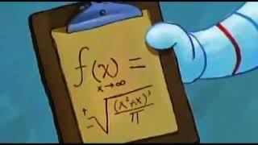
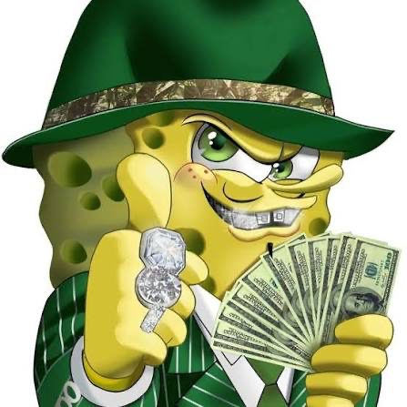
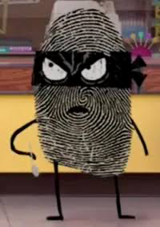

---
# =====================================================================
#  SusceptibilidadCiencia.qmd
#  ========================
#
#
#  Descripcion:
#  ------------
#  Presentacion por equipos de Matematicas para la Computacion sobre el
#  capitulo 9 de Calling Bullshit (Bergstrom y West, 2020), "The
#  Susceptibility of Science". Sigue el orden del capitulo y sus
#  ejemplos, con poco texto por diapositiva: incentivos de la ciencia,
#  valor p y falacia del fiscal, p-hacking y sesgo de publicacion, tasa
#  base e Ioannidis, la ciencia en los medios, revistas depredadoras y
#  por que la ciencia funciona de todos modos. Se compila con
#  "quarto render SusceptibilidadCiencia.qmd".
#
#  Las graficas de datos, entre los comentarios inicio:nombre y
#  fin:nombre, las escribe FigurasSusceptibilidad.py; no se editan a
#  mano.
#
#  Las notas del presentador son un guion corto: solo lo que se dice.
#
#  Plantilla propia sobre el tema simple de reveal.js: fondo hueso,
#  titulos en sans con una franja naranja, secciones en azul marino y
#  un subrayado de marcador que se dibuja. Paleta azul, naranja y aqua,
#  validada; el gris es contexto.
#
#
#  Metadata:
#  ----------
#   * Author: zxxz6 (Bryan Violante Arriaga)
#   * Version: 1.5.0
#
#
#  History:
#  ------------
#  Author      Date            Description
#  zxxz6       17/11/2026      Imagenes en la portada de la seccion 01,
#                              al pie de puros y contaminados, junto a
#                              la conclusion de la economia del
#                              reconocimiento y en el robo de arte
#  zxxz6       17/11/2026      Sin el modelo contra el de referencia, los
#                              titulares del Higgs, Scott Kelly ni las
#                              correcciones que no viajan
#  zxxz6       17/11/2026      Sin la diapositiva del argumento de
#                              Ioannidis
#  zxxz6       17/11/2026      Sin el control deslizante de Ioannidis
#  zxxz6       17/11/2026      Del p-hacking en adelante, mas breve y con
#                              los ejemplos del libro: analgesicos, Lyme
#                              y Helicobacter, Turner, Dumas-Mallet,
#                              Scott Kelly, McCool y Pauling
#  zxxz6       17/11/2026      Seccion del valor p con la estructura y
#                              los ejemplos del libro: la huella, las
#                              cartas de Carl, lo que dice y no dice el
#                              valor p, y los titulares que lo voltean
#  zxxz6       16/11/2026      Solo contenido del capitulo 9: fuera la
#                              maldicion del ganador, la potencia y
#                              los ejemplos y fuentes externos
#  zxxz6       16/11/2026      La falacia del fiscal en una diapositiva:
#                              que es y un ejemplo con tabla
#  zxxz6       16/11/2026      Diapositiva del mejor invento mas resumida
#  zxxz6       16/11/2026      Creation
#
#
# =====================================================================
title: "La susceptibilidad de la ciencia"
subtitle: "Calling Bullshit, capítulo 9. Carl T. Bergstrom y Jevin D. West, 2020"
author:
  - "Bryan Ezequiel Violante Arriaga"
  - "Arturo Zabdi Reyes Pérez"
lang: es
title-slide-attributes:
  data-background-color: "#1b2a41"
format:
  revealjs:
    theme: simple
    from: markdown-smart
    slide-number: c/t
    progress: false
    hash: true
    transition: slide
    footer: "Calling Bullshit, cap. 9: The Susceptibility of Science"
    html-math-method: katex
    embed-resources: true
    center: false
    width: 1280
    height: 720
    include-in-header:
      text: |
        <style>
        :root { --r-main-font-size: 32px;
          --r-main-font: Inter, "Segoe UI", "Helvetica Neue", Arial,
            sans-serif;
          --r-heading-font: Inter, "Segoe UI", "Helvetica Neue", Arial,
            sans-serif;
          --tinta: #1b2a41; --texto: #2b2b2b; --texto2: #52514e;
          --tenue: #8a8984; --azul: #2a78d6; --azul-cl: #e3eefb;
          --naranja: #eb6834; --nar-cl: #fde9df; --aqua: #1baf7a;
          --aqua-cl: #e0f5ec; --fondo: #fbfaf7; --linea: #e3e1da;
          --marcador: #ffe58a; }
        .reveal-viewport { background: var(--fondo); }
        .reveal { color: var(--texto); }
        .reveal .slides section { padding-bottom: 44px; }
        .reveal h2 { color: var(--tinta); font-size: 1.3em;
          font-weight: 800; letter-spacing: -0.5px; text-transform: none;
          margin-bottom: 22px; }
        .reveal h2::before { content: ""; display: inline-block;
          width: 12px; height: 0.78em; background: var(--naranja);
          border-radius: 2px; margin-right: 16px; vertical-align: -3px; }
        .reveal strong { color: var(--tinta); }
        .reveal .footer { font-size: 14px; color: var(--tenue); }
        .reveal .slide-number { font-size: 14px; color: var(--tenue);
          background: none; }
        #title-slide { text-align: left; }
        #title-slide .title { color: #fbfaf7; font-size: 2.3em;
          font-weight: 800; letter-spacing: -1px; margin-top: 120px; }
        #title-slide .title::after { content: ""; display: block;
          width: 120px; height: 8px; background: var(--naranja);
          margin-top: 22px; border-radius: 3px; }
        #title-slide .subtitle { color: #c9d1dc; font-size: 24px;
          font-style: italic; margin: 18px 0 40px; }
        #title-slide .quarto-title-author-name { color: #fbfaf7;
          font-size: 24px; }
        #title-slide .quarto-title-authors { flex-direction: column;
          align-items: flex-start; gap: 0; }
        #title-slide .quarto-title-author { padding-left: 0; }
        #title-slide .portada-inst { font-size: 20px; margin: 18px 0 0;
          color: #ffb08a; letter-spacing: 3px; }
        #title-slide .portada-liga { font-size: 19px; color: #c9d1dc; }
        .reveal .slides section.level1 { text-align: left; }
        .reveal .slides section.level1 h1 { color: #fbfaf7;
          font-size: 2.1em; font-weight: 800; margin-top: 150px;
          text-transform: none; letter-spacing: -1px; }
        .reveal .slides section.level1 h1 .num { display: block;
          font-size: 140px; line-height: 1; color: var(--naranja);
          margin-bottom: 6px; }
        .reveal .slides section.level1 .lema { font-size: 29px;
          color: #c9d1dc; font-style: italic; }
        .reveal mark, .reveal .mark { color: inherit; padding: 0 3px;
          background: linear-gradient(transparent 58%, var(--marcador) 58%); }
        .reveal mark.fragment { opacity: 1; visibility: inherit;
          background-size: 0% 100%; background-repeat: no-repeat;
          transition: background-size .7s ease-out; }
        .reveal mark.fragment.visible { background-size: 100% 100%; }
        .nota { font-size: 22px; color: var(--texto2); line-height: 1.4; }
        .chico { font-size: 22px; }
        .gris { color: var(--tenue); }
        .ficha { background: #fff; border: 1px solid var(--linea);
          border-left: 10px solid var(--tinta); border-radius: 6px;
          padding: 12px 22px; margin: 14px 0; font-size: 27px; }
        .ficha p { margin: 4px 0; }
        .ficha.f-azul { border-left-color: var(--azul); }
        .ficha.f-nar { border-left-color: var(--naranja); }
        .ficha.f-aqua { border-left-color: var(--aqua); }
        .dos { display: grid; grid-template-columns: 1fr 1fr; gap: 22px;
          margin-top: 10px; }
        .tres { display: grid; grid-template-columns: 1fr 1fr 1fr;
          gap: 18px; margin-top: 10px; }
        .cuatro { display: grid; grid-template-columns: 1fr 1fr;
          gap: 16px 22px; margin-top: 6px; }
        .dos > div, .tres > div, .cuatro > div { background: #fff;
          border: 1px solid var(--linea); border-radius: 6px;
          padding: 14px 20px; font-size: 25px; line-height: 1.4; }
        .dos > div > b:first-child, .tres > div > b:first-child,
        .cuatro > div > b:first-child { display: block; font-size: 27px;
          color: var(--tinta); margin-bottom: 6px; }
        .t-azul { border-top: 6px solid var(--azul) !important; }
        .t-nar { border-top: 6px solid var(--naranja) !important; }
        .t-aqua { border-top: 6px solid var(--aqua) !important; }
        .t-tinta { border-top: 6px solid var(--tinta) !important; }
        .carta-foto { display: flex; flex-direction: column; }
        .carta-foto > span { flex: 1; }
        .carta-foto .foto { display: block; height: 200px; width: auto;
          margin: 12px auto 0; border-radius: 6px; }
        .con-foto { display: grid; grid-template-columns: 1fr auto;
          gap: 24px; align-items: center; }
        .con-foto .foto-lado { display: block; height: 200px;
          width: auto; border-radius: 6px; }
        .cifras { display: flex; margin-top: 18px;
          border-top: 1px solid var(--linea);
          border-bottom: 1px solid var(--linea); }
        .cifras > div { flex: 1; padding: 14px 22px;
          border-right: 1px solid var(--linea); }
        .cifras > div:last-child { border-right: none; }
        .cifras b { display: block; font-size: 60px; line-height: 1.05;
          color: var(--tinta); font-weight: 800; }
        .cifras span { font-size: 21px; color: var(--texto2); }
        .etq { display: inline-block; font-size: 14px; letter-spacing: 2px;
          text-transform: uppercase; color: var(--tenue);
          margin-bottom: 4px; }
        .lado { display: grid; grid-template-columns: 650px 1fr;
          gap: 34px; align-items: start; }
        .lado .paso { font-size: 26px; line-height: 1.4; margin: 0 0 16px;
          padding-left: 16px; border-left: 4px solid var(--linea); }
        .lado .paso.azul { border-left-color: var(--azul); }
        .lado .paso.nar { border-left-color: var(--naranja); }
        .lado .paso.tinta { border-left-color: var(--tinta); }
        .lado .paso p { margin: 0; }
        .opciones { display: grid; grid-template-columns: 1fr 1fr;
          gap: 14px 20px; margin-top: 14px; }
        .opciones > div { position: relative; background: #fff;
          border: 1px solid var(--linea); border-radius: 6px;
          padding: 14px 20px 14px 66px; font-size: 25px;
          line-height: 1.35; }
        .opciones > div > i { position: absolute; left: 18px; top: 13px;
          font-style: normal; font-weight: 800; font-size: 24px;
          color: var(--tinta); }
        .veredicto { display: inline-block; margin-top: 8px;
          font-size: 15px; font-weight: 800; letter-spacing: 1.5px;
          text-transform: uppercase; padding: 2px 10px;
          border-radius: 3px; }
        .veredicto.no { background: var(--nar-cl); color: #a53c12; }
        .veredicto.si { background: var(--azul-cl); color: #1c5cab; }
        .cadena { display: grid; grid-template-columns: repeat(4, 1fr);
          gap: 16px; margin-top: 10px; }
        .cadena > div { background: #fff; border: 1px solid var(--linea);
          border-radius: 6px; padding: 12px 16px; font-size: 23px;
          line-height: 1.38; position: relative; }
        .cadena > div .etq { display: block; }
        .cadena del { color: var(--tenue);
          text-decoration-color: var(--naranja);
          text-decoration-thickness: 3px; }
        .cadena .perdio { display: block; margin-top: 10px;
          font-size: 18px; color: #a53c12; background: var(--nar-cl);
          border-radius: 3px; padding: 4px 8px; }
        .correo { background: #fff; border: 1px solid var(--linea);
          border-radius: 6px; font-size: 21px; line-height: 1.4;
          padding: 12px 18px; font-family: Georgia, serif;
          color: var(--texto2); }
        .correo .enc { font-family: Inter, Arial, sans-serif;
          font-size: 15px; color: var(--tenue);
          border-bottom: 1px solid var(--linea); padding-bottom: 6px;
          margin-bottom: 8px; }
        .reveal ol.lista-chk { list-style: none; display: block;
          margin: 8px 0 0 !important; padding: 0; counter-reset: q; }
        .reveal ol.lista-chk li { counter-increment: q;
          position: relative; display: block;
          padding: 10px 0 10px 66px; font-size: 30px;
          border-bottom: 1px solid var(--linea); margin: 0 !important; }
        .reveal ol.lista-chk li::before { content: counter(q);
          position: absolute; left: 6px; top: 10px; width: 38px; height: 38px;
          border-radius: 50%; background: var(--tinta); color: #fff;
          font-weight: 800; font-size: 20px; text-align: center;
          line-height: 38px; }
        .cita { font-size: 46px; font-weight: 800; color: var(--tinta);
          line-height: 1.2; letter-spacing: -0.5px; margin: 30px 0 8px; }
        .cita-autor { font-size: 20px; color: var(--tenue);
          margin-bottom: 26px; }
        table.tabla-fiscal { border-collapse: collapse; font-size: 27px;
          margin: 10px 0 6px; width: auto !important; }
        table.tabla-fiscal th { font-weight: 700; color: var(--tinta);
          border-bottom: 2px solid var(--tinta); padding: 6px 30px;
          text-align: center; }
        table.tabla-fiscal td { padding: 8px 30px; text-align: center;
          border-bottom: 1px solid var(--linea); }
        table.tabla-fiscal td:first-child { text-align: left;
          color: var(--texto2); }
        table.tabla-fiscal td.col { background: var(--azul-cl);
          font-weight: 800; color: var(--tinta); }
        table.tabla-fiscal td.col.nar { background: var(--nar-cl); }
        .refs li { font-size: 20px; margin-bottom: 7px; }
        .reveal ul { margin-left: 1em; }
        .reveal li { margin-bottom: 6px; }
        .dibuja { stroke-dasharray: 1; stroke-dashoffset: 1; }
        .reveal section.present .dibuja {
          animation: dibuja 1.8s ease-out .3s forwards; }
        @keyframes dibuja { to { stroke-dashoffset: 0; } }
        html.print-pdf .dibuja { stroke-dashoffset: 0; }
        </style>
    include-after-body:
      text: |
        <script>
        (function () {
          var t = document.getElementById("title-slide");
          if (t) {
            var a = t.querySelector(".quarto-title-authors");
            var i = document.createElement("p");
            i.className = "portada-inst";
            i.textContent = "INAOE";
            if (a) a.insertAdjacentElement("afterend", i);
            var l = document.createElement("p");
            l.className = "portada-liga";
            l.textContent = "Matemáticas para la Computación, Otoño 2026";
            t.appendChild(l);
          }
        })();
        </script>
---


# [01]{.num}La 100cia {background-color="#1b2a41"}

{.absolute right=40 top=170 width="520"
style="border-radius:8px;"}

## Que es?

La ciencia nos lleva **más allá de nuestras escalas**: de lo que dura un
parpadeo y mide un grano de arena, a todo el universo.

::: {.incremental}
- Pero es una **institución humana**, normas y costumbres armadas a
  prueba y error.
- Su ventaja: **se autocorrige**. Todo se puede cuestionar.
:::

::: {.fragment .fade-up}
::: {.ficha .f-nar}
Entonces, **¿cómo se le cuela el bullshit a la ciencia?**
:::
:::

::: {.notes}
- La ciencia supera los límites de nuestros sentidos y de nuestra
  intuición.
- Pero es una institución humana, hecha a prueba y error.
- Su ventaja: se corrige sola, todo se puede cuestionar.
- Pregunta del capítulo: cómo entra el bullshit a la ciencia.
:::

## Puros y contaminados

```{=html}
<div class="dos">
<div class="t-azul carta-foto"><b>Epistémicamente puro</b><span>Un
científico ideal que solo busca entender el mundo. Sin interés por el
dinero, la fama ni el poder.<br><span class="gris"
style="font-size:18px;">El que pedía Francis Bacon.</span></span></div>
<div class="t-nar fragment fade-up carta-foto"><b>Epistémicamente
contaminado</b><span>Curiosos, sí, pero también quieren una plaza,
financiamiento, prestigio y que sus colegas los admiren.</span></div>
</div>
```

::: {.fragment .fade-up}
Los términos son del filósofo **Philip Kitcher**. "Contaminado" no
quiere decir deshonesto: quiere decir que **tiene incentivos**, como
cualquier persona.
:::


::: {.notes}
- Kitcher distingue puro y contaminado.
- Puro: solo quiere entender. No existe.
- Contaminado: todos. Curiosidad más dinero y prestigio. No es
  deshonestidad, son incentivos.
:::

## La economía del reconocimiento

```{=html}
<svg viewBox="0 0 1180 300" width="1180" height="300"
  style="display:block;margin:0 auto;"
  font-family="Inter, Segoe UI, Helvetica Neue, Arial, sans-serif">
<defs><marker id="flecha-ciclo" viewBox="0 0 10 10" refX="9" refY="5"
  markerWidth="8" markerHeight="8" orient="auto-start-reverse">
  <path d="M0,0 L10,5 L0,10 z" fill="#8a8984"/></marker></defs>
<g>
<rect x="10" y="40" width="190" height="86" rx="8" fill="#fff"
  stroke="#e3e1da"/><rect x="10" y="40" width="190" height="7" rx="3"
  fill="#2a78d6"/>
<text x="105" y="84" font-size="21" font-weight="700" fill="#1b2a41"
  text-anchor="middle">Investigar</text>
<text x="105" y="108" font-size="15" fill="#52514e"
  text-anchor="middle">experimentos, datos</text>
</g>
<g class="fragment" data-fragment-index="1">
<line x1="204" y1="83" x2="236" y2="83" stroke="#8a8984" stroke-width="2"
  marker-end="url(#flecha-ciclo)"/>
<rect x="240" y="40" width="190" height="86" rx="8" fill="#fff"
  stroke="#e3e1da"/><rect x="240" y="40" width="190" height="7" rx="3"
  fill="#2a78d6"/>
<text x="335" y="84" font-size="21" font-weight="700" fill="#1b2a41"
  text-anchor="middle">Artículo</text>
<text x="335" y="108" font-size="15" fill="#52514e"
  text-anchor="middle">novedoso y reproducible</text>
</g>
<g class="fragment" data-fragment-index="2">
<line x1="434" y1="83" x2="466" y2="83" stroke="#8a8984" stroke-width="2"
  marker-end="url(#flecha-ciclo)"/>
<rect x="470" y="40" width="190" height="86" rx="8" fill="#fff"
  stroke="#e3e1da"/><rect x="470" y="40" width="190" height="7" rx="3"
  fill="#2a78d6"/>
<text x="565" y="84" font-size="21" font-weight="700" fill="#1b2a41"
  text-anchor="middle">Revisión por pares</text>
<text x="565" y="108" font-size="15" fill="#52514e"
  text-anchor="middle">otros expertos opinan</text>
</g>
<g class="fragment" data-fragment-index="3">
<line x1="664" y1="83" x2="696" y2="83" stroke="#8a8984" stroke-width="2"
  marker-end="url(#flecha-ciclo)"/>
<rect x="700" y="40" width="190" height="86" rx="8" fill="#fff"
  stroke="#e3e1da"/><rect x="700" y="40" width="190" height="7" rx="3"
  fill="#eb6834"/>
<text x="795" y="84" font-size="21" font-weight="700" fill="#1b2a41"
  text-anchor="middle">Revista</text>
<text x="795" y="108" font-size="15" fill="#52514e"
  text-anchor="middle">más o menos prestigio</text>
</g>
<g class="fragment" data-fragment-index="4">
<line x1="894" y1="83" x2="926" y2="83" stroke="#8a8984" stroke-width="2"
  marker-end="url(#flecha-ciclo)"/>
<rect x="930" y="40" width="230" height="86" rx="8" fill="#fff"
  stroke="#e3e1da"/><rect x="930" y="40" width="230" height="7" rx="3"
  fill="#eb6834"/>
<text x="1045" y="84" font-size="21" font-weight="700" fill="#1b2a41"
  text-anchor="middle">Reputación</text>
<text x="1045" y="108" font-size="15" fill="#52514e"
  text-anchor="middle">plazas, becas, invitaciones</text>
</g>
<g class="fragment" data-fragment-index="5">
<path d="M1045,132 C1045,230 105,230 105,136" fill="none"
  stroke="#8a8984" stroke-width="2" marker-end="url(#flecha-ciclo)"/>
<text x="575" y="250" font-size="17" fill="#52514e"
  text-anchor="middle">más financiamiento para investigar</text>
</g>
</svg>
```

::: {.fragment .fade-up fragment-index=6}
:::: {.con-foto}
::: {.ficha .f-azul}
Premiar el **prestigio** en vez de la producción es un buen truco:
todos publican lo que encuentran y nadie repite trabajo. Pero cada
incentivo **abre una puerta**: lo que se premia no es la verdad, es
**publicar**.
:::
```{=html}

```
::::
:::

::: {.notes}
- El ciclo: investigas, escribes, te revisan, publicas en una revista
  con cierto prestigio, ganas reputación, consigues dinero, investigas.
- Un buen artículo: novedoso, relevante, completo para que otro lo
  reproduzca, y correcto.
- Lo bueno: se comparte todo y no se duplica trabajo.
- Lo malo: el incentivo es publicar, no acertar.
:::

## Autocorreccion (replicar)

Si otros laboratorios no logran reproducir un resultado, el resultado
se cae. Hasta las ideas más asentadas se cambian si la evidencia lo
pide.


::: {.notes}
- La ciencia se corrige replicando: si nadie reproduce tu resultado,
  se cae.
- Hasta las ideas más asentadas se revisan si la evidencia lo pide.
:::

# [02]{.num}p value{background-color="#1b2a41"}


## ¿Patrón o ruido?

Casi todos los estudios buscan **patrones** en los datos. Pero los
datos traen ruido: ¿cómo distinguimos un patrón real de uno que salió
**por azar**?

::: {.fragment .fade-up}
::: {.ficha .f-azul}
**Valor p**, dicho a la ligera: qué tan probable es ver un patrón así
**solo por azar**. Si es muy improbable, el resultado se llama
**estadísticamente significativo**.
:::
:::

::: {.fragment .fade-up}
¿Qué quiere decir eso exactamente, y qué **no** quiere decir? El libro
lo explica con un juicio.
:::

::: {.notes}
- Los estudios buscan patrones, pero los datos traen ruido.
- La herramienta más común para separarlos es el valor p.
- A grandes rasgos: qué tan probable es el patrón solo por azar. Si es
  muy improbable, se dice significativo.
- Para ver qué significa de verdad, el libro cuenta un juicio.
:::

## Ejemplo: El robo

:::: {.columns}
::: {.column width="56%"}
::: {.incremental}
- Una coleccionista manda **30 cuadros** en tren a Nueva York. Al
  llegar, faltan **los 4 más valiosos**.
- La única pista: **una huella** en uno de los marcos.
- La policía la busca en la base de huellas del FBI y aparece un
  **biólogo** que dice haber pasado esas semanas siguiendo aves en la
  sierra. No tiene coartada.
:::
:::
::: {.column width="44%"}
```{=html}

```
::: {.fragment .fade-up}
::: {.ficha .f-nar}
**La fiscal:** "Que dos huellas distintas coincidan así pasa **una vez
en diez millones**. Eso está más allá de toda duda razonable."
:::
:::
:::
::::

::: {.notes}
- Una coleccionista manda 30 cuadros en tren; al llegar faltan los 4
  más valiosos.
- Única pista: una huella. La buscan en la base del FBI y sale un
  biólogo sin coartada.
- La fiscal dice que una coincidencia así por accidente pasa una vez
  en diez millones.
- Suena a culpable seguro. Veamos qué responde el defensor.
:::

## Prosecutor´s Fallacy

:::: {.lado style="grid-template-columns: 560px 1fr; gap: 26px;"}
::: {.figura}
```{=html}
<svg viewBox="0 0 560 320" width="560" height="320"
  font-family="Inter, Segoe UI, Helvetica Neue, Arial, sans-serif">
<text x="285" y="44" font-size="19" font-weight="700" fill="#1b2a41"
  text-anchor="middle">Coincide</text>
<text x="455" y="44" font-size="19" font-weight="700" fill="#1b2a41"
  text-anchor="middle">No coincide</text>
<text x="180" y="117" font-size="19" fill="#52514e"
  text-anchor="end">Culpable</text>
<text x="180" y="217" font-size="19" fill="#52514e"
  text-anchor="end">Inocente</text>
<rect x="200" y="60" width="340" height="200" fill="#fff"
  stroke="#e3e1da"/>
<line x1="370" y1="60" x2="370" y2="260" stroke="#e3e1da"/>
<line x1="200" y1="160" x2="540" y2="160" stroke="#e3e1da"/>
<text x="285" y="121" font-size="30" font-weight="800" fill="#1b2a41"
  text-anchor="middle">1</text>
<text x="455" y="121" font-size="30" font-weight="800" fill="#1b2a41"
  text-anchor="middle">0</text>
<g class="fragment" data-fragment-index="1">
<text x="455" y="220" font-size="26" font-weight="800" fill="#1b2a41"
  text-anchor="middle">50 000 000</text>
</g>
<g class="fragment" data-fragment-index="2">
<text x="285" y="221" font-size="30" font-weight="800" fill="#1b2a41"
  text-anchor="middle">5</text>
</g>
<g class="fragment" data-fragment-index="3">
<ellipse cx="372" cy="210" rx="180" ry="40" fill="none"
  stroke="#eb6834" stroke-width="3"/>
<text x="470" y="300" font-size="17" font-weight="700" fill="#eb6834"
  text-anchor="middle">renglón de la fiscal</text>
</g>
<g class="fragment" data-fragment-index="4">
<ellipse cx="285" cy="160" rx="66" ry="110" fill="#2a78d6"
  fill-opacity="0.12" stroke="#2a78d6" stroke-width="3"/>
<text x="270" y="300" font-size="17" font-weight="700" fill="#2a78d6"
  text-anchor="middle">columna del jurado</text>
</g>
</svg>
```
:::
::: {.texto}
::: {.paso .fragment fragment-index=1}
La base tiene unos **50 millones** de personas; casi todas son
inocentes que no coinciden.
:::
::: {.paso .fragment fragment-index=2}
Con un error de 1 en 10 millones, coinciden unos **5 inocentes**.
:::
::: {.paso .nar .fragment fragment-index=3}
**La fiscal** lee el renglón:\
$P(\text{coincide} \mid \text{inocente})$ = 1 en 10 millones.
:::
::: {.paso .azul .fragment fragment-index=4}
**El jurado** necesita la columna:\
$P(\text{inocente} \mid \text{coincide}) = 5/6$.
:::
:::
::::

::: {.fragment .fade-up fragment-index=5}
::: {.ficha .f-nar}
**Falacia del fiscal:** confundir qué tan rara sería la evidencia **si
fuera inocente** con qué tan probable es que sea inocente **dada la
evidencia**.
:::
:::

::: {.notes}
- El defensor arma una tabla: culpable o inocente, coincide o no.
- El culpable está en la base y coincide: un uno arriba a la
  izquierda.
- En la base hay unos 50 millones de inocentes.
- Con un error de uno en diez millones, coinciden unos 5 inocentes.
- La fiscal compara en el renglón de los inocentes: 5 de 50 millones.
- Pero ya sabemos que hay coincidencia, así que importa la columna: 1
  culpable y 5 inocentes. Cinco de seis de que sea inocente.
- Confundir las dos es la falacia del fiscal.
:::

## Ejemplos: Telekinesis

Unos morrillos intentan **adivinar el
palo** de 52 cartas sin verlas. Al azar se acierta una de cada cuatro:
**13**. Él acertó **19**.

::: {.dos style="margin-top:4px;font-size:24px;"}
<div style="padding:8px 18px;">
**H~0~ (nula):** adivina al azar; cada carta, 1 de 4.
</div>
<div style="padding:8px 18px;">
**H~1~ (alternativa):** acierta más de lo que da el azar.
</div>
:::

<!-- inicio:cartas -->
```{=html}
<svg viewBox="0 0 1180 290" width="1180" height="290" style="display:block;margin:0 auto;" font-family="Inter, Segoe UI, Helvetica Neue, Arial, sans-serif">
<line x1="80.0" y1="175.7" x2="1140.0" y2="175.7" stroke="#e3e1da" stroke-width="1"/>
<text x="70.0" y="180.7" font-size="17" fill="#52514e" text-anchor="end">0.04</text>
<line x1="80.0" y1="121.4" x2="1140.0" y2="121.4" stroke="#e3e1da" stroke-width="1"/>
<text x="70.0" y="126.4" font-size="17" fill="#52514e" text-anchor="end">0.08</text>
<line x1="80.0" y1="67.1" x2="1140.0" y2="67.1" stroke="#e3e1da" stroke-width="1"/>
<text x="70.0" y="72.1" font-size="17" fill="#52514e" text-anchor="end">0.12</text>
<line x1="80.0" y1="230.0" x2="1140.0" y2="230.0" stroke="#8a8984" stroke-width="1"/>

<text x="97.1" y="252.0" font-size="17" fill="#52514e" text-anchor="middle">0</text>

<text x="131.3" y="252.0" font-size="17" fill="#52514e" text-anchor="middle">1</text>

<text x="165.5" y="252.0" font-size="17" fill="#52514e" text-anchor="middle">2</text>

<text x="199.7" y="252.0" font-size="17" fill="#52514e" text-anchor="middle">3</text>
<path d="M221.9,230.0 V229.3 a0.7,0.7 0 0 1 0.7,-0.7 H245.1 a0.7,0.7 0 0 1 0.7,0.7 V230.0 Z" fill="#b9b7af"><title>4 aciertos: 0.0011</title></path>
<text x="233.9" y="252.0" font-size="17" fill="#52514e" text-anchor="middle">4</text>
<path d="M256.1,230.0 V227.7 a2.3,2.3 0 0 1 2.3,-2.3 H277.8 a2.3,2.3 0 0 1 2.3,2.3 V230.0 Z" fill="#b9b7af"><title>5 aciertos: 0.0034</title></path>
<text x="268.1" y="252.0" font-size="17" fill="#52514e" text-anchor="middle">5</text>
<path d="M290.3,230.0 V221.9 a4.0,4.0 0 0 1 4.0,-4.0 H310.3 a4.0,4.0 0 0 1 4.0,4.0 V230.0 Z" fill="#b9b7af"><title>6 aciertos: 0.0089</title></path>
<text x="302.3" y="252.0" font-size="17" fill="#52514e" text-anchor="middle">6</text>
<path d="M324.5,230.0 V207.6 a4.0,4.0 0 0 1 4.0,-4.0 H344.5 a4.0,4.0 0 0 1 4.0,4.0 V230.0 Z" fill="#b9b7af"><title>7 aciertos: 0.0195</title></path>
<text x="336.5" y="252.0" font-size="17" fill="#52514e" text-anchor="middle">7</text>
<path d="M358.6,230.0 V184.4 a4.0,4.0 0 0 1 4.0,-4.0 H378.6 a4.0,4.0 0 0 1 4.0,4.0 V230.0 Z" fill="#b9b7af"><title>8 aciertos: 0.0365</title></path>
<text x="370.6" y="252.0" font-size="17" fill="#52514e" text-anchor="middle">8</text>
<path d="M392.8,230.0 V153.2 a4.0,4.0 0 0 1 4.0,-4.0 H412.8 a4.0,4.0 0 0 1 4.0,4.0 V230.0 Z" fill="#b9b7af"><title>9 aciertos: 0.0595</title></path>
<text x="404.8" y="252.0" font-size="17" fill="#52514e" text-anchor="middle">9</text>
<path d="M427.0,230.0 V118.2 a4.0,4.0 0 0 1 4.0,-4.0 H447.0 a4.0,4.0 0 0 1 4.0,4.0 V230.0 Z" fill="#b9b7af"><title>10 aciertos: 0.0853</title></path>
<text x="439.0" y="252.0" font-size="17" fill="#52514e" text-anchor="middle">10</text>
<path d="M461.2,230.0 V86.6 a4.0,4.0 0 0 1 4.0,-4.0 H481.2 a4.0,4.0 0 0 1 4.0,4.0 V230.0 Z" fill="#b9b7af"><title>11 aciertos: 0.1086</title></path>
<text x="473.2" y="252.0" font-size="17" fill="#52514e" text-anchor="middle">11</text>
<path d="M495.4,230.0 V66.1 a4.0,4.0 0 0 1 4.0,-4.0 H515.4 a4.0,4.0 0 0 1 4.0,4.0 V230.0 Z" fill="#b9b7af"><title>12 aciertos: 0.1237</title></path>
<text x="507.4" y="252.0" font-size="17" fill="#52514e" text-anchor="middle">12</text>
<path d="M529.6,230.0 V61.8 a4.0,4.0 0 0 1 4.0,-4.0 H549.6 a4.0,4.0 0 0 1 4.0,4.0 V230.0 Z" fill="#b9b7af"><title>13 aciertos: 0.1269</title></path>
<text x="541.6" y="252.0" font-size="17" fill="#52514e" text-anchor="middle">13</text>
<path d="M563.8,230.0 V74.1 a4.0,4.0 0 0 1 4.0,-4.0 H583.8 a4.0,4.0 0 0 1 4.0,4.0 V230.0 Z" fill="#b9b7af"><title>14 aciertos: 0.1178</title></path>
<text x="575.8" y="252.0" font-size="17" fill="#52514e" text-anchor="middle">14</text>
<path d="M598.0,230.0 V99.0 a4.0,4.0 0 0 1 4.0,-4.0 H618.0 a4.0,4.0 0 0 1 4.0,4.0 V230.0 Z" fill="#b9b7af"><title>15 aciertos: 0.0995</title></path>
<text x="610.0" y="252.0" font-size="17" fill="#52514e" text-anchor="middle">15</text>
<path d="M632.2,230.0 V129.9 a4.0,4.0 0 0 1 4.0,-4.0 H652.2 a4.0,4.0 0 0 1 4.0,4.0 V230.0 Z" fill="#b9b7af"><title>16 aciertos: 0.0767</title></path>
<text x="644.2" y="252.0" font-size="17" fill="#52514e" text-anchor="middle">16</text>
<path d="M666.4,230.0 V160.5 a4.0,4.0 0 0 1 4.0,-4.0 H686.4 a4.0,4.0 0 0 1 4.0,4.0 V230.0 Z" fill="#b9b7af"><title>17 aciertos: 0.0541</title></path>
<text x="678.4" y="252.0" font-size="17" fill="#52514e" text-anchor="middle">17</text>
<path d="M700.6,230.0 V186.4 a4.0,4.0 0 0 1 4.0,-4.0 H720.6 a4.0,4.0 0 0 1 4.0,4.0 V230.0 Z" fill="#b9b7af"><title>18 aciertos: 0.0351</title></path>
<text x="712.6" y="252.0" font-size="17" fill="#52514e" text-anchor="middle">18</text>
<path d="M734.8,230.0 V205.6 a4.0,4.0 0 0 1 4.0,-4.0 H754.8 a4.0,4.0 0 0 1 4.0,4.0 V230.0 Z" fill="#b9b7af"><title>19 aciertos: 0.0209</title></path>
<path d="M734.8,230.0 V205.6 a4.0,4.0 0 0 1 4.0,-4.0 H754.8 a4.0,4.0 0 0 1 4.0,4.0 V230.0 Z" fill="#eb6834" class="fragment" data-fragment-index="1"><title>19 aciertos: 0.0209</title></path>
<text x="746.8" y="252.0" font-size="17" fill="#52514e" text-anchor="middle">19</text>
<path d="M769.0,230.0 V218.4 a4.0,4.0 0 0 1 4.0,-4.0 H789.0 a4.0,4.0 0 0 1 4.0,4.0 V230.0 Z" fill="#b9b7af"><title>20 aciertos: 0.0115</title></path>
<path d="M769.0,230.0 V218.4 a4.0,4.0 0 0 1 4.0,-4.0 H789.0 a4.0,4.0 0 0 1 4.0,4.0 V230.0 Z" fill="#eb6834" class="fragment" data-fragment-index="1"><title>20 aciertos: 0.0115</title></path>
<text x="781.0" y="252.0" font-size="17" fill="#52514e" text-anchor="middle">20</text>
<path d="M803.2,230.0 V226.0 a4.0,4.0 0 0 1 4.0,-4.0 H823.2 a4.0,4.0 0 0 1 4.0,4.0 V230.0 Z" fill="#b9b7af"><title>21 aciertos: 0.0058</title></path>
<path d="M803.2,230.0 V226.0 a4.0,4.0 0 0 1 4.0,-4.0 H823.2 a4.0,4.0 0 0 1 4.0,4.0 V230.0 Z" fill="#eb6834" class="fragment" data-fragment-index="1"><title>21 aciertos: 0.0058</title></path>
<text x="815.2" y="252.0" font-size="17" fill="#52514e" text-anchor="middle">21</text>
<path d="M837.4,230.0 V228.1 a1.9,1.9 0 0 1 1.9,-1.9 H859.5 a1.9,1.9 0 0 1 1.9,1.9 V230.0 Z" fill="#b9b7af"><title>22 aciertos: 0.0027</title></path>
<path d="M837.4,230.0 V228.1 a1.9,1.9 0 0 1 1.9,-1.9 H859.5 a1.9,1.9 0 0 1 1.9,1.9 V230.0 Z" fill="#eb6834" class="fragment" data-fragment-index="1"><title>22 aciertos: 0.0027</title></path>
<text x="849.4" y="252.0" font-size="17" fill="#52514e" text-anchor="middle">22</text>
<path d="M871.5,230.0 V229.2 a0.8,0.8 0 0 1 0.8,-0.8 H894.7 a0.8,0.8 0 0 1 0.8,0.8 V230.0 Z" fill="#b9b7af"><title>23 aciertos: 0.0012</title></path>
<path d="M871.5,230.0 V229.2 a0.8,0.8 0 0 1 0.8,-0.8 H894.7 a0.8,0.8 0 0 1 0.8,0.8 V230.0 Z" fill="#eb6834" class="fragment" data-fragment-index="1"><title>23 aciertos: 0.0012</title></path>
<text x="883.5" y="252.0" font-size="17" fill="#52514e" text-anchor="middle">23</text>
<path d="M905.7,230.0 V229.7 a0.3,0.3 0 0 1 0.3,-0.3 H929.4 a0.3,0.3 0 0 1 0.3,0.3 V230.0 Z" fill="#b9b7af"><title>24 aciertos: 0.0005</title></path>
<path d="M905.7,230.0 V229.7 a0.3,0.3 0 0 1 0.3,-0.3 H929.4 a0.3,0.3 0 0 1 0.3,0.3 V230.0 Z" fill="#eb6834" class="fragment" data-fragment-index="1"><title>24 aciertos: 0.0005</title></path>
<text x="917.7" y="252.0" font-size="17" fill="#52514e" text-anchor="middle">24</text>


<text x="951.9" y="252.0" font-size="17" fill="#52514e" text-anchor="middle">25</text>


<text x="986.1" y="252.0" font-size="17" fill="#52514e" text-anchor="middle">26</text>


<text x="1020.3" y="252.0" font-size="17" fill="#52514e" text-anchor="middle">27</text>


<text x="1054.5" y="252.0" font-size="17" fill="#52514e" text-anchor="middle">28</text>


<text x="1088.7" y="252.0" font-size="17" fill="#52514e" text-anchor="middle">29</text>


<text x="1122.9" y="252.0" font-size="17" fill="#52514e" text-anchor="middle">30</text>
<text x="610.0" y="280.0" font-size="18" fill="#52514e" text-anchor="middle">aciertos de Carl en 52 cartas, si H<tspan baseline-shift='sub' font-size='11'>0</tspan> es cierta</text>
<text x="20.0" y="26.0" font-size="17" fill="#52514e" text-anchor="start">probabilidad</text>
<g class="fragment" data-fragment-index="1">
<line x1="729.7" y1="50.0" x2="1134.0" y2="50.0" stroke="#1b2a41" stroke-width="1.5"/>
<line x1="729.7" y1="44.0" x2="729.7" y2="56.0" stroke="#1b2a41" stroke-width="1.5"/>
<text x="934.8" y="42.0" font-size="19" fill="#1b2a41" text-anchor="middle" font-weight="700">P(X &#8805; 19 | H<tspan baseline-shift='sub' font-size='12'>0</tspan>) = 0.043</text>
</g>
</svg>
```
<!-- fin:cartas -->

::: {.fragment .fade-up fragment-index=2}
Al azar, el **95.7&#8201;%** de las veces acertaría menos de 19. Eso
**no** quiere decir que estemos 95.7&#8201;% seguros de que H~0~ es
falsa.
:::

::: {.notes}
- Carl, de niño, quiso ver si podía adivinar el palo de las cartas.
- Al azar se esperan 13 de 52. Acertó 19. ¿Es mucho?
- Nula: adivina al azar. Alternativa: le atina más que el azar.
- La gráfica dice cuántos aciertos salen solo por azar. 19 o más pasa
  4.3 % de las veces: ese es el valor p, 0.043.
- Cuidado: 95.7 % no es qué tan seguros estamos de que tiene poderes.
:::

## Lo que queremos VS lo que nos dan

```{=html}
<svg viewBox="0 0 1180 320" width="1180" height="320"
  style="display:block;margin:0 auto;"
  font-family="Inter, Segoe UI, Helvetica Neue, Arial, sans-serif">
<text x="310" y="34" font-size="22" font-weight="800" fill="#1b2a41"
  text-anchor="middle">La huella</text>
<text x="230" y="74" font-size="18" font-weight="700" fill="#1b2a41"
  text-anchor="middle">Coincide</text>
<text x="390" y="74" font-size="18" font-weight="700" fill="#1b2a41"
  text-anchor="middle">No coincide</text>
<text x="138" y="136" font-size="18" fill="#52514e"
  text-anchor="end">Culpable</text>
<text x="138" y="216" font-size="18" fill="#52514e"
  text-anchor="end">Inocente</text>
<rect x="150" y="90" width="320" height="160" fill="#fff"
  stroke="#e3e1da"/>
<line x1="310" y1="90" x2="310" y2="250" stroke="#e3e1da"/>
<line x1="150" y1="170" x2="470" y2="170" stroke="#e3e1da"/>
<text x="980" y="34" font-size="22" font-weight="800" fill="#1b2a41"
  text-anchor="middle">Las cartas</text>
<text x="900" y="74" font-size="18" font-weight="700" fill="#1b2a41"
  text-anchor="middle">Acierta &#8805; 19</text>
<text x="1060" y="74" font-size="18" font-weight="700" fill="#1b2a41"
  text-anchor="middle">Acierta &lt; 19</text>
<text x="808" y="136" font-size="18" fill="#52514e"
  text-anchor="end">H<tspan baseline-shift="sub"
  font-size="13">1</tspan>: hay telepatía</text>
<text x="808" y="216" font-size="18" fill="#52514e"
  text-anchor="end">H<tspan baseline-shift="sub"
  font-size="13">0</tspan>: no hay</text>
<rect x="820" y="90" width="320" height="160" fill="#fff"
  stroke="#e3e1da"/>
<line x1="980" y1="90" x2="980" y2="250" stroke="#e3e1da"/>
<line x1="820" y1="170" x2="1140" y2="170" stroke="#e3e1da"/>
<g class="fragment" data-fragment-index="1">
<ellipse cx="310" cy="210" rx="164" ry="34" fill="none"
  stroke="#eb6834" stroke-width="3"/>
<ellipse cx="980" cy="210" rx="164" ry="34" fill="none"
  stroke="#eb6834" stroke-width="3"/>
<rect x="150" y="286" width="16" height="16" rx="3" fill="#eb6834"/>
<text x="176" y="300" font-size="19" fill="#52514e">lo que da el valor
  p: P(datos | H<tspan baseline-shift="sub"
  font-size="13">0</tspan>), el renglón</text>
</g>
<g class="fragment" data-fragment-index="2">
<ellipse cx="230" cy="170" rx="62" ry="90" fill="#2a78d6"
  fill-opacity="0.12" stroke="#2a78d6" stroke-width="3"/>
<ellipse cx="900" cy="170" rx="62" ry="90" fill="#2a78d6"
  fill-opacity="0.12" stroke="#2a78d6" stroke-width="3"/>
<rect x="680" y="286" width="16" height="16" rx="3" fill="#2a78d6"/>
<text x="706" y="300" font-size="19" fill="#52514e">lo que queremos:
  P(H<tspan baseline-shift="sub" font-size="13">0</tspan> | datos), la
  columna</text>
</g>
</svg>
```

::: {.fragment .fade-up fragment-index=3}
::: {.ficha .f-nar}
El valor p es $P(\text{datos al menos tan extremos} \mid H_0)$: qué tan
**raros** serían los datos si solo hubiera azar. Lo que queremos es
$P(H_0 \mid \text{datos})$. **No son lo mismo.**
:::
:::

::: {.fragment .fade-up fragment-index=4}
[Los científicos no engañan como la fiscal: reportan el valor p porque
la probabilidad de la hipótesis casi nunca se puede calcular.]{.nota}
:::

::: {.notes}
- El valor p es la versión científica del número de la fiscal.
- Misma tabla con las cartas: arriba, hay telepatía; abajo, no hay.
- El valor p lee el renglón de abajo: sin telepatía, qué tan seguido se
  aciertan 19 o más. 4.3 %.
- Lo que queremos es la columna: ya acertó 19, ¿qué tan probable es
  que no haya telepatía?
- Ese es el secreto del valor p: los científicos lo reportan porque la
  otra probabilidad casi nunca se puede calcular, no por engañar.
:::

## Lo que queremos depende de lo que creíamos

$P(H_1 \mid \text{datos})$ depende de qué tan probable era $H_1$
**antes** del experimento

```{=html}
<div class="dos">
<div class="t-nar fragment fade-up"><b>H<sub>1a</sub>: la telepatía
existe</b>Nadie la había visto hasta que dos niños jugaron con cartas
en una sala de Ann Arbor. Antes era una en un millón, o menos. Con 19
aciertos <mark>sigue siendo improbable</mark>.</div>
<div class="t-azul fragment fade-up"><b>H<sub>1b</sub>: el amigo hizo
trampa</b>Arnie, que hacía trampa en todo, a veces dijo "acertaste"
cuando no. Era probable desde antes, y explica los 19 aciertos sin
ningún poder.</div>
</div>
```

::: {.fragment .fade-up}
::: {.ficha}
**Rechazar H~0~ no prueba tu hipótesis favorita.** Solo dice que pasó
algo además del azar.
:::
:::

::: {.notes}
- Lo que queremos depende de qué tan creíble era la alternativa antes
  del experimento.
- Si la alternativa es que existe la telepatía, era improbable y
  sigue siéndolo con 19 aciertos.
- Si es que el amigo hizo trampa, era probable y explica todo.
- Rechazar la nula no confirma la explicación que me gusta.
:::

# [03]{.num}p-hacking y sesgo de publicación {background-color="#1b2a41"}


## pq nadie publica lo negativo

Por **pura convención**, $p < 0.05$ es la frontera de lo
"significativo". Y casi solo se publica lo que la cruza.

```{=html}
<div class="tres">
<div class="t-nar fragment fade-up"><b>Aburren</b>"Estos dos grupos no
difieren." Se siente como volver al inicio.</div>
<div class="t-nar fragment fade-up"><b>Parecen error</b>Carl no lograba
cultivar <i>E. coli</i>. No era un hallazgo: era torpeza en el
laboratorio.</div>
<div class="t-nar fragment fade-up"><b>Sobran</b>"Los tulipanes
muerden." "Los elefantes son aves." Como en la batalla naval: fallar
casi no enseña nada.</div>
</div>
```

::: {.notes}
- 0.05 es una convención, nada más.
- Los negativos casi no se publican: aburren, se confunden con no saber
  hacer el experimento, y las afirmaciones falsas sobran.
- En la batalla naval casi todo es agua: fallar no dice mucho, atinar
  sí.
:::

## Ejemplo: elecciones y analgésicos

¿El resultado de una elección cambia el consumo de analgésicos? Antes
de analizar hay que decidir:

```{=html}
<div class="tres" style="gap:12px 18px;">
<div class="fragment fade-up">¿Qué elección? Presidente, senado,
alcaldía.</div>
<div class="fragment fade-up">¿Hombres, mujeres o ambos?</div>
<div class="fragment fade-up">¿Qué edades?</div>
<div class="fragment fade-up">¿Ganó un partido, o ganó mi
candidato?</div>
<div class="fragment fade-up">¿Qué cuenta como analgésico? ¿Aspirina?
¿Opioides?</div>
<div class="fragment fade-up">¿Antes y después, o entre lugares?</div>
</div>
```

::: {.fragment .fade-up}
::: {.ficha .f-nar}
Con tantas combinaciones, **alguna** sale significativa aunque no haya
ninguna relación. La salida: decidir todo **antes** de ver los datos.
:::
:::

::: {.notes}
- Ejemplo del libro: elecciones y consumo de analgésicos.
- Antes de analizar hay decenas de decisiones: qué elección, quiénes,
  qué edades, qué medicamentos, qué comparación.
- Con tantas combinaciones, alguna sale significativa por azar.
- Por eso hay que fijarlas antes de ver los datos.
:::

## Las tentaciones

Meses juntando datos, y el resultado sale **casi** significativo.

```{=html}
<div class="cuatro">
<div class="t-nar fragment fade-up"><b>Juntar más datos</b>Hasta que p
baje de 0.05, y parar justo ahí.</div>
<div class="t-nar fragment fade-up"><b>Probar otras pruebas</b>Hasta que
alguna pase.</div>
<div class="t-nar fragment fade-up"><b>Quedarse con un subgrupo</b>"En
hombres sí sale. Siempre pensé quitar a las mujeres."</div>
<div class="t-nar fragment fade-up"><b>Cambiar lo que se mide</b>La
supervivencia a cinco años no mejora; la calidad de vida a tres años,
sí.</div>
</div>
```


::: {.notes}
- Póngase en los zapatos del investigador: meses de trabajo y p casi
  significativo.
- Juntar datos hasta que salga, probar otras pruebas, quedarse con los
  hombres, cambiar la variable del ensayo clínico.
- Nada es fraude, pero todo es p-hacking.
:::


## La ley de Goodhart

::: {.cita}
"Cuando una medida se vuelve objetivo, deja de ser una buena medida."
:::

::: {.fragment .fade-up}
::: {.ficha .f-nar}
El valor p medía qué tanto apoyan los datos una hipótesis. Desde que
$p < 0.05$ decide si se publica, **dejó de medirlo**.
:::
:::

::: {.notes}
- Si una medida se vuelve meta, se corrompe.
- El valor p era evidencia; al volverse requisito para publicar, ya no
  lo es.
:::

# [04]{.num}¿La mayoría de los hallazgos son falsos? {background-color="#1b2a41"}

[El argumento de Ioannidis (2005)]{.lema}

## La falacia de la tasa base

Una prueba con **5&#8201;%** de falsos positivos sale positiva. ¿Qué tan
probable es que el paciente esté enfermo? En 10&#8201;000 personas:

```{=html}
<div class="dos">
<div class="t-nar"><b>Lyme: 1 de cada 1000</b>
<table class="tabla-fiscal" style="font-size:24px;margin:2px 0 8px;">
<tr><th></th><th>Positivo</th><th>Negativo</th></tr>
<tr><td>Enfermo</td><td class="col">10</td><td>0</td></tr>
<tr><td>Sano</td><td class="col nar">500</td><td>9&#8201;490</td></tr>
</table>
De los positivos, <mark>menos del 2&#8201;%</mark> está enfermo.</div>
<div class="t-azul fragment fade-up"><b><i>Helicobacter</i>: 1 de cada
5</b>
<table class="tabla-fiscal" style="font-size:24px;margin:2px 0 8px;">
<tr><th></th><th>Positivo</th><th>Negativo</th></tr>
<tr><td>Enfermo</td><td class="col">2&#8201;000</td><td>0</td></tr>
<tr><td>Sano</td><td class="col nar">400</td><td>7&#8201;600</td></tr>
</table>
De los positivos, <mark>5 de cada 6</mark> lo portan.</div>
</div>
```

::: {.fragment .fade-up}
::: {.ficha .f-nar}
Es la falacia del fiscal otra vez: el 5&#8201;% se lee en el renglón,
y lo que importa está en la **columna**.
:::
:::

::: {.notes}
- Una prueba de Lyme con 5 % de falsos positivos sale positiva.
- Si solo 1 de cada 1000 está infectado: 10 positivos verdaderos y
  500 falsos. Menos de 2 % de los positivos está enfermo.
- Con Helicobacter, que porta 1 de cada 5: 2000 verdaderos y 400
  falsos. 5 de 6 lo portan.
- Depende de qué tan común es la condición: la tasa base.
:::

## Lo que no se publica: los antidepresivos

Erick Turner revisó los **74 ensayos** de 12 antidepresivos que la FDA
obliga a registrar, se publiquen o no.

<!-- inicio:turner -->
```{=html}
<svg viewBox="0 0 1180 262" width="1180" height="262" style="display:block;margin:0 auto;" font-family="Inter, Segoe UI, Helvetica Neue, Arial, sans-serif">
<g>
<text x="244.0" y="60.0" font-size="19" fill="#1b2a41" text-anchor="end">Registrados ante la FDA</text>
<rect x="260.0" y="24" width="455.0" height="58" rx="4" fill="#2a78d6"><title>38 ensayos</title></rect>
<text x="488.5" y="60.0" font-size="19" fill="#ffffff" text-anchor="middle" font-weight="700">38 positivos</text>
<rect x="717.0" y="24" width="142.3" height="58" rx="4" fill="#b9b7af"><title>12 ensayos</title></rect>
<text x="789.2" y="60.0" font-size="19" fill="#1b2a41" text-anchor="middle" font-weight="700">12 dudosos</text>
<rect x="861.4" y="24" width="286.6" height="58" rx="4" fill="#eb6834"><title>24 ensayos</title></rect>
<text x="1005.7" y="60.0" font-size="19" fill="#ffffff" text-anchor="middle" font-weight="700">24 negativos</text>
</g>
<g class="fragment" data-fragment-index="1">
<text x="244.0" y="152.0" font-size="19" fill="#1b2a41" text-anchor="end">Publicados en revistas</text>
<rect x="260.0" y="116" width="443.0" height="58" rx="4" fill="#2a78d6"><title>37 ensayos</title></rect>
<text x="482.5" y="152.0" font-size="19" fill="#ffffff" text-anchor="middle" font-weight="700">37 positivos</text>
<rect x="705.0" y="116" width="130.3" height="58" rx="4" fill="#f4b08f"><title>11 ensayos</title></rect>
<text x="771.1" y="152.0" font-size="19" fill="#1b2a41" text-anchor="middle" font-weight="700">11</text>
<rect x="837.3" y="116" width="34.1" height="58" rx="4" fill="#eb6834"><title>3 ensayos</title></rect>
<text x="855.3" y="152.0" font-size="19" fill="#ffffff" text-anchor="middle" font-weight="700">3</text>
<rect x="873.4" y="116" width="274.6" height="58" rx="4" fill="none" stroke="#8a8984" stroke-dasharray="6 4"><title>23 ensayos</title></rect>
<text x="1011.7" y="152.0" font-size="19" fill="#52514e" text-anchor="middle" font-weight="700">23 sin publicar</text>
</g>
<rect x="260" y="224" width="14" height="14" rx="3" fill="#2a78d6"/>
<text x="282.0" y="236.0" font-size="17" fill="#52514e" text-anchor="start">positivo</text>
<rect x="392.8" y="224" width="14" height="14" rx="3" fill="#b9b7af"/>
<text x="414.8" y="236.0" font-size="17" fill="#52514e" text-anchor="start">dudoso</text>
<rect x="506.90000000000003" y="224" width="14" height="14" rx="3" fill="#eb6834"/>
<text x="528.9" y="236.0" font-size="17" fill="#52514e" text-anchor="start">negativo</text>
<rect x="639.7" y="224" width="14" height="14" rx="3" fill="#f4b08f"/>
<text x="661.7" y="236.0" font-size="17" fill="#52514e" text-anchor="start">negativo o dudoso, publicado como positivo</text>
</svg>
```
<!-- fin:turner -->

::: {.fragment .fade-up fragment-index=2}
::: {.ficha .f-nar}
En la FDA, **51&#8201;%** salieron positivos. En las revistas,
**94&#8201;%**. Lo publicado es la punta del iceberg.
:::
:::

::: {.notes}
- Para medir el sesgo hay que ver lo que no se publicó. La FDA obliga
  a registrar los ensayos clínicos.
- De 74 ensayos, 38 positivos, 12 dudosos, 24 negativos.
- Casi todos los positivos se publicaron; de los otros, menos de la
  mitad, y 11 de esos 14 se presentaron como positivos.
- La literatura dice 94 % de éxito; la realidad, 51 %.
:::

# [05]{.num}Del laboratorio al titular {background-color="#1b2a41"}

[Cómo viaja, y cómo se vende, un resultado]{.lema}

## Un estudio no es un hecho

```{=html}
<div class="dos">
<div class="t-nar"><b>Álbum de estampas</b>Cada artículo es un hecho
que se pega y ya no se mueve. Así lo pintan muchas notas.</div>
<div class="t-azul"><b>Un argumento más</b>Cada estudio mueve un poco lo
que creemos. Se juzga junto con el resto de la literatura.</div>
</div>
```

::: {.fragment .fade-up}
::: {.ficha .f-nar}
**Ciencia de cafetería:** escoger solo los estudios que cuentan la
historia que uno quiere. En 1980, una carta de **100 palabras** en el
*NEJM* se citó tanto como prueba de que los opioides casi no causan
adicción que en 2017 la revista le puso una advertencia.
:::
:::

::: {.notes}
- La prensa pinta la ciencia como un álbum de estampas: cada estudio es
  un hecho.
- En realidad cada estudio es un argumento que se pesa con los demás.
- Ciencia de cafetería: quedarse con los que convienen. La carta de
  1980 sobre opioides se citó sin crítica durante décadas.
:::

## ¿Quién le paga a quién?

```{=html}
<div class="tres">
<div class="t-azul fragment fade-up"><b>Suscripción</b>El autor publica
gratis y las bibliotecas <b>pagan por leer</b>.</div>
<div class="t-aqua fragment fade-up"><b>Acceso abierto</b>El autor
<b>paga por publicar</b> y cualquiera lee gratis.</div>
<div class="t-nar fragment fade-up"><b>Depredadora</b>El autor <b>paga
por publicar</b> y nadie revisa: se acepta lo que sea.</div>
</div>
```

::: {.fragment .fade-up}
::: {.ficha .f-nar}
John McCool mandó un "caso clínico" de la **uromicitisis**, una
enfermedad inventada en *Seinfeld*. Se lo aceptaron en días, a cambio
de 799 dólares. Nunca pagó.
:::
:::

::: {.notes}
- En suscripción, la revista vive de que la lean.
- En acceso abierto, de los autores; las serias cuidan su nombre.
- Las depredadoras cobran y publican cualquier cosa. Otra vez Goodhart:
  si se cuentan artículos, nace el mercado.
- McCool les mandó el capítulo de Seinfeld como caso clínico y se lo
  aceptaron.
:::

## Cualquier artículo puede estar mal

```{=html}
<div class="tres">
<div class="t-nar"><b>Linus Pauling</b>Dos premios Nobel, y propuso un
ADN de <b>tres</b> hélices.</div>
<div class="t-nar fragment fade-up"><b><i>Science</i>, 1969</b>El
"poliagua", un polímero de agua que no existe.</div>
<div class="t-nar fragment fade-up"><b><i>Nature</i>, 1988</b>Un
artículo según el cual la homeopatía funciona.</div>
</div>
```

::: {.fragment .fade-up}
::: {.ficha}
La **revisión por pares** revisa que los métodos y el razonamiento sean
razonables. No repite los experimentos, no corre el código ni rehace
las cuentas.
:::
:::

::: {.notes}
- Nadie es infalible: ni Pauling, ni Science, ni Nature.
- La revisión por pares ayuda, pero no repite el trabajo ni detecta un
  fraude bien escondido.
:::

## ¿Es legítimo este artículo?

**Legítimo:** escrito de buena fe, con métodos apropiados y tomado en
serio por la comunidad del área.

```{=html}
<div class="dos">
<div class="t-azul fragment fade-up"><b>¿Corresponde al foro?</b>"Pesos
de algunas ranas ribereñas" en una revista modesta: normal. "Los
neandertales se extinguieron en la Guerra de los Cien Años" en la misma
revista: alarma.</div>
<div class="t-nar fragment fade-up"><b>El café verde del Dr. Oz</b>Un
"milagro" para bajar de peso, en una revista marginal y con 16
personas. Después se retractó.</div>
</div>
```

::: {.fragment .fade-up}
[Antes de apostar por un artículo: revisar la revista, la editorial y si
tiene retractación.]{.nota}
:::

::: {.notes}
- No podemos saber si un artículo es correcto, pero sí si es legítimo.
- Una afirmación extraordinaria en una revista menor es una alarma.
- El café verde del Dr. Oz: revista marginal, 16 personas, retractado.
- Revisar revista, editorial y retractaciones.
:::

# [06]{.num}Por qué la ciencia funciona {background-color="#1b2a41"}

## Cuatro razones

```{=html}
<div class="cuatro">
<div class="t-azul fragment fade-up"><b>Hipótesis plausibles</b>Nadie
gasta años en tiros al aire, así que casi todos los positivos son
verdaderos.</div>
<div class="t-azul fragment fade-up"><b>Es acumulativa</b>Un mecanismo
hallado en moscas se prueba en ratones y gusanos. Si era falso, ahí se
cae.</div>
<div class="t-aqua fragment fade-up"><b>La dirección delata al
ruido</b>Si un fármaco mejora la memoria en unos estudios y la empeora
en otros, lo más probable es que no haga nada.</div>
<div class="t-aqua fragment fade-up"><b>Contradecir se vuelve
noticia</b>Medir que la velocidad de la luz <b>no</b> cambia era un
negativo aburrido; ahora que se discute, es publicable.</div>
</div>
```

::: {.fragment .fade-up}
::: {.ficha}
Y, sobre todo, **funciona**: los artículos sueltos fallan, la
institución no.
:::
:::

::: {.notes}
- Se prueban hipótesis razonables.
- Es acumulativa: lo falso no aguanta que construyan encima.
- Si hay efectos en las dos direcciones, es ruido.
- Lo establecido se vuelve objetivo: contradecirlo es publicable.
- Y empíricamente funciona.
:::


## Para leer un hallazgo

```{=html}
<ol class="lista-chk">
<li class="fragment fade-up">¿Qué tan probable era la hipótesis
<b>antes</b> del estudio?</li>
<li class="fragment fade-up">¿Cuántos análisis se hicieron? ¿Se
decidieron <b>antes</b> de ver los datos?</li>
<li class="fragment fade-up">¿Cuántos estudios <b>no vemos</b>?</li>
<li class="fragment fade-up">¿Es <b>un</b> estudio o un cuerpo de
evidencia?</li>
<li class="fragment fade-up">¿Dónde se publicó, y es <b>proporcional</b>
a lo que afirma?</li>
<li class="fragment fade-up">¿Qué se perdió entre el artículo y el
<b>titular</b>?</li>
</ol>
```

::: {.notes}
- Seis preguntas que resumen el capítulo.
- La previa, el número de análisis, el cajón, un estudio contra
  muchos, el foro, y el teléfono descompuesto.
- Gracias.
:::

## Referencia {.refs}

- C. T. Bergstrom y J. D. West. *Calling Bullshit: The Art of
  Skepticism in a Data-Driven World*. Random House, 2020. Capítulo 9,
  "The Susceptibility of Science".

<!--
####################### END OF SUSCEPTIBILIDADCIENCIA.QMD ######################
################################################################################
-->
